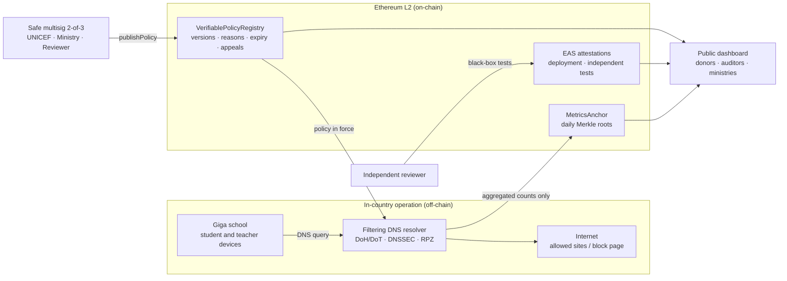

# Verifiable Policy Registry

[](https://github.com/xcapit/verifiable-policy-registry/actions/workflows/ci.yml) [](LICENSE) [](docs/DPG.md)

**Accountable, privacy-preserving content filtering for child-safe school connectivity.**

Public bodies increasingly filter internet access for children. Today nobody outside the operator can check *what* is blocked, *who* decided it, or *whether* children's browsing is being recorded. The Verifiable Policy Registry (VPR) is open-source tooling that makes any content-filtering policy:

- **public**: every policy version is published in full, each block and exception with its reason;
- **multisig-governed**: a change needs, for example, 2 of 3 signatures (UNICEF Giga, the Ministry of Education and an independent reviewer);
- **time-limited**: every version expires unless it is signed again, so no block becomes permanent by default;
- **contestable**: anyone can file an appeal, and the decision is recorded on-chain;
- **independently verified**: an independent reviewer, never the operator, attests that each school is actually protected;
- **privacy-preserving**: no personal data on-chain, no query logs, and impact metrics published only as k-anonymous aggregates with a daily Merkle commitment anyone can recompute.

The first deployment is a proposed pilot with **UNICEF Giga** in 20–50 connected schools in Latin America, using a filtering DNS resolver. The registry itself is generic: municipal Wi-Fi, libraries or NGO networks can use it the same way.

> **Status: proof of concept.** Contracts and off-chain tools work and are tested. Nothing here is production-ready or audited. See [docs/ROADMAP.md](docs/ROADMAP.md).

## How it works



What Ethereum proves, and what it does not:

| Ethereum proves | Ethereum does not prove | How the gap is covered |
| --- | --- | --- |
| Which policy is in force, who signed it and why | That the resolver actually applies it | Black-box tests from each school, attested by the independent reviewer |
| That published impact figures were not altered later | That the resolver keeps no logs | Public privacy statement (RFC 8932), external audit, published minimal-retention configuration |
| That a school was certified on a given date | That the network was not changed afterwards | Attestations expire; periodic re-testing; revocation on failure |

## Repository layout

| Path | What it contains |
| --- | --- |
| [`contracts/`](contracts) | Solidity contracts (`VerifiablePolicyRegistry`, `MetricsAnchor`) and Hardhat tests |
| [`tools/`](tools) | Python package `vpr`: policy validation and hashing, RPZ compilation, k-anonymous metrics, Merkle proofs, CLI |
| [`policies/`](policies) | Example public policy document |
| [`schemas/`](schemas) | EAS attestation schemas and JSON schemas for policy documents and datasets (CC0) |
| [`deploy/`](deploy) | Reference resolver configuration (Unbound + RPZ) |
| [`examples/`](examples) | Example category feeds and synthetic events |
| [`docs/`](docs) | [White paper](docs/WHITEPAPER.md), [architecture](docs/ARCHITECTURE.md), [interfaces](docs/INTERFACES.md), [decision records](docs/adr), [roadmap](docs/ROADMAP.md), [policy governance](docs/GOVERNANCE.md), [privacy statement](docs/PRIVACY_STATEMENT.md), [do no harm](docs/DO_NO_HARM.md), [DPG readiness](docs/DPG.md), [backlog](docs/BACKLOG.md) |

## Quick start

Requirements: Node.js 20+, Python 3.10+.

```bash
# Contracts
cd contracts
npm install
npx hardhat test                  # set OFFLINE_SOLC=1 to compile with solc-js if the native compiler cannot be downloaded

# Off-chain tools
cd ../tools
pip install -e ".[dev]"
pytest

# Try the CLI from the repository root
vpr policy-hash policies/example-primary.yaml
vpr compile-rpz policies/example-primary.yaml --feeds-dir examples/feeds --block-page block.example.org
vpr aggregate examples/events.csv --k 10 --out-csv dataset.csv
vpr verify-root dataset.csv 0x<root printed by the previous command>
```

## Where to start

| If you are… | Read |
| --- | --- |
| deciding whether to fund or adopt it | [White paper](docs/WHITEPAPER.md), [do no harm](docs/DO_NO_HARM.md), [DPG readiness](docs/DPG.md) |
| building a component | [Architecture](docs/ARCHITECTURE.md), [interfaces](docs/INTERFACES.md), [decision records](docs/adr), [backlog](docs/BACKLOG.md) |
| contributing a fix | [Contributing](CONTRIBUTING.md), [good first issues](https://github.com/xcapit/verifiable-policy-registry/labels/good%20first%20issue) |
| reviewing security | [Security policy](SECURITY.md), [threat model summary](docs/WHITEPAPER.md#7-threat-model-summary) |

## Design principles

1. **Commit, don't store.** The chain holds hashes, signatures and aggregate roots. Policy documents and datasets live off-chain and are verified against their on-chain commitments.
2. **Never certify yourself.** The operator attests deployments; the independent reviewer attests tests; auditors attest conformance.
3. **Privacy by collection, not by deletion.** The metrics pipeline only ever receives `(school_id, day, category)`. No IPs, device identifiers or queried names.
4. **Narrow scope.** School networks for children only. The project does not support ISP-wide or national blocking.
5. **Restricted lists stay restricted.** Lists that cannot legally be published (such as the IWF list) are represented only by a hash commitment, and are never labelled in compiled zones.

## Standards

[NIST SP 800-81r3](https://csrc.nist.gov/pubs/sp/800/81/r3/final) (secure and protective DNS) · [RFC 8932](https://www.rfc-editor.org/rfc/rfc8932.html) (DNS privacy operator statement) · UK Safer Internet Centre school-filtering criteria · ITU Child Online Protection guidelines · [EAS](https://attest.org/) · W3C Verifiable Credentials 2.0 · UNICEF Policy on Personal Data Protection. Development follows Xcapit's ISO/IEC 27001-certified process. Rationale for each choice, and what was left out: [docs/WHITEPAPER.md](docs/WHITEPAPER.md#8-standards).

## Contributing and community

Contributions are welcome. Start with [CONTRIBUTING.md](CONTRIBUTING.md) and the [backlog](docs/BACKLOG.md). Everyone taking part follows the [Code of Conduct](CODE_OF_CONDUCT.md). How decisions are made: [GOVERNANCE.md](GOVERNANCE.md); who maintains the project: [MAINTAINERS.md](MAINTAINERS.md); getting help: [SUPPORT.md](SUPPORT.md). Report vulnerabilities privately as described in [SECURITY.md](SECURITY.md).

## Digital Public Good

The project is being prepared for registration as a [Digital Public Good](https://digitalpublicgoods.net/). [docs/DPG.md](docs/DPG.md) maps each indicator of the DPG Standard to its evidence in this repository and lists what is still missing.

## Licence

- Code: [GNU AGPL-3.0-only](LICENSE). Anyone who runs a modified version as a network service must publish their changes.
- EAS schemas (`schemas/`): CC0-1.0.
- Documentation (`docs/` and the Markdown files at the root): CC BY 4.0.

Licence texts are in [`LICENSES/`](LICENSES); ownership and attribution are in [NOTICE](NOTICE). If you cite the project, see [CITATION.cff](CITATION.cff).

## Who is behind it

[Xcapit](https://xcapit.com) (Córdoba, Argentina), an ISO/IEC 27001-certified software factory that has built Digital Public Goods with UNICEF: the [Xcapit Wallet](https://digitalpublicgoods.net/registry/xcapit.html), the AidLink SMS wallet, and the technical build of the [Primero DAO](https://www.unicefventurefund.org/story/primero-dao-pilot-introduction-progress-learnings-outlook). Contact: Fernando Boiero, CTO.
