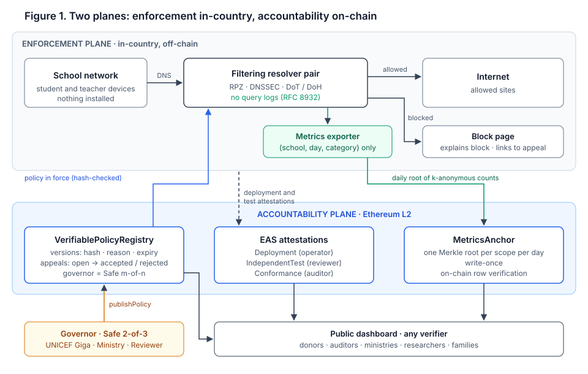

# Verifiable Policy Registry

[](https://github.com/xcapit/verifiable-policy-registry/actions/workflows/ci.yml) [](LICENSE) [](docs/DPG.md) [](docs/WHITEPAPER.md)

**Accountable, privacy-preserving content filtering for school connectivity.**

Connecting a school to the internet means protecting its children from malware, phishing and harmful content, and that protection is usually delivered by network-level filtering. The same mechanism is among the most common instruments of internet censorship. A filter is legitimate only when people outside the operator can see what it blocks, who decided it and for how long, and can be sure that it does not record what children do. Conventional filters provide none of these guarantees.

The Verifiable Policy Registry (VPR) separates the **enforcement** of filtering from its **accountability**. A standard protective DNS resolver enforces the policy in-country. An Ethereum layer-2 network holds only commitments. Every policy version is published in full, except for legally restricted lists, which are committed to by hash, and is authorised by a threshold of independent institutions. It expires by default and can be contested. An independent reviewer, never the operator, attests that each school is actually protected. Impact is reported as aggregates with small-cell suppression, bound to a daily Merkle root that anyone can recompute. No personal data is ever written on-chain.

The first deployment is a proposed pilot with **UNICEF Giga** in 20 to 50 connected schools in Latin America. The design applies to any bounded network with an accountable governor, such as libraries, municipal Wi-Fi or NGO networks.

> **Status: research prototype.** The contracts and off-chain tools are implemented and tested, but they are not audited and not deployed on any production network. See the [roadmap](docs/ROADMAP.md) and the [security policy](SECURITY.md).

<p align="center"></p>

## Guarantees, and their limits

The system is built around seven properties, stated formally in the [white paper](docs/WHITEPAPER.md#33-properties). Some hold cryptographically and others rest on a named institution, and we keep the two apart.

| Property | What it means | Rests on |
| --- | --- | --- |
| Transparency | Anyone can see which policy is in force and check its full document against the on-chain hash | Cryptography |
| Non-equivocation | Everyone sees the same append-only history of versions | Ledger consensus |
| Threshold authorisation | A policy changes only with *m* of *n* signatures (pilot: UNICEF Giga, Ministry of Education, independent reviewer) | Multisignature |
| Bounded duration | Every version expires (pilot: at most 90 days) unless it is signed again | Contract |
| Contestability | Anyone can appeal; acceptance or rejection is recorded on-chain | Contract + governor |
| Attested enforcement | A school counts as protected only with a valid attestation from the independent reviewer | Reviewer |
| Aggregate integrity | Published impact figures cannot be changed after anchoring, contain only counts at or above a suppression threshold, and, from milestone M4 of the pilot, come with a zero-knowledge proof that they aggregate the committed event log under the policy in force | Cryptography; ZK proof planned (M4); completeness of the log rests on the reviewer |

What the ledger cannot prove is that a resolver behaves as declared at runtime. It is covered by independent black-box testing and audit. In addition, the pilot plans [zero-knowledge proofs of aggregation](docs/WHITEPAPER.md#11-closing-the-enforcementaccountability-gap): by the end of the pilot, every daily release is to carry a proof, verified on-chain, that it is the correct k-suppressed aggregation of a committed event log under the policy in force.

## Documentation

| If you are… | Start with |
| --- | --- |
| evaluating the approach (funders, partners, reviewers) | [White paper](docs/WHITEPAPER.md) · [Do no harm](docs/DO_NO_HARM.md) · [DPG readiness](docs/DPG.md) · [Sustainability and cost](docs/SUSTAINABILITY.md) |
| building a component | [Architecture](docs/ARCHITECTURE.md) · [Interfaces](docs/INTERFACES.md) · [Decision records](docs/adr) · [Backlog](docs/BACKLOG.md) |
| operating or governing a deployment | [Policy governance](docs/GOVERNANCE.md) · [Privacy statement (RFC 8932)](docs/PRIVACY_STATEMENT.md) · [Roadmap](docs/ROADMAP.md) |
| contributing | [Contributing](CONTRIBUTING.md) · [Code of conduct](CODE_OF_CONDUCT.md) · [Project governance](GOVERNANCE.md) |
| reviewing security | [Security policy](SECURITY.md) · [Threat model](docs/WHITEPAPER.md#6-threat-model-and-security-analysis) |

## Repository layout

| Path | Contents |
| --- | --- |
| [`contracts/`](contracts) | `VerifiablePolicyRegistry` and `MetricsAnchor` (Solidity 0.8.24) with Hardhat tests |
| [`tools/`](tools) | Python package and CLI `vpr`: policy validation and canonical hashing, RPZ compilation, aggregation with small-cell suppression, Merkle proofs |
| [`schemas/`](schemas) | EAS attestation schemas and JSON Schemas for policy documents and datasets (CC0) |
| [`policies/`](policies) | Example public policy document |
| [`deploy/`](deploy) | Reference resolver configuration (Unbound with RPZ) |
| [`examples/`](examples) | Synthetic feeds and events (`.example` domains only) and the end-to-end demo |
| [`docs/`](docs) | White paper, architecture, interfaces, ADRs, governance, privacy, DPG material |

## Try it in five minutes

One command runs the whole accountability path on a local Hardhat network: hash the example policy, publish it as version 1 under a scope, compile the RPZ zone, aggregate one day of synthetic events with *k* = 10, anchor the daily root, and verify one published row (accepted) and one tampered row (rejected).

```bash
cd contracts && npm ci && cd ..
pip install -e tools
./examples/e2e/run.sh
```

The same script runs in CI on every push. Its source is in [`examples/e2e/`](examples/e2e) and [`contracts/scripts/e2e.js`](contracts/scripts/e2e.js).

## Quick start

Requirements: Node.js 20+ and Python 3.10+.

```bash
# Contracts
cd contracts
npm ci
npx hardhat test          # OFFLINE_SOLC=1 npx hardhat test if the native compiler cannot be downloaded

# Off-chain tools
cd ../tools
pip install -e ".[dev]"
pytest
```

From the repository root:

```bash
vpr policy-hash policies/example-primary.yaml        # scopeId and contentHash to publish on-chain
vpr compile-rpz policies/example-primary.yaml --feeds-dir examples/feeds --block-page block.example.org
vpr aggregate examples/events.csv --k 10 --out-csv dataset.csv   # prints the daily Merkle root
vpr verify-root dataset.csv 0x<root>                 # anyone can recompute a published root
```

## What other builders can reuse

The pilot targets school networks, but the components are generic and released for reuse:

| Component | Status | What it gives you |
| --- | --- | --- |
| EAS schemas `VPR.Deployment.v1`, `VPR.IndependentTest.v1`, `VPR.Conformance.v1` ([`schemas/`](schemas), CC0) | Defined | Attestations for "deployed", "independently tested" and "conforms to framework X", with one issuer role per schema so that an operator never certifies itself |
| Policy registry pattern (`VerifiablePolicyRegistry`) | Implemented, not audited | Versioned commitments with a stated reason, mandatory expiry bounded per scope, on-chain appeals and a governor that can be any Safe |
| `MetricsAnchor` | Implemented, not audited | Write-once daily Merkle roots per scope, with an OpenZeppelin-compatible `verifyLeaf` |
| `vpr` tools | Implemented | Canonical hashing of policy documents, RPZ compilation, aggregation with small-cell suppression and Merkle proofs |
| ZK aggregation verifier and `vpr verify-proof` | Planned (M4) | On-chain check that a published table is the correct suppressed aggregation of a committed private log |

The design applies to any bounded network with an accountable governor: libraries, public Wi-Fi, health centres or NGO networks. It is not meant for ISP-wide or national blocking ([ADR-0006](docs/adr/0006-scope-school-networks-only.md)).

## Design principles

1. **Commit, do not store.** The chain holds hashes, signatures, expiries and aggregate roots. Documents and datasets live off-chain and are verified against those commitments.
2. **Never certify yourself.** The operator attests deployments, the independent reviewer attests tests and the auditor attests conformance.
3. **Privacy by collection, not by deletion.** The metrics pipeline only ever receives `(school_id, day, category)`. IP addresses, device identifiers and queried names never leave the resolver process.
4. **Accountability over prevention.** No single party can change a policy. A majority can, but every change is public, has a stated reason, is temporary and can be contested.
5. **Restricted lists stay restricted.** Lists that cannot legally be published, such as the IWF list, are represented only by a hash commitment.
6. **Narrow scope.** Bounded networks with an accountable governor. The project does not support ISP-wide or national blocking.

## Standards

[NIST SP 800-81r3](https://csrc.nist.gov/pubs/sp/800/81/r3/final) (protective DNS) · [RFC 8932](https://www.rfc-editor.org/rfc/rfc8932.html) (resolver privacy statement) · [UK Safer Internet Centre filtering criteria](https://saferinternet.org.uk/guide-and-resource/teachers-and-school-staff/appropriate-filtering-and-monitoring/appropriate-filtering/filtering-accreditation-scheme-for-uk-schools) with the [IWF URL List](https://www.iwf.org.uk/our-technology/our-services/url-list) · [ITU Child Online Protection](https://www.itu.int/en/ITU-D/Cybersecurity/Documents/COP/20-00802_COP-Policy_Brief.pdf) · [UNICEF Policy on Personal Data Protection](https://www.unicef.org/documents/policy-personal-data-protection) · [EAS](https://attest.org/) · W3C Verifiable Credentials 2.0. The rationale for each choice, and for what was left out, is in [§7 of the white paper](docs/WHITEPAPER.md#7-standards-and-compliance).

## Who is behind it

The project is developed by [Xcapit](https://xcapit.com) (CryptoLab S.A.S., Córdoba, Argentina), an ISO/IEC 27001-certified software company that has built Digital Public Goods with UNICEF.

| Prior work | Public evidence |
| --- | --- |
| **Xcapit Wallet**: open-source, self-custodial wallet, built with UNICEF Venture Fund investment and registered as a Digital Public Good | [UNICEF Venture Fund](https://www.unicefventurefund.org/story/xcapit-smart-crypto-wallet-social-impact-and-financial-literacy-and-inclusion) · [mid-investment update](https://www.unicefventurefund.org/story/mid-investment-update-how-xcapit-revolutionizing-financial-inclusion-growth-funding) · [DPG Registry](https://digitalpublicgoods.net/r/xcapit) · [UNICEF Innovation Fund cohort](https://www.unicef.org/innovation/InnovationFund/blockchain-financial-inclusion-cohort) |
| **Primero DAO**: an 18-month pilot with UNICEF Ventures and Primero to govern and fund Primero, UNICEF's child-protection DPG; Xcapit delivered and managed the technical build | [UNICEF Venture Fund: pilot](https://www.unicefventurefund.org/story/primero-dao-pilot-introduction-progress-learnings-outlook) · [DAOs at UNICEF](https://www.unicefventurefund.org/story/daos-decentralized-autonomous-organizations-do-they-make-sense-unicef) · [Primero](https://www.primero.org/blog/dao) |
| **Shelter / AidLink**: humanitarian cash-transfer wallet that works over SMS without a smartphone or internet; DPG certification in progress with UNICEF (no public record yet) | [UNICEF: humanitarian cash transfers](https://www.unicef.org/innovation/stories/how-blockchain-can-transform-humanitarian-cash-transfers-scale) · [UNICEF: digital disbursement](https://www.unicef.org/innovation/stories/cash-transfers-digital-disbursement) · [growth cohort](https://www.unicef.org/innovation/stories/investing-blockchain-web3-and-ai-social-impact) |
| **QuarkID**: self-sovereign identity system, co-created by Xcapit, registered as a DPG and running on ZKsync Era | [DPG Registry](https://digitalpublicgoods.net/r/quarkid) · [ZKsync announcement](https://zksync.mirror.xyz/kWRhD81C7il4YWGrkDplfhIZcmViisRe3lnsmbvOEmg) |

Maintainers are listed in [MAINTAINERS.md](MAINTAINERS.md). Contact: dpg@xcapit.com.

## Licence and citation

- Code: [GNU AGPL-3.0-only](LICENSE). Anyone who runs a modified version as a network service must offer its source.
- Schemas (`schemas/`): [CC0-1.0](LICENSES/CC0-1.0.txt).
- Documentation (`docs/` and the Markdown files at the root): [CC BY 4.0](LICENSES/CC-BY-4.0.txt).

Ownership and attribution are described in [NOTICE](NOTICE). If you refer to this work, please cite it using [CITATION.cff](CITATION.cff). The project is being prepared for registration as a [Digital Public Good](https://digitalpublicgoods.net/); see [docs/DPG.md](docs/DPG.md).
