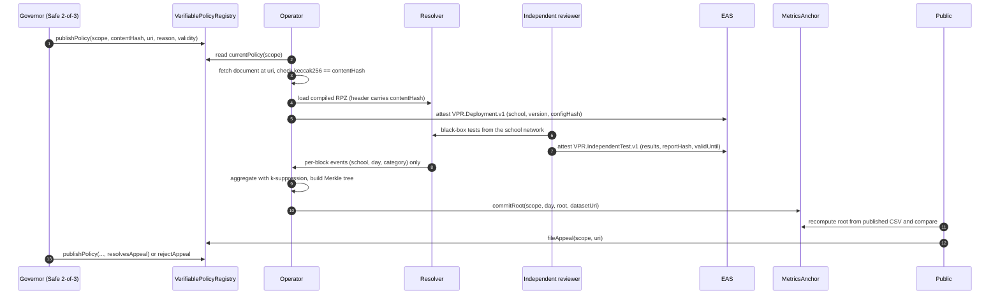
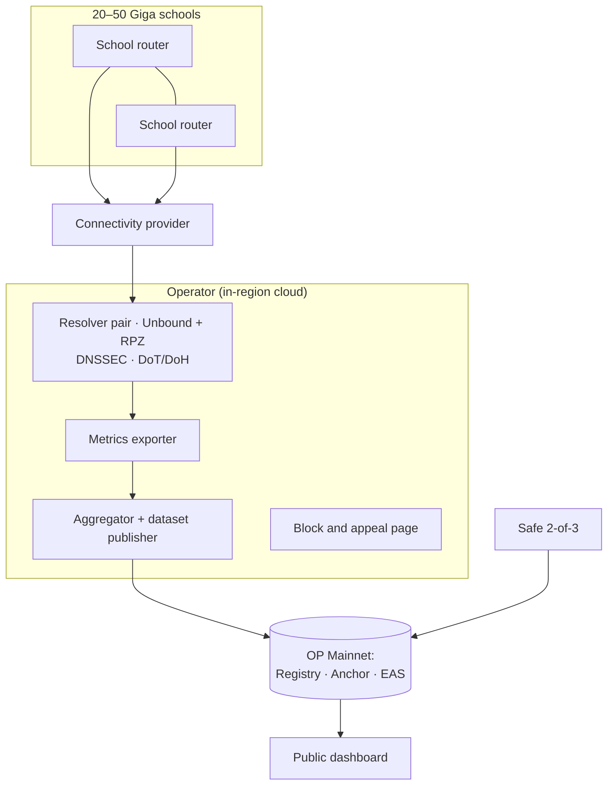

# Architecture

*CC BY 4.0*

## Components

| Component | Where | Responsibility | Status in this repo |
| --- | --- | --- | --- |
| `VerifiablePolicyRegistry` | Ethereum L2 | Scopes, governors, versioned policies with reason and expiry, appeals | Implemented + tests |
| `MetricsAnchor` | Ethereum L2 | Write-once daily Merkle roots per scope; on-chain leaf verification | Implemented + tests |
| EAS schemas | Ethereum L2 (EAS) | Deployment, independent test and conformance attestations | Defined in `schemas/`; registration script pending (BACKLOG) |
| Governor | Safe multisig | Signs policy versions and appeal decisions | External (Safe) |
| Policy tooling (`vpr.policy`) | Operator / anyone | Validate policy, canonical hash, compile RPZ | Implemented + tests |
| Resolver | Cloud region or ISP | Filtering DNS with DNSSEC, DoH/DoT, RPZ, no query logs | Reference Unbound config in `deploy/` |
| Metrics exporter | Next to resolver | Emits `(school_id, day, category)` per block | Pending (BACKLOG) |
| Aggregator (`vpr.metrics`) | Operator / anyone | k-suppression, dataset, Merkle root and proofs | Implemented + tests |
| Block page | Web | Explains the block; links to appeal | Pending (BACKLOG) |
| Dashboard | Web | Public view of policies, attestations and metrics | Pending (BACKLOG) |

## Data flow

## On-chain vs off-chain

| Data | Location | Visibility |
| --- | --- | --- |
| Policy content hash, reason code, expiry, signatures | On-chain | Public |
| Full policy document (categories, local blocks, exceptions with reasons) | Off-chain (`uri`) | Public |
| Restricted list (for example IWF) | Operator only | Commitment hash public; contents never published |
| Deployment / test / conformance attestations | EAS | Public |
| Daily aggregate dataset | Off-chain (`datasetUri`) | Public |
| Daily dataset root | On-chain | Public |
| Individual queries, IPs, devices | Not stored | Nobody |

## Contract interfaces (summary)

`VerifiablePolicyRegistry`

- `createScope(bytes32 scopeId, address governor, uint64 maxValidity)`
- `setGovernor(bytes32 scopeId, address newGovernor)`: governor only
- `publishPolicy(bytes32 scopeId, bytes32 contentHash, bytes32 restrictedListHash, string uri, uint16 reasonCode, uint64 validity, bytes32 resolvesAppeal) returns (uint256 version)`: governor only; `0 < validity <= maxValidity`
- `fileAppeal(bytes32 scopeId, string uri) returns (bytes32 appealId)`: anyone; id = `keccak256(abi.encode(scopeId, uri))`
- `rejectAppeal(bytes32 appealId)`: governor only
- `currentPolicy(bytes32 scopeId) returns (uint256 version, PolicyVersion policy, bool inForce)`

`MetricsAnchor`

- `configure(bytes32 scopeId, address admin, address publisher)`: one-time
- `setPublisher(bytes32 scopeId, address publisher)`: admin only
- `commitRoot(bytes32 scopeId, uint32 day, bytes32 root, string datasetUri)`: publisher only, write-once per day
- `verifyLeaf(bytes32 scopeId, uint32 day, bytes32 leaf, bytes32[] proof) returns (bool)`

Merkle scheme: sorted-pair keccak256 (OpenZeppelin-compatible). Leaf = `keccak256("school_id|day|category|count")`. Implemented identically in `tools/vpr/merkle.py` and tested against the same vector in both languages.

## Deployment topology (pilot)

Resolvers run on dedicated infrastructure, at least two instances, with DNS from schools forced to them (outbound port 53/853 to other resolvers blocked at the provider), following NIST SP 800-81r3.
