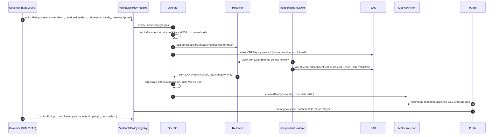
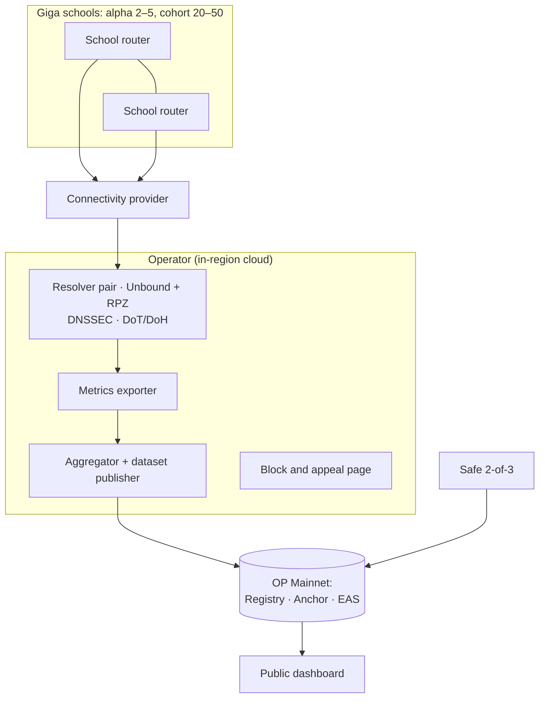

# Architecture

*CC BY 4.0*

The exact formats exchanged between these components (documents, events, datasets, ABIs, attestations) are specified in [INTERFACES.md](INTERFACES.md). The reasons behind the main choices are in the [decision records](adr).

## Components

| Component | Where | Responsibility | Status in this repo |
| --- | --- | --- | --- |
| `VerifiablePolicyRegistry` | Ethereum L2 | Scopes, governors, versioned policies with reason and expiry, appeals | Implemented + tests |
| `MetricsAnchor` | Ethereum L2 | Write-once daily Merkle roots per scope; on-chain leaf verification | Implemented + tests |
| EAS schemas | Ethereum L2 (EAS) | Deployment, independent test and conformance attestations | Defined in `schemas/`; registration script pending (BACKLOG) |
| Governor | Safe multisig | Signs policy versions and appeal decisions | External (Safe) |
| Policy tooling (`vpr.policy`) | Operator / anyone | Validate policy, canonical hash, compile RPZ | Implemented + tests |
| Resolver | Cloud region or ISP | Filtering DNS with DNSSEC, DoH/DoT, RPZ, no query logs | Reference Unbound config in `deploy/` |
| Metrics exporter | Next to resolver | Emits `(school_id, day, category)` per block | Pending (BACKLOG) |
| Aggregator (`vpr.metrics`) | Operator / anyone | Small-cell suppression, dataset, Merkle root and proofs | Implemented + tests |
| Verification toolkit (`vpr.toolkit`, CLI) | Anyone | Use-case-independent hashing, release roots, row proofs and verification; zone evaluation | Implemented + tests ([guide](toolkit/INTEGRATION_GUIDE.md)) |
| Demonstrator (`examples/e2e`) | CI / anyone | Synthetic end-to-end run with an evidence manifest | Demonstrated in CI |
| `IssuerRoleResolver` | Ethereum L2 (EAS) | Accepts an attestation only from the holder of the schema's role in the scope | Implemented + tests; not registered on a public network |
| Block page | Web | Explains the block; links to appeal | Pending (BACKLOG) |
| ZK aggregation prover | Next to the aggregator | Proves that each daily release is the k-suppressed aggregation of the committed event log under the policy in force | Planned (ROADMAP M4) |
| ZK verifier | Ethereum L2 | Verifies the daily proof before a root is accepted | Planned (ROADMAP M4 on testnet; mainnet in phase 2) |
| Dashboard | Web | Public view of policies, attestations and metrics | Pending (BACKLOG) |

## Data flow

## On-chain vs off-chain

| Data | Location | Visibility |
| --- | --- | --- |
| Policy content hash, reason code, expiry and the authorising governor address (signatures stay in the governor contract, for example the Safe) | On-chain | Public |
| Full policy document (categories, local blocks, exceptions with reasons) | Off-chain (`uri`) | Public |
| Restricted list (for example IWF) | Operator only | Commitment hash public; contents never published |
| Deployment / test / conformance attestations | EAS | Public |
| Full independent test report | Shared with governor signers | Hash public (`reportHash`); contents not published, since they can reveal exploitable weaknesses of a school network |
| Daily aggregate dataset | Off-chain (`datasetUri`) | Public |
| Daily dataset root | On-chain | Public |
| Individual queries, IPs, devices | Not stored | Nobody |

## Contract interfaces (summary)

Full specification, including events, errors and invariants: [INTERFACES.md](INTERFACES.md#i2--verifiablepolicyregistry-abi).

`VerifiablePolicyRegistry`

- `createScope(string name, uint64 maxValidity) returns (bytes32 scopeId)`: the caller becomes the governor; `scopeId = keccak256(abi.encode(governor, name))`; validity at most 365 days
- `proposeGovernor(bytes32 scopeId, address newGovernor)` and `acceptGovernor(bytes32 scopeId)`: two-step handover
- `setIssuer(bytes32 scopeId, address issuer, Role role)`: governor only; one attestation role per address per scope
- `publishPolicy(bytes32 scopeId, bytes32 contentHash, bytes32 restrictedListHash, string uri, uint16 reasonCode, uint64 validity, bytes32 resolvesAppeal) returns (uint256 version)`: governor only; `0 < validity <= maxValidity`
- `fileAppeal(bytes32 scopeId, bytes32 documentHash) returns (bytes32 appealId)`: anyone; stores only the hash of a validated appeal document; resubmission after rejection opens a new round
- `rejectAppeal(bytes32 appealId, bytes32 reasonHash)`: governor only, with the hash of a reasoned decision
- `currentPolicy(bytes32 scopeId) returns (uint256 version, PolicyVersion policy, bool inForce)`

`MetricsAnchor` (constructed with the registry address)

- `setPublisher(bytes32 scopeId, address publisher, uint32 maxLagDays)`: the scope's governor in the registry only; `address(0)` revokes
- `markEmpty(bytes32 scopeId, uint32 day)`: publisher; `correctRoot(…, reasonHash)`: governor
- `commitRoot(bytes32 scopeId, uint32 day, bytes32 root, string datasetUri)`: publisher only, once per day, only after the UTC day has ended and within the scope's back-fill limit
- `verifyRow(bytes32 scopeId, uint32 day, string schoolId, string category, uint256 count, bytes32[] proof) returns (bool)`

Merkle scheme (dataset format 2): sorted pairs, leaves `keccak256(0x00 ‖ day ‖ count ‖ len ‖ school ‖ len ‖ category)` and nodes `keccak256(0x01 ‖ min ‖ max)`. Implemented identically in `tools/vpr/merkle.py` and `tools/vpr/metrics.py`, and tested against the same vector in both languages.

## Deployment topology (pilot)

Resolvers run on dedicated infrastructure, at least two instances, with DNS from schools forced to them (outbound port 53/853 to other resolvers blocked at the provider), following NIST SP 800-81r3.

## Deployment conditions

**Satellite and low-bandwidth links.** Many Giga schools connect over satellite or congested rural links, where each round trip can cost hundreds of milliseconds. Resolvers are placed in the cloud region or ISP point of presence closest to the schools' egress, not in a distant central location. They cache aggressively within record TTLs and serve stale answers when an upstream is slow (RFC 8767), so that a slow upstream does not stall page loads. The latency budget per school is measured during onboarding and recorded in the deployment attestation report.

**What the connectivity provider must configure.** DNS-level enforcement only works if the network sends DNS to the resolver. The provider redirects or blocks outbound port 53 and 853 to other resolvers, and blocks the known public DNS-over-HTTPS endpoints. The reviewer test kit checks each of these from the school network (VPR-018, VPR-019), so a missing rule shows up as a failed `bypassResisted` in the attestation rather than going unnoticed. Encrypted Client Hello does not affect DNS filtering, which acts on the queried name, provided that clients use the network resolver; it matters only for filtering based on the TLS server name, which this project does not use.

**Resolver unreachable.** With DNS forced to the pilot resolvers, losing both instances means losing name resolution, which is fail-closed in effect. The scope charter decides the alternative: either a secondary protective resolver configured at the provider, or no fallback. An unfiltered fallback is not recommended for school networks. Availability is tracked against the 99.9% target of the evaluation plan.

## Integration with Giga

- **School identifiers.** `school_id` is the public school identifier used by [Giga Maps](https://maps.giga.global/), so dashboards and datasets join directly with Giga's school data (VPR-047).
- **Measurement.** Giga already measures connectivity in schools with Giga Meter ([unicef/project-connect-daily-check-app](https://github.com/unicef/project-connect-daily-check-app)) and, since 2025, through a partnership with Cloudflare. VPR does not measure connectivity. It adds a different signal, whether the school is protected under an accountable policy. The reviewer test kit is designed to run alongside Giga Meter on the same school machines where it is already installed.
- **Data.** VPR publishes only aggregates per school, day and category. These can be shown next to connectivity data in Giga Maps without adding any personal data.
