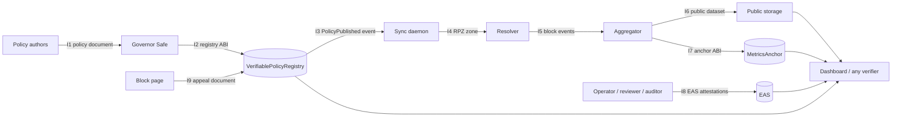

# Interfaces

*CC BY 4.0 · Format version 1 · Applies to the contracts in `contracts/src/` and the `vpr` tools 0.1.x*

This document specifies every boundary between the components described in [ARCHITECTURE.md](ARCHITECTURE.md): what each side sends, in which format, and what the receiver must check. If two components are built by different teams, this is the contract between them. Anything marked **planned** is not implemented yet and links to its backlog item.

## Map



## Common conventions

| Item | Rule |
| --- | --- |
| Hash function | keccak256 (Ethereum), not NIST SHA3-256 |
| Hex encoding | `0x` prefix, lowercase, 32 bytes = 64 hex characters |
| Scope name | UTF-8 string `<programme>:<country>:<profile>`, for example `giga:AR:primary`. Country is ISO 3166-1 alpha-2 (`XX` in examples) |
| Scope id | `bytes32 scopeId = keccak256(utf8(scope))` |
| School id | Public Giga school identifier (or the equivalent public id of the network). Never a personal identifier |
| Dates | `YYYY-MM-DD`, UTC, in documents and datasets |
| Day number | On-chain `uint32 day` = whole days since 1970-01-01 UTC. `2026-11-01` is day `20758` |
| Times | `uint64` Unix seconds on-chain |
| Domains | Lowercase ASCII, no trailing dot; internationalised names in punycode (`xn--`) |
| Reason codes | Table in [GOVERNANCE.md](GOVERNANCE.md#reason-codes), shared by contracts and documents |

## I1 · Policy document

Producer: policy authors (operator drafts, governor signers approve). Consumers: `vpr` tools, sync daemon, dashboard, the public.

**Format.** YAML (or JSON) validated by [`schemas/policy.schema.json`](../schemas/policy.schema.json). Example: [`policies/example-primary.yaml`](../policies/example-primary.yaml).

| Field | Type | Required | Meaning |
| --- | --- | --- | --- |
| `scope` | string | yes | Scope name; must match the on-chain scope |
| `version` | integer ≥ 1 | yes | Document version; should equal the on-chain version it is published as |
| `profile` | `primary` \| `secondary` \| `teachers` | yes | Filtering profile |
| `categories` | list of strings | yes | Category feeds applied (mapped to ITU COP categories) |
| `local_blocks` | list of `{domain, reason}` | yes | Extra blocks for this scope; every entry states why |
| `exceptions` | list of `{domain, reason}` | yes | Never blocked, even if a feed lists them; every entry states why |
| `valid_days` | integer | recommended | Intended validity; must be ≤ the scope `maxValidity` |
| `reason_code` | integer | recommended | Same value passed to `publishPolicy` |
| `threat_feeds` | list of `{provider, version}` | optional | Third-party feeds by reference, never copied |
| `restricted_list_hash` | `0x` hex or `null` | optional | Commitment to a restricted list (see below) |

Validation rules enforced by `vpr.policy.validate`: required keys present; domains valid; every block and exception has a non-empty reason; no domain is both blocked and excepted; `restricted_list_hash` well formed. The fields marked *recommended* or *optional* are checked by the JSON schema but not yet by `validate` ([VPR-007](BACKLOG.md)).

**Canonical form and `contentHash`.**

1. Parse the document and validate it. Validation normalises domains (lowercase, trailing dot removed).
2. Serialise as JSON with keys sorted, separators `,` and `:` without spaces, UTF-8, non-ASCII characters kept as is (Python: `json.dumps(doc, sort_keys=True, separators=(",", ":"), ensure_ascii=False)`).
3. `contentHash = keccak256(canonical_bytes)`.

Comments and key order in the YAML do not affect the hash; values do. `vpr policy-hash <file>` prints the `scopeId` and `contentHash`.

**Restricted list commitment.** `restricted_list_hash = keccak256(utf8(join("\n", sorted(unique(normalised domains)))))`. The same value goes in the document and in the `restrictedListHash` argument of `publishPolicy` (`0x00…00` when there is none).

## I2 · `VerifiablePolicyRegistry` ABI

Source: [`contracts/src/VerifiablePolicyRegistry.sol`](../contracts/src/VerifiablePolicyRegistry.sol).

| Function | Caller | Effect | Reverts |
| --- | --- | --- | --- |
| `createScope(bytes32 scopeId, address governor, uint64 maxValidity)` | anyone | Creates a scope | `ScopeAlreadyExists`, `ZeroAddress`, `InvalidValidity` |
| `setGovernor(bytes32 scopeId, address newGovernor)` | governor | Rotates the governor | `UnknownScope`, `NotGovernor`, `ZeroAddress` |
| `publishPolicy(bytes32 scopeId, bytes32 contentHash, bytes32 restrictedListHash, string uri, uint16 reasonCode, uint64 validity, bytes32 resolvesAppeal) → uint256 version` | governor | Appends a version (1-based); optionally accepts an appeal | `UnknownScope`, `NotGovernor`, `EmptyContentHash`, `InvalidValidity`, `AppealNotOpen`, `AppealScopeMismatch` |
| `fileAppeal(bytes32 scopeId, string uri) → bytes32 appealId` | anyone | Opens an appeal; `appealId = keccak256(abi.encode(scopeId, uri))` | `UnknownScope`, `AppealAlreadyExists` |
| `rejectAppeal(bytes32 appealId)` | governor of the appeal's scope | Closes an appeal as rejected | `AppealNotOpen`, `NotGovernor` |
| `currentPolicy(bytes32 scopeId) → (uint256 version, PolicyVersion policy, bool inForce)` | view | Latest version; `inForce = block.timestamp < expiresAt` | none |
| `getVersion(bytes32 scopeId, uint256 version) → PolicyVersion` | view | A specific version | panics on out-of-range |
| `versionCount(bytes32 scopeId) → uint256` | view | Number of versions | none |
| `scopes(bytes32) → (address governor, uint64 maxValidity, bool exists)` | view | Scope record | none |
| `appeals(bytes32) → (bytes32 scopeId, uint8 status, uint64 filedAt, string uri)` | view | Appeal record; status `0 None, 1 Open, 2 Accepted, 3 Rejected` | none |

`PolicyVersion = (bytes32 contentHash, bytes32 restrictedListHash, string uri, uint16 reasonCode, uint64 publishedAt, uint64 expiresAt, bytes32 resolvesAppeal)`.

Events: `ScopeCreated(scopeId, governor, maxValidity)`, `GovernorChanged(scopeId, previousGovernor, newGovernor)`, `PolicyPublished(scopeId, version, contentHash, restrictedListHash, uri, reasonCode, expiresAt, resolvesAppeal)`, `AppealFiled(appealId, scopeId, uri)`, `AppealResolved(appealId, accepted)`. Indexed fields: `scopeId`, `version`, `governor` addresses, `appealId`.

Invariants: versions are append-only; every version expires; an appeal moves only `Open → Accepted` or `Open → Rejected`.

## I3 · Registry → sync daemon (planned, [VPR-015](BACKLOG.md))

The daemon subscribes to `PolicyPublished` for its scope, then:

1. fetches the document at `uri`;
2. recomputes the canonical `contentHash` (I1) and **refuses** the document on mismatch, keeping the previous zone;
3. checks `inForce` through `currentPolicy`; if the version is expired, applies the fallback defined in the scope charter;
4. compiles the zone (I4) and reloads the resolver;
5. logs only scope, version and hash, never query data.

## I4 · RPZ zone (tools → resolver)

Produced by `vpr compile-rpz`. Standard Response Policy Zone usable by Unbound or PowerDNS. Reference loader: [`deploy/unbound/rpz.conf`](../deploy/unbound/rpz.conf).

- The first two comment lines identify the source, so a reviewer can link a running zone to an on-chain version:
  ```
  ; RPZ generated by vpr for scope <scope> version <version>
  ; policy content hash 0x<contentHash>
  ```
- Exceptions: `<domain> CNAME rpz-passthru.` and `*.<domain> CNAME rpz-passthru.`
- Blocks: `<domain> CNAME <block-page>.` (or `CNAME .` for NXDOMAIN), plus the wildcard. A comment states the source (`category:<name>` or `local`). Restricted entries carry no comment.
- SOA serial: `YYYYMMDDHH` in UTC.

## I5 · Block events (resolver exporter → aggregator)

Exporter is planned ([VPR-016](BACKLOG.md)); the aggregator is implemented.

CSV with header `school_id,day,category`, one row per blocked query. These three fields are the **only** ones allowed: no IP address, no device identifier, no queried name, no timestamp finer than a day. The exporter derives `school_id` from the source network mapping and drops everything else in memory. Example: [`examples/events.csv`](../examples/events.csv).

## I6 · Public dataset (aggregator → public)

Produced by `vpr aggregate`. Format described by [`schemas/dataset.schema.json`](../schemas/dataset.schema.json).

- CSV with header `school_id,day,category,count`, rows sorted by `(school_id, day, category, count)`, `\n` line endings, UTF-8.
- Rows with `count < k` are suppressed (default k = 10). The JSON summary reports `k`, `suppressed_cells`, `root` and `rows`.
- No field may contain `|`.
- Leaf: `keccak256(utf8("<school_id>|<day>|<category>|<count>"))`, count in decimal without padding.
- Tree: leaves in row order; parent = `keccak256(min(a,b) ‖ max(a,b))`; an odd node is promoted unchanged. An empty dataset has no root and is not anchored.
- Anyone can check a dataset with `vpr verify-root dataset.csv <root>`.

## I7 · `MetricsAnchor` ABI

Source: [`contracts/src/MetricsAnchor.sol`](../contracts/src/MetricsAnchor.sol).

| Function | Caller | Effect | Reverts |
| --- | --- | --- | --- |
| `configure(bytes32 scopeId, address admin, address publisher)` | anyone, once per scope | Sets admin (expected: governor Safe) and publisher (operator) | `AlreadyConfigured`, `ZeroAddress` |
| `setPublisher(bytes32 scopeId, address publisher)` | admin | Rotates the publisher | `NotAdmin`, `ZeroAddress` |
| `commitRoot(bytes32 scopeId, uint32 day, bytes32 root, string datasetUri)` | publisher | Write-once root for a day | `NotPublisher`, `EmptyRoot`, `DayAlreadyCommitted` |
| `getCommitment(bytes32 scopeId, uint32 day) → (bytes32 root, string datasetUri, uint64 committedAt)` | view | Stored commitment | none |
| `verifyLeaf(bytes32 scopeId, uint32 day, bytes32 leaf, bytes32[] proof) → bool` | view | Checks a row against the anchored root | none |

Events: `PublisherSet(scopeId, admin, publisher)`, `RootCommitted(scopeId, day, root, datasetUri)`.

Known gap: `configure` is open to the first caller of each scope, so someone could claim a scope before its operator does. Until this is fixed ([VPR-009](BACKLOG.md)), deployment scripts must configure the anchor scope in the same batch that creates it in the registry ([VPR-010](BACKLOG.md)), and verifiers must check that the anchor admin equals the registry governor.

## I8 · EAS attestations

Definitions: [`schemas/eas-schemas.json`](../schemas/eas-schemas.json) (CC0). Registration on OP Sepolia and OP Mainnet is planned ([VPR-012](BACKLOG.md)); UIDs will be stored in `deployments/<network>.json`.

| Schema | Issuer | Fields |
| --- | --- | --- |
| `VPR.Deployment.v1` | operator | `string schoolId, bytes32 scopeId, uint256 policyVersion, bytes32 resolverConfigHash, uint64 deployedAt` |
| `VPR.IndependentTest.v1` | independent reviewer | `string schoolId, bytes32 scopeId, uint256 policyVersion, bool categoriesBlocked, bool exceptionsReachable, bool dnssecValidated, bool bypassResisted, bytes32 reportHash, uint64 testedAt, uint64 validUntil` |
| `VPR.Conformance.v1` | auditor | `bytes32 scopeId, string framework, string frameworkVersion, bytes32 reportHash, uint64 assessedAt, uint64 validUntil` |

All schemas are revocable. For `VPR.IndependentTest.v1`, the booleans are the public summary; `reportHash` commits to the full report, which is shared with the governor signers and not published, since a per-school account of bypass attempts can be useful to an attacker. Verifiers must check that the attester address belongs to the expected role for the scope, and that `validUntil` has not passed. A school counts as protected only with a valid, unrevoked `VPR.IndependentTest.v1` for the policy version in force.

## I9 · Appeal document (planned, [VPR-017](BACKLOG.md))

The `uri` passed to `fileAppeal` points to a small public JSON document:

```json
{
  "format": "vpr-appeal/1",
  "scope": "giga:XX:primary",
  "domain": "educational-site.example",
  "request": "unblock",
  "reason": "Used for the science curriculum in grade 5"
}
```

Allowed `request` values: `unblock`, `block`. The document must not contain names, emails, school staff details or anything about a student. The block page relayer enforces this and rate-limits submissions. Because the appeal id derives from `(scopeId, uri)`, the same document cannot be filed twice.

## I10 · Command-line interface

Installed with `pip install -e tools/`. Exit code `0` on success, non-zero on validation errors or mismatches.

| Command | Input | Output |
| --- | --- | --- |
| `vpr policy-hash <policy>` | Policy document (I1) | `scope`, `scopeId`, `version`, `contentHash` |
| `vpr compile-rpz <policy> [--feeds-dir DIR] [--restricted FILE] [--block-page HOST] [--out FILE]` | Policy, feeds (`<category>.txt`, one domain per line, `#` comments), optional restricted list | RPZ zone (I4) |
| `vpr aggregate <events.csv> [--k N] [--out-csv FILE]` | Block events (I5) | JSON summary on stdout, dataset CSV (I6) |
| `vpr verify-root <dataset.csv> <root>` | Dataset (I6) and expected root | `MATCH` (exit 0) or `MISMATCH` (exit 1) |

## Versioning of these interfaces

Interfaces follow the project's semantic version. Any change to hashing, leaf encoding, field sets or ABI signatures is a breaking change: it needs an ADR, a new format version (`vpr-appeal/2`, `VPR.Deployment.v2`, …) and an entry in [CHANGELOG.md](../CHANGELOG.md).
