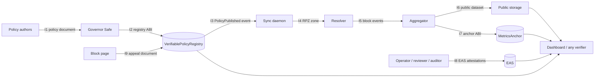

# Interfaces

*CC BY 4.0 · Policy format 1, dataset format 2, appeal format 3 · Applies to the contracts in `contracts/src/` and the `vpr` tools 0.7.x*

This document specifies every boundary between the components described in [ARCHITECTURE.md](ARCHITECTURE.md): what each side sends, in which format, and what the receiver must check. If two components are built by different teams, this is the contract between them. Anything marked **planned** is not implemented yet and links to its backlog item.

## Map



## Common conventions

| Item | Rule |
| --- | --- |
| Hash function | keccak256 (Ethereum), not NIST SHA3-256 |
| Hex encoding | `0x` prefix, lowercase, 32 bytes = 64 hex characters |
| Scope name | UTF-8 string `<programme>:<country>:<profile>`, for example `giga:AR:primary`. Country is ISO 3166-1 alpha-2 (`XX` in examples) |
| Scope id | `bytes32 scopeId = keccak256(abi.encode(governor, scope))`, computed by `VerifiablePolicyRegistry.scopeIdOf` and `vpr policy-hash --governor` |
| School id | Public Giga school identifier (or the equivalent public id of the network). Never a personal identifier |
| Dates | `YYYY-MM-DD`, UTC, in documents and datasets |
| Day number | On-chain `uint32 day` = whole days since 1970-01-01 UTC. `2026-11-01` is day `20758` |
| Times | `uint64` Unix seconds on-chain |
| Domains | Lowercase ASCII, no trailing dot; internationalised names in punycode (`xn--`) |
| Reason codes | Table in [GOVERNANCE.md](GOVERNANCE.md#reason-codes), shared by contracts and documents |

## I1 · Policy document

Producer: policy authors (operator drafts, governor signers approve). Consumers: `vpr` tools, sync daemon, dashboard, the public.

**Format.** YAML (or JSON) validated by [`schemas/policy.schema.json`](../schemas/policy.schema.json). Example: [`policies/example-primary.yaml`](../policies/example-primary.yaml).

| Field | Type | Required | Meaning |
| --- | --- | --- | --- |
| `scope` | string | yes | Scope name; must match the on-chain scope |
| `version` | integer ≥ 1 | yes | Document version; should equal the on-chain version it is published as |
| `profile` | `primary` \| `secondary` \| `teachers` | yes | Filtering profile |
| `categories` | list of strings | yes | Category feeds applied (mapped to ITU COP categories) |
| `local_blocks` | list of `{domain, reason}` | yes | Extra blocks for this scope; every entry states why |
| `exceptions` | list of `{domain, reason}` | yes | Never blocked when a feed or local block lists the same domain; a feed entry for a subdomain of an exception stays blocked (exact-match RPZ semantics); an exception that equals or covers a restricted entry is refused at compilation; every entry states why |
| `valid_days` | integer | recommended | Intended validity; must be ≤ the scope `maxValidity` |
| `reason_code` | integer | recommended | Same value passed to `publishPolicy` |
| `threat_feeds` | list of `{provider, version}` | optional | Third-party feeds by reference, never copied |
| `restricted_list_hash` | `0x` hex or `null` | optional | Commitment to a restricted list (see below) |

Validation rules enforced by `vpr.policy.validate`, a superset of the JSON schema (it also normalises domains, requires `feed_hashes` keys to equal `categories`, rejects floating-point numbers such as `1.0` that the schema's `integer` type accepts, and rejects duplicate YAML keys): required keys present and no unknown keys; scope, version, profile, categories (unique), `valid_days`, `reason_code` and `threat_feeds` well formed; domains valid; every block and exception has exactly a domain and a non-empty reason; no domain is both blocked and excepted; `restricted_list_hash` well formed.

**Canonical form and `contentHash`.**

1. Parse the document and validate it. Validation normalises domains (lowercase, trailing dot removed).
2. Serialise as JSON with keys sorted by code point, separators `,` and `:` without spaces, UTF-8, non-ASCII characters kept as is (Python: `json.dumps(doc, sort_keys=True, separators=(",", ":"), ensure_ascii=False)`). This expression is the normative definition. For a document accepted by `vpr.policy.validate` (ASCII keys, integer numbers only) it produces the same bytes as the JSON Canonicalization Scheme (RFC 8785) whenever every integer is smaller than 2⁵³ in magnitude, so a JCS implementation can be used to verify such documents. JCS sorts keys by UTF-16 code unit and this rule by code point; the two agree on ASCII keys. Above 2⁵³ JCS would serialise an integer as a double and the hashes would differ. A string containing a lone surrogate is rejected here (it cannot be encoded as UTF-8), whereas JCS would escape it.
3. `contentHash = keccak256(canonical_bytes)`.

Comments and key order in the YAML do not affect the hash; values do. `vpr policy-hash <file>` prints the `scopeId`, `contentHash` and `rulesDigest`.

**Rules digest** (ADR-0012). `rulesDigest = keccak256` of the canonical form of the document without the keys `version`, `reason_code` and `valid_days`. Two versions with the same rules digest block and allow exactly the same things. It is computed off-chain only; it is never the content hash of a valid policy, because a valid policy always has `version`.

**Restricted list commitment.** `restricted_list_hash = keccak256(utf8(join("\n", sorted(unique(normalised domains)))))`. The same value goes in the document and in the `restrictedListHash` argument of `publishPolicy` (`0x00…00` when there is none).

## I2 · `VerifiablePolicyRegistry` ABI

Source: [`contracts/src/VerifiablePolicyRegistry.sol`](../contracts/src/VerifiablePolicyRegistry.sol).

| Function | Caller | Effect | Reverts |
| --- | --- | --- | --- |
| `createScope(string name, uint64 maxValidity) → bytes32 scopeId` | anyone; becomes the governor | Creates the scope `scopeIdOf(msg.sender, name)`, governed by the caller, with no versions; name 1 to 128 bytes; `0 < maxValidity ≤ 365 days`; refused if the caller already created that name | `EmptyName`, `NameTooLong`, `InvalidValidity`, `ScopeAlreadyExists` |
| `scopeIdOf(address governor, string name) → bytes32` | pure | `keccak256(abi.encode(governor, name))` | none |
| `proposeGovernor(bytes32 scopeId, address newGovernor)` | governor | Starts a handover; `address(0)` cancels; an address holding an issuer role cannot be proposed | `UnknownScope`, `NotGovernor`, `GovernorCannotHoldRole` |
| `acceptGovernor(bytes32 scopeId)` | the proposed governor | Completes the handover; refused if the proposed address holds an issuer role | `UnknownScope`, `NotPendingGovernor`, `GovernorCannotHoldRole` |
| `setIssuer(bytes32 scopeId, address issuer, Role role)` | governor | Grants, changes or revokes (`Role.None`) an attestation role of a non-zero address; neither the governor nor the pending governor can hold one: the issuer cannot be the governor (even with `Role.None`), and the pending governor can only be given `Role.None` | `UnknownScope`, `NotGovernor`, `ZeroAddress`, `GovernorCannotHoldRole` |
| `publishPolicy(bytes32 scopeId, bytes32 contentHash, bytes32 restrictedListHash, string uri, uint16 reasonCode, uint64 validity, bytes32 resolvesAppeal) → uint256 version` | governor | Appends a version (1-based) holding the arguments, with `publishedAt = block.timestamp` and `expiresAt = publishedAt + validity`; `contentHash` ≠ 0; `0 < validity ≤` the scope's `maxValidity`; `reasonCode` in 1..6, and 3 if and only if `resolvesAppeal` is set; `uri` ≤ 256 bytes. A set `resolvesAppeal` must be an open appeal of the same scope, which is accepted with `resolutionHash = contentHash` | `UnknownScope`, `NotGovernor`, `EmptyContentHash`, `InvalidValidity`, `UriTooLong`, `InvalidReasonCode`, `AppealNotOpen`, `AppealScopeMismatch` |
| `fileAppeal(bytes32 scopeId, bytes32 documentHash) → bytes32 appealId` | anyone | Opens an appeal for a non-zero hash of an appeal document (I9) in an existing scope, as round *r* + 1 with id `appealIdOf(scopeId, documentHash, r + 1)`, where *r* is the document's latest round (0 if none); refused while the latest round is open or accepted, so a rejected document can be filed again in a new round | `UnknownScope`, `EmptyDocumentHash`, `AppealAlreadyExists` |
| `rejectAppeal(bytes32 appealId, bytes32 reasonHash)` | governor of the appeal's scope | Closes an open appeal as rejected with the non-zero hash of a reasoned decision | `AppealNotOpen`, `NotGovernor`, `EmptyReason` |
| `appealIdOf(bytes32 scopeId, bytes32 documentHash, uint32 round) → bytes32` | pure | `keccak256(abi.encode(scopeId, documentHash, round))` | none |
| `currentPolicy`, `getVersion`, `versionCount`, `scopes`, `scopeName`, `pendingGovernor`, `issuerRole`, `appeals`, `appealRounds` | view | State; `currentPolicy` returns the latest version, in force exactly while `block.timestamp < expiresAt` | `getVersion` reverts `UnknownVersion` for 0 or out of range |

Events: `ScopeCreated(scopeId, governor, name, maxValidity)`, `GovernorProposed(scopeId, currentGovernor, proposedGovernor)`, `GovernorChanged(scopeId, previousGovernor, newGovernor)`, `IssuerSet(scopeId, issuer, role)`, `PolicyPublished(…)`, `AppealFiled(appealId, scopeId, documentHash, round)`, `AppealResolved(appealId, accepted, resolutionHash)`.

Invariants: versions are append-only; every version expires within at most 365 days; an appeal moves only `Open → Accepted` or `Open → Rejected`; a document has at most one open or accepted round; a scope id belongs to the address that created it.

**Scope discovery.** Scope ids cannot be front-run, but anyone can still create a scope with a familiar name under their own address. Verifiers therefore pin the chain id, contract addresses, scope ids and governors from the deployment manifest (I11) and alert on governor proposals, `GovernorChanged`, `IssuerSet` and changes to the Safe's owners or threshold.

## I3 · Registry → sync daemon (planned, [VPR-015](BACKLOG.md))

The daemon subscribes to `PolicyPublished` for its scope, then:

1. fetches the document at `uri`;
2. recomputes the canonical `contentHash` (I1) and **refuses** the document on mismatch, keeping the previous zone;
3. checks `inForce` through `currentPolicy`; if the version is expired, applies the fallback defined in the scope charter;
4. compiles the zone (I4) and reloads the resolver;
5. logs only scope, version and hash, never query data.

## I4 · RPZ zone (tools → resolver)

Produced by `vpr compile-rpz`. Standard Response Policy Zone usable by Unbound or PowerDNS. Reference loader: [`deploy/unbound/rpz.conf`](../deploy/unbound/rpz.conf).

- The first two comment lines identify the source, so a reviewer can link a running zone to an on-chain version:
  ```
  ; RPZ generated by vpr for scope <scope> version <version>
  ; policy content hash 0x<contentHash>
  ```
- Exceptions: `<domain> CNAME rpz-passthru.` and `*.<domain> CNAME rpz-passthru.`
- Blocks: `<domain> CNAME <block-page>.` (or `CNAME .` for NXDOMAIN), plus the wildcard. A comment states the source (`category:<name>` or `local`). Restricted entries carry no comment.
- SOA serial: the policy version, so the same policy and feeds always produce the same zone (and the same `zoneHash`).

## I5 · Block events (resolver exporter → aggregator)

Exporter is planned ([VPR-016](BACKLOG.md)); the aggregator is implemented.

CSV with header `<unit>,day,category` (`<unit>` is `school_id` or `unit_id`), one row per event; `metrics.read_events` rejects any other column. These three fields are the **only** ones allowed: no IP address, no device identifier, no queried name, no timestamp finer than a day. The exporter derives `school_id` from the source network mapping and drops everything else in memory. Example: [`examples/events.csv`](../examples/events.csv).

## I6 · Public dataset (aggregator → public)

Produced by `vpr aggregate`. Format `vpr-dataset/2`, described by [`schemas/dataset.schema.json`](../schemas/dataset.schema.json).

- A release covers exactly one UTC day. CSV with header `<unit>,day,category,count`, where `<unit>` is `school_id` (school use case) or `unit_id` (any other use case); the encoding is the same, rows sorted by `(school_id, day, category, count)`, strings compared by Unicode code point (equivalently, byte-wise on their UTF-8 encoding), `\n` line endings, UTF-8. Cells `(school_id, day, category)` are unique.
- Rows with `count < k` are suppressed (default k = 10). The JSON summary reports `format`, `k`, `root` and `rows`. The number of suppressed cells is not published.
- Leaf: `keccak256(0x00 ‖ day:uint32 ‖ count:uint256 ‖ len(school_id):uint16 ‖ school_id ‖ len(category):uint16 ‖ category)`, big-endian, where `day` is the on-chain day number. Length prefixes make the encoding unambiguous, and the day binds a row to one anchored date.
- Internal node: `keccak256(0x01 ‖ min(a,b) ‖ max(a,b))`, comparing the two hashes as 256-bit unsigned integers; leaves in row order; an odd node is promoted unchanged. The tree has the shape of RFC 9162's (promoting an odd node unchanged gives the same tree) and uses its `0x00`/`0x01` domain-separation tags. It differs in the hash (keccak-256) and in ordering children by value, so a proof shows inclusion but not position, and there is no consistency proof between releases. An empty release has no root and is not anchored.
- Anyone can check a release with `vpr verify-root dataset.csv <root>`, or a single row on-chain with `MetricsAnchor.verifyRow`.

## I7 · `MetricsAnchor` ABI

Source: [`contracts/src/MetricsAnchor.sol`](../contracts/src/MetricsAnchor.sol). Constructed with the address of the policy registry.

| Function | Caller | Effect | Reverts |
| --- | --- | --- | --- |
| `setPublisher(bytes32 scopeId, address publisher, uint32 maxLagDays)` | the scope's current governor in the registry | Appoints, rotates or revokes (`address(0)` with `maxLagDays` 0) the publisher, and sets the back-fill limit: at least 1 (yesterday only), or `NO_LAG_LIMIT` (2³²−1) for no bound | `UnknownScope`, `NotGovernor`, `InvalidLag` |
| `commitRoot(bytes32 scopeId, uint32 day, bytes32 root, string datasetUri)` | publisher | Non-zero root for a day: once, only after the UTC day has ended (`day < today()`), and `day + maxLagDays ≥ today()` unless `maxLagDays` is `NO_LAG_LIMIT`; `datasetUri` ≤ 256 bytes; stores revision 0 and `committedAt = block.timestamp`. A scope without a publisher has `maxLagDays` 0, so no address, the zero address included, can write it | `NotPublisher`, `DayNotClosed`, `DayTooOld`, `DayAlreadyCommitted`, `EmptyRoot`, `UriTooLong` |
| `markEmpty(bytes32 scopeId, uint32 day)` | publisher | Declares a day with no publishable cell | as `commitRoot` |
| `correctRoot(bytes32 scopeId, uint32 day, bytes32 newRoot, string datasetUri, bytes32 reasonHash)` | the scope's current governor in the registry | Replaces the root of an anchored or empty day with a different root, increments `revision`, keeps `committedAt` and the previous root in the event; `newRoot` 0 turns the day into an empty day; `reasonHash` ≠ 0 | `UnknownScope`, `NotGovernor`, `DayNotCommitted`, `NoChange`, `EmptyReason`, `UriTooLong` |
| `getCommitment(bytes32 scopeId, uint32 day) → (root, datasetUri, committedAt, revision, empty)` | view | Stored commitment | none |
| `leafHash(uint32 day, string unitId, string category, uint256 count) → bytes32` | pure | Leaf of a row (I6) | `FieldTooLong` |
| `verifyRow(bytes32 scopeId, uint32 day, string unitId, string category, uint256 count, bytes32[] proof) → bool` | view | Checks a row against the current root of the day | `FieldTooLong` |
| `today() → uint32` | view | Current UTC day number | none |

Events: `PublisherSet(scopeId, governor, publisher, maxLagDays)`, `RootCommitted(scopeId, day, root, datasetUri)`, `EmptyDayMarked(scopeId, day)`, `RootCorrected(scopeId, day, previousRoot, newRoot, datasetUri, reasonHash, revision)`. An anchored root is never 0, so a root of 0 in `RootCorrected` always means an empty day.

A governor handover does not revoke the publisher; the new governor should confirm or replace it. Verifiers read `revision` and the `RootCorrected` events, and compare `committedAt` with `day`. The leaf does not bind the scope id: roots are stored per scope, and a row is verified only against the root of the scope it is checked for (decision recorded before the audit, so the leaf encoding and test vectors stay frozen).

## I8 · EAS attestations

Definitions: [`schemas/eas-schemas.json`](../schemas/eas-schemas.json) (CC0). Registration on OP Sepolia and OP Mainnet is planned ([VPR-012](BACKLOG.md)); UIDs will be stored in `deployments/<network>.json`.

| Schema | Issuer | Fields |
| --- | --- | --- |
| `VPR.Deployment.v1` | operator | `string schoolId, bytes32 scopeId, uint256 policyVersion, bytes32 resolverConfigHash, uint64 deployedAt` |
| `VPR.IndependentTest.v1` | independent reviewer | `string schoolId, bytes32 scopeId, uint256 policyVersion, bool categoriesBlocked, bool exceptionsReachable, bool dnssecValidated, bool bypassResisted, bytes32 reportHash, uint64 testedAt, uint64 validUntil` |
| `VPR.Conformance.v1` | auditor | `bytes32 scopeId, string framework, string frameworkVersion, bytes32 reportHash, uint64 assessedAt, uint64 validUntil` |

All schemas are revocable. Each schema is registered with its own `IssuerRoleResolver` ([`contracts/src/IssuerRoleResolver.sol`](../contracts/src/IssuerRoleResolver.sol)), constructed with `(eas, registry, SchemaKind)`. The kind fixes the role and the encoding (Deployment → Operator, IndependentTest → Reviewer, Conformance → Auditor), so a resolver cannot be deployed with a mismatched role or slot. It accepts an attestation only if the attester holds that role in the registry for the scope carried in the attestation, at issuance time. It reads the scope id from the ABI head (slot 1 for Deployment and IndependentTest, slot 0 for Conformance), after checking that the head is complete and that the first string offset is canonical; it does not decode the tail, so verifiers decode `data` strictly and treat a decoding failure as no attestation. The role is checked at issuance only: an attestation stays valid on EAS after the attester's role is withdrawn, so verifiers compare the attestation time with the `IssuerSet` history. `policyVersion` is not checked on-chain. Registration of the schemas on a public network is Planned (M2). For `VPR.IndependentTest.v1`, the booleans are the public summary; `reportHash` commits to the full report, which is shared with the governor signers and not published, since a per-school account of bypass attempts can be useful to an attacker. Verifiers must check that the attester address belongs to the expected role for the scope, and that `validUntil` has not passed. A school counts as protected only with a valid, unrevoked `VPR.IndependentTest.v1` for the policy version in force, or for an earlier version of the same scope with the same rules digest (I1; ADR-0012), so that a renewal that changes nothing that is blocked does not require a new test. `vpr check-carryover` checks the documents for this rule; the attestation's `validUntil` and revocation are checked separately.

## I9 · Appeal document (format 3; relayer planned, [VPR-017](BACKLOG.md))

An appeal is a small JSON document, canonicalised like a policy document (sorted keys, no whitespace, UTF-8, no floats). The contract stores only `documentHash = keccak256(canonical document)`, computed by `vpr appeal-hash` or `toolkit.appeal_document_hash`, which also validate it:

```json
{
  "format": "vpr-appeal/3",
  "scope": "giga:XX:primary",
  "domain": "educational-site.example",
  "request": "unblock",
  "reason": "Used for the science curriculum in grade 5",
  "nonce": "0x<64 random hexadecimal digits>"
}
```

Rules: exactly these six keys; `request` is `unblock` or `block`; `domain` is a valid lowercase domain; `reason` is 1–280 characters; `nonce` is 32 random bytes. The nonce makes the hash unguessable, so nobody can pre-file someone else's appeal. The relayer also refuses anything resembling personal data, publishes accepted documents off-chain keyed by their hash, and can withhold a document without affecting the on-chain record. Rounds count resubmissions after rejection; they are not an escalation count.

The governor answers each appeal with a reasoned decision: a rejection records the hash of the published reasoning; an acceptance records the content hash of the version that resolves it (reason code 3).

## I11 · Deployment manifest

Format `vpr-manifest/1`, schema [`schemas/deployment-manifest.schema.json`](../schemas/deployment-manifest.schema.json), synthetic example [`deployments/example.local.json.example`](../deployments/example.local.json.example). Published by the deploying partners. It lists the network and chain id, the registry, anchor and resolver addresses, the EAS and SchemaRegistry addresses, EAS schema UIDs, the finality tag at which verifiers read state (`finalized`, `safe` or, for a local demonstrator only, `latest`), and for each scope its name, scope id, governor and declared threshold, issuers, publisher, back-fill limit and charter hash. Verifiers pin these values and treat any on-chain state that differs as untrusted. `MANIFEST=<file> npx hardhat run --network <network> scripts/check-eas.js` checks, for each schema, that the UID is registered with the schema string and revocability of `schemas/eas-schemas.json`, that its resolver is the manifest's, has the matching `SchemaKind`, points to the manifest's registry and EAS, and is not payable (exit 0 if all hold, 1 otherwise).

## I10 · Command-line interface

Installed with `pip install -e tools/`. Exit codes: `0` success, `1` verification mismatch, `2` invalid input or usage. `--json` prints one JSON object; errors go to stderr, never with a traceback, and never echo suppressed cells or restricted-list entries; any unexpected error exits with 2. `verify-row` without `--root` reports `anchored: false`; `verify-root --k K` checks the threshold, which the root does not commit to. The stable Python API is `vpr.toolkit` ([integration guide](toolkit/INTEGRATION_GUIDE.md)).

| Command | Input | Output |
| --- | --- | --- |
| `vpr policy-hash <policy> [--governor ADDR] [--json]` | Policy document (I1) | `scope`, `version`, `contentHash`, `rulesDigest`; with `--governor`, the on-chain `scopeId` |
| `vpr compile-rpz <policy> [--feeds-dir DIR] [--restricted FILE] [--block-page HOST] [--out FILE]` | Policy, feeds (`<category>.txt`, one domain per line, `#` comments), optional restricted list | RPZ zone (I4). Fails closed: a category without a feed, or a restricted list whose hash differs from the policy's, is an error |
| `vpr aggregate <events.csv> [--day YYYY-MM-DD] [--k N] [--out-csv FILE]` | Block events (I5); `--day` is required when they span several days | JSON summary on stdout, dataset CSV (I6) |
| `vpr evaluate <zone> <domain>… [--json]` | Compiled zone (I4) and domains | Action per domain (`passthru`, `redirect`, `nxdomain`, `allow`) and matching rule; a zone evaluation, not DNS resolution |
| `vpr prove-row <release.csv> --index N` | Release (I6) | JSON with the row, day number, leaf, proof and root |
| `vpr verify-row <proof.json> [--root R] [--json]` | Output of `prove-row`; optionally the anchored root | `MATCH` (exit 0) or `MISMATCH` (exit 1) |
| `vpr list-hash <list>` | Domain list | Its commitment, for `feed_hashes` or `restricted_list_hash` |
| `vpr zone-hash <zone>` | Compiled zone | keccak256 of the zone (`resolverConfigHash`) |
| `vpr check-onchain <policy> [--content-hash H] [--version N] [--validity S] [--reason-code C]` | Policy and on-chain values | `ok`/`MISMATCH` per field; exit 1 on any mismatch |
| `vpr check-carryover <tested> <in-force> [--tested-hash H] [--in-force-hash H] [--json]` | Policy documents of the tested version and of the version in force; optionally their on-chain content hashes | Whether a test of the first remains evidence for the second (I8, ADR-0012): same scope, tested version not later, same rules digest. Exit 1 if not, or on a content-hash mismatch. `anchored: false` without both hashes. Notes when the documents have no `feed_hashes`. Does not check the attestation's `validUntil` or revocation |
| `vpr check-renewal <previous> <renewal> [--reason-code C] [--previous-hash H] [--renewal-hash H] [--json]` | Policy documents of two consecutive versions; the on-chain reason code if the document has none | For reason code 2, that the rules digest is unchanged (GOVERNANCE). Also checks the next version number, the scope, and that the document's reason code agrees with `--reason-code`. Exit 1 on a mismatch; exit 2 if the reason code is unknown |
| `vpr appeal-hash <document.json>` | Appeal document (I9) | Its hash for `fileAppeal`, after validation |
| `vpr restricted-hash <list>` | Restricted list, one domain per line | Its commitment (I1); the list itself is never published |
| `vpr verify-root <dataset.csv> <root> [--k K] [--json]` | Dataset (I6) and expected root | `MATCH` (exit 0) or `MISMATCH` (exit 1) |

## Versioning of these interfaces

Interfaces follow the project's semantic version. Any change to hashing, leaf encoding, field sets or ABI signatures is a breaking change: it needs an ADR, a new format version (`vpr-appeal/2`, `VPR.Deployment.v2`, …) and an entry in [CHANGELOG.md](../CHANGELOG.md).
