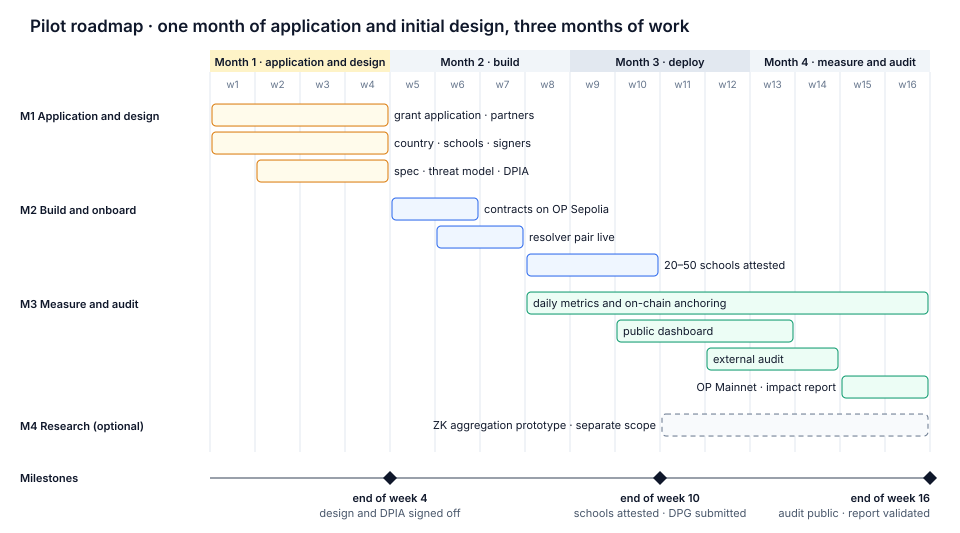

# Roadmap

*CC BY 4.0 · Indicative plan for the pilot: four months from the start of funding, with one month of application and initial design and three months of work. Payment shares per milestone are indicative.*

| Milestone | Weeks | Share | Ends with |
| --- | --- | --- | --- |
| M0 · Proof of concept | before funding | — | This repository (done) |
| M1 · Application and initial design | 1–4 | 15% | Design, DPIA and privacy statement signed off |
| M2 · Build and onboard | 5–10 | 45% | 20–50 schools attested; DPG application submitted |
| M3 · Measure and audit | 8–16 | 40% | Public audit, contracts on OP Mainnet, impact report validated |
| M4 · Research (optional) | 11–16 | separate scope | ZK prototype and write-up |

M2 and M3 overlap on purpose. Metrics start flowing as soon as the first school is attested, so the impact report rests on at least six weeks of data.

## M0 · Proof of concept · done

- [x] `VerifiablePolicyRegistry` with versions, reasons, mandatory expiry, appeals and governor rotation
- [x] `MetricsAnchor` with write-once daily roots and on-chain proof verification
- [x] Python tooling: policy validation and hashing, RPZ compilation, k-anonymous aggregation, Merkle proofs, CLI
- [x] EAS schema definitions with separate issuer roles
- [x] Reference Unbound configuration
- [x] White paper, architecture, interfaces, decision records, governance, privacy statement draft

## M1 · Application and initial design · weeks 1–4 · 15%

Deliverables:
- funding application and partner agreements;
- pilot country, schools and connectivity provider chosen with Giga and the ministry;
- the two institutional signers named and the independent reviewer agreed;
- final contract and EAS specifications (VPR-001, VPR-002) and threat model (VPR-003);
- DPIA completed with Giga's data-protection focal point (VPR-004);
- RFC 8932 privacy statement v1 (VPR-005);
- filtering profiles for primary, secondary and teachers, mapped to ITU COP categories (VPR-006);
- external auditor booked for weeks 12–14.

Acceptance: documents merged in this repository; DPIA signed off by Giga; audit slot confirmed in writing.

## M2 · Build and onboard · weeks 5–10 · 45%

Deliverables:
- contracts deployed and verified on OP Sepolia, with scopes created under the governor Safe (VPR-009, VPR-010, VPR-011);
- EAS schemas registered (VPR-012) and attestation commands (VPR-013);
- resolver pair live with DNSSEC, DoT/DoH and RPZ, synchronised from the registry (VPR-014, VPR-015, VPR-019);
- metrics exporter (VPR-016) and block and appeal page (VPR-017);
- reviewer test kit (VPR-018);
- 20–50 schools onboarded, with deployment and independent test attestations;
- DPG application submitted (VPR-025).

Acceptance: at least 20 schools hold a valid `VPR.IndependentTest.v1` signed by the reviewer; policy v1 published with signatures; DPG application submitted.

The pilot runs on OP Sepolia until the audit is closed. Filtering does not depend on the network, so schools are protected from their first day; only the accountability records move to mainnet in M3.

## M3 · Measure and audit · weeks 8–16 · 40%

Deliverables:
- daily dataset publication and root anchoring, from the first attested school onwards (VPR-020);
- public dashboard (VPR-021);
- NIST SP 800-81r3 compliance matrix and UK Safer Internet Centre checklist (VPR-022, VPR-023), with `VPR.Conformance.v1` attestations;
- pre-audit hardening, including Merkle domain separation (VPR-027), and an external audit of the contracts and the resolver configuration (VPR-024), with a contract freeze at the end of week 11;
- deployment to OP Mainnet after the audit, with scopes and the policy in force re-published there;
- impact report and playbook for new countries (VPR-026).

Acceptance: a party outside the project recomputes published roots; the audit report is public with no open high-severity findings; the impact report is validated by Giga.

## M4 · Research (optional) · weeks 11–16, separate scope

Prototype zero-knowledge proof that the published aggregates are the correct k-suppressed aggregation of the committed event log (VPR-030), with a benchmark and a write-up. Directions for later work: TEE attestation (VPR-032) and verifiable differential privacy (VPR-031).

## Schedule risks

- **Audit capacity.** External auditors are often booked weeks ahead. The slot is reserved in M1, and the contracts are frozen at the end of week 11.
- **School onboarding.** Onboarding depends on the ministry and the connectivity provider. Schools are onboarded in waves from week 8, so that a delay does not hold up the whole cohort.
- **Data window.** A four-month plan leaves six to eight weeks of metrics for the impact report. Longer-term figures are reported after the pilot, from the same public datasets.

## After the pilot

Scale to more countries through Giga; recertify every policy cycle; community governance of the schemas; explore an EAS community standard for the schemas.
