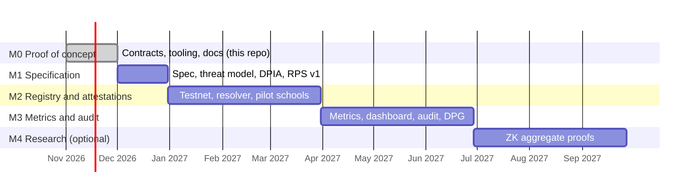

# Roadmap

*CC BY 4.0 · Milestones mirror the Ethereum Foundation ESP concept note. Payments by milestone are indicative.*

## M0 · Proof of concept (this repository) · done

- [x] `VerifiablePolicyRegistry` with versions, reasons, mandatory expiry, appeals, governor rotation
- [x] `MetricsAnchor` with write-once daily roots and on-chain proof verification
- [x] Python tooling: policy validation and hashing, RPZ compilation, k-anonymous aggregation, Merkle proofs, CLI
- [x] EAS schema definitions with separated issuer roles
- [x] Reference Unbound configuration
- [x] README, white paper, architecture, governance, privacy statement draft

## M1 · Specification · month 1 · 15%

Deliverables: final contract specification; EAS schema specification and issuer guidelines; threat model; DPIA template completed with Giga; RFC 8932 privacy statement v1; filtering profiles (primary, secondary, teachers) mapped to ITU COP categories.

Acceptance: documents merged in this repository and reviewed in an ESP check-in; DPIA signed off by Giga's data-protection focal point.

## M2 · Registry and attestations · months 2–4 · 45%

Deliverables: contracts deployed and verified on OP Sepolia, then OP Mainnet; EAS schemas registered; Safe governor configured per scope; resolver pair live with DNSSEC, DoT/DoH and RPZ; metrics exporter; block and appeal page; 20–50 schools onboarded; first deployment and independent test attestations; DPG application.

Acceptance: contracts verified on-chain; at least 20 schools with a valid `VPR.IndependentTest.v1` attestation signed by the reviewer; policy v1 published with signatures; DPG application submitted.

## M3 · Metrics and audit · months 5–7 · 40%

Deliverables: daily dataset publication and root anchoring; public dashboard; NIST SP 800-81r3 compliance matrix and `VPR.Conformance.v1` attestations; UKSIC self-certification checklist; external audit of contracts and resolver configuration; impact report; playbook for new countries.

Acceptance: a party outside the project recomputes published roots; audit report public with no open high-severity findings; impact report validated by Giga.

## M4 · Research (optional, separate scope) · months 8–10

Zero-knowledge proof that published aggregates derive from the policy in force (and from resolver events), with a prototype and write-up.

## After the pilot

Scale to more countries via Giga; recertification every policy cycle; community governance of schemas; explore EAS community standard for the schemas.
