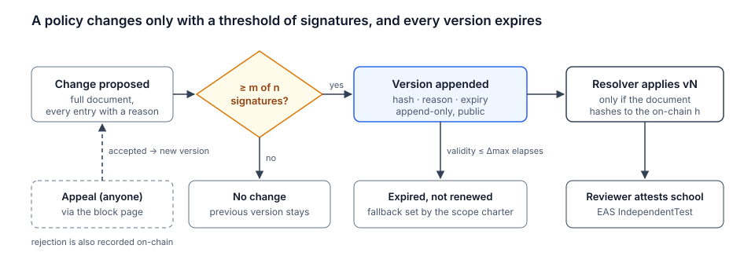
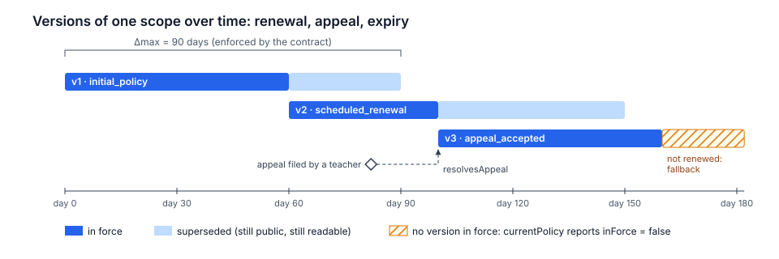
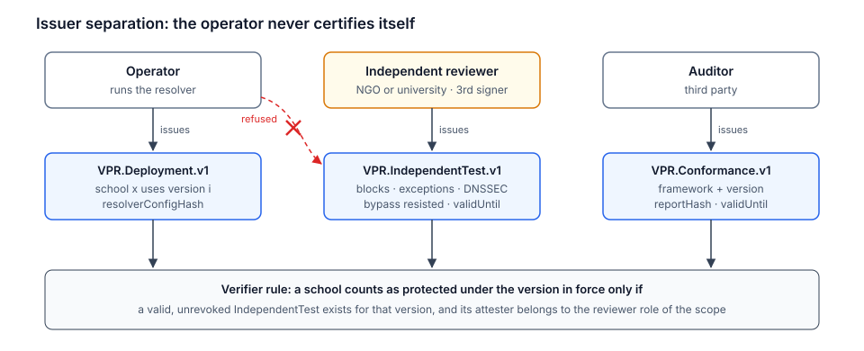
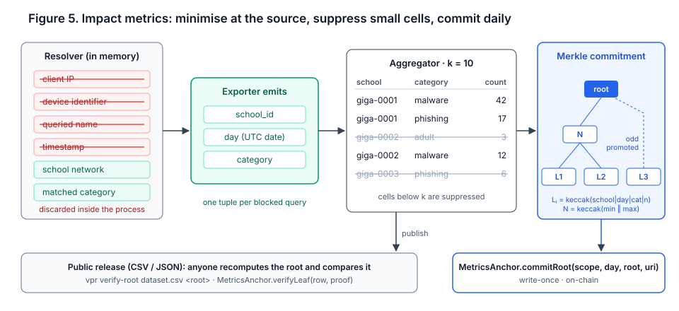
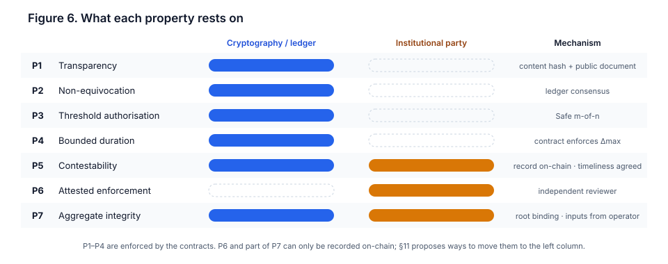
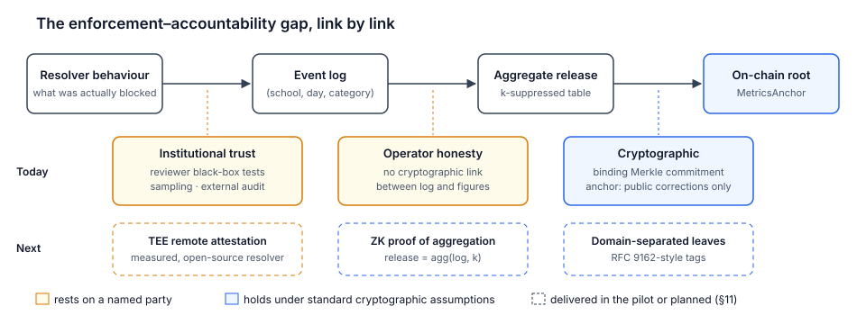

# Verifiable Policy Registry: Accountable and Privacy-Preserving Content Filtering for School Connectivity

**Fernando Boiero** · Xcapit (CryptoLab S.A.S.), Córdoba, Argentina
Correspondence: dpg@xcapit.com

*White paper · Version 0.3 (draft for review) · November 2026 · Licensed under CC BY 4.0*

> **Status.** This document describes a design and a proof-of-concept implementation. The smart contracts have not been audited and are not deployed on any production network. Claims about security and privacy are stated together with the assumptions under which they hold.

---

## Abstract

Programmes that connect schools to the internet must protect children from malware, phishing and harmful content, and in practice they do so with network-level content filtering. The same mechanism is among the most common instruments of internet censorship. Its legitimacy therefore depends on properties that today's filters do not provide: the public cannot learn what is blocked, who decided it, for how long, or whether the infrastructure records children's browsing. We present the *Verifiable Policy Registry* (VPR), a system that separates the **enforcement plane** of filtering, a conventional protective DNS resolver operated in-country, from an **accountability plane** built on a public blockchain. In the accountability plane, every policy version is committed to by hash, authorised by a threshold of independent institutions, bounded in time and open to appeal. The correct deployment of a policy is attested by a party other than the operator. Impact is reported as aggregates with small-cell suppression, bound to a daily Merkle commitment that anyone can recompute.

We state the security properties the system offers, separate those that hold cryptographically from those that rest on institutional trust, and identify the gap between what a ledger can prove and how a resolver actually behaves. We narrow that gap with zero-knowledge proofs that bind the published figures to a committed event log and to the policy in force, implemented as part of the pilot, and identify trusted execution as further work. The first deployment targets a pilot in 20 to 50 schools connected by UNICEF Giga in Latin America. The design is generic to any bounded network with an accountable governor.

---

## 1. Introduction

Giga, a joint initiative of UNICEF and the International Telecommunication Union, has mapped more than 2.1 million schools in over 140 countries with the aim of connecting every school to the internet [1]. For many of these schools, connectivity arrives for the first time. It reaches shared devices with little or no security management, used by children who may have had no previous exposure to the open web. Three classes of risk follow. The first is technical: malware, phishing, cryptojacking and command-and-control traffic. The second is content: child sexual abuse material (CSAM), and violent or sexual content unsuitable for minors, as catalogued in the ITU Child Online Protection guidelines [2]. The third is a governance risk that is less often named. A filter whose configuration is opaque can block legitimate educational content through error or through intent, and neither the funding agency, the donors nor the families can tell which.

Commercial protective DNS services address the first two risks reasonably well. They do not address the third, and they cannot: when the operator of the filter is also the custodian of its change log, the log proves nothing. The problem is structurally similar to the one that motivated Certificate Transparency in the Web PKI [3]. The relying parties depended on decisions made by a few operators whose mistakes or misbehaviour were invisible until exploited. The answer there was to make every decision publicly logged and auditable after the fact. We apply the same principle to content-filtering policy and extend it with mechanisms suited to the setting: threshold authorisation, mandatory expiry, a contestation procedure, separation of the parties who operate and who certify, and impact metrics designed so that the act of reporting does not itself become a surveillance channel.

**Contributions.** This paper makes the following contributions.

1. A system model for accountable content filtering in bounded networks, with seven explicitly stated properties (§3.3). For each, we identify whether it rests on cryptographic assumptions, on the honesty of a named institutional party, or on both.
2. A minimal on-chain design consisting of a policy registry and a metrics anchor. Only commitments are stored on-chain, so the ledger never holds personal data or the contents of legally restricted lists (§4).
3. An attestation scheme with three non-overlapping issuer roles, so that the operator of the resolver never certifies its own deployment (§4.4).
4. A privacy-preserving impact pipeline with data minimisation at the source, k-suppression and Merkle commitments. We also analyse its residual leakage and the conditions under which differential privacy would be preferable (§5).
5. A threat model with concrete adversaries and mitigations (§6), a mapping to existing standards (§7), and a zero-knowledge proof of correct aggregation that closes part of the enforcement–accountability gap, with trusted execution as further work (§11).

An open-source implementation of the contracts and the off-chain tooling accompanies this paper under the AGPL-3.0 licence [4].

---

## 2. Background and related work

**Protective DNS and Response Policy Zones.** Filtering at the recursive resolver is the dominant technique for network-wide protection because it requires no software on end-user devices. Response Policy Zones (RPZ) [5] express filtering rules as an ordinary DNS zone, and every major open-source resolver supports them. NIST SP 800-81 Revision 3 [6] is the current reference for secure and protective DNS deployments, including RPZ, DNSSEC validation and encrypted transport (DNS over TLS [7] and DNS over HTTPS [8]). RFC 8932 [9] defines the *Recursive operator Privacy Statement*, a public declaration of what a resolver logs, for how long and with whom it shares data. DNS filtering acts on domain names, not on URLs. Filtering at the level of individual pages, as required by some entries of the Internet Watch Foundation (IWF) list [10], needs a separate layer (§10).

**Transparency logs.** Certificate Transparency [3, 11] introduced publicly verifiable, append-only logs of certificate issuance, which let anyone detect misissuance after the fact. Similar constructions followed: key transparency for end-to-end messaging (CONIKS [12]), software supply-chain transparency (Sigstore and its Rekor log [13]), and binary transparency. All of these share a weakness, the *split-view* or equivocation attack, in which a log shows different histories to different observers. The usual defence is gossip between observers. A public blockchain gives a single, globally agreed history by construction and so removes the need for gossip, under the assumptions stated in §3.2 and provided that verifiers check state against the chain's consensus (for instance with a light client or several independent RPC providers) rather than trusting a single endpoint. In exchange, the trust assumption moves to the consensus of the chain and to its liveness.

**Censorship measurement.** Projects such as OONI [14] measure network interference from the outside, through vantage points that run tests and publish the results. Our independent test attestations (§4.4) follow the same principle. Measurement is done by a party distinct from the operator, from inside the network under test, and its results are published.

**Attestations and credentials.** The Ethereum Attestation Service (EAS) [15] provides a schema registry and a contract for on-chain and off-chain attestations, deployed on Ethereum and several layer-2 networks. W3C Verifiable Credentials 2.0 [16] defines a data model for credentials that can be verified independently of the issuing infrastructure. We use EAS for on-chain verifiability and keep the schemas compatible with representation as Verifiable Credentials.

**Privacy-preserving aggregation.** k-anonymity [17] and its refinements, such as ℓ-diversity [18], protect against re-identification in released tables, but their guarantees do not compose under repeated or overlapping releases. Differential privacy [19] provides composable guarantees at the cost of calibrated noise. Systems such as Prio [20] compute aggregate statistics over secret-shared inputs with robustness against malicious clients. Our setting is simpler than Prio's, because the aggregator already sees the events it counts. Our concern is what the *published* output reveals, and whether the output can be bound to its inputs (§5, §11).

**Multi-party governance on Ethereum.** Smart-contract multisignature wallets, of which Safe [21] is the most widely deployed, implement m-of-n authorisation over arbitrary contract calls. Institutional signers can use hardware security modules or passkey-based smart accounts, so signing does not require handling cryptocurrency directly.

---

## 3. System model and goals

### 3.1 Actors

- **Governor.** A Safe multisignature account bound to a *scope*. In the pilot it is a 2-of-3 configuration whose signers are UNICEF Giga, the national Ministry of Education and an independent reviewer. The governor is the only party able to change a policy.
- **Operator.** Runs the resolver, compiles policies into zones, publishes aggregate datasets and anchors their commitments. During the pilot the operator is Xcapit.
- **Independent reviewer.** An organisation with no operational role, for example a child-protection NGO or a university. It signs as the third member of the governor, tests deployments from inside school networks and reviews appeals.
- **Auditor.** Assesses the resolver service against named frameworks and attests conformance.
- **Schools.** Change a single network setting and report wrongly blocked sites. School staff are never required to hold keys or tokens.
- **Public.** Donors, researchers, journalists, families and any other party who verifies.

### 3.2 Trust assumptions

We assume a standard computational model for keccak-256 (collision and second-preimage resistance) and the unforgeability of ECDSA over secp256k1 and, for passkey-based signers, over P-256. We assume the safety and eventual liveness of the layer-2 network on which the contracts are deployed, inherited from its fault-proof and forced-inclusion mechanisms on Ethereum L1. For the governor, we assume that no coalition of fewer than *m* of the *n* signers can produce an authorised transaction.

We do **not** assume that the operator is honest. We **do** assume that the independent reviewer performs its tests honestly and that at least one of the governor's signers acts in the interest of the children and the public. Every property in §3.3 is stated relative to these assumptions.

### 3.3 Properties

Let a scope *s* have a sequence of policy versions ⟨*p*₁, …, *p*ₙ⟩. Each version *p*ᵢ = (*h*ᵢ, *ρ*ᵢ, *u*ᵢ, *c*ᵢ, *t*ᵢ, *e*ᵢ, *a*ᵢ) consists of a content hash *h*ᵢ, a restricted-list commitment *ρ*ᵢ, a document locator *u*ᵢ, a reason code *c*ᵢ, a publication time *t*ᵢ, an expiry *e*ᵢ and an optional resolved appeal *a*ᵢ. The registry maintains this sequence. A version is *in force* at time τ if it is the most recent version appended before τ and τ < *e*ᵢ. The system aims to provide the following properties.

- **P1 · Transparency.** At any time τ, any party can determine which version of *s* is in force, retrieve its document and check that it hashes to *h*ᵢ. *Holds cryptographically,* given availability of the document.
- **P2 · Non-equivocation.** All parties observe the same sequence ⟨*p*₁, …, *p*ₙ⟩, which is append-only. *Holds under the safety of the ledger.*
- **P3 · Threshold authorisation.** A new version can be appended only with the approval of at least *m* of the *n* governor signers. *Holds cryptographically,* given the multisignature and key custody.
- **P4 · Bounded duration.** For every *i*, *e*ᵢ − *t*ᵢ ≤ Δ_max(*s*). The contract enforces this. In the pilot, Δ_max is 90 days.
- **P5 · Contestability.** Any party can file an appeal against a scope. Its resolution, acceptance through a new version or rejection, is publicly recorded and attributable to the governor. *Holds cryptographically for the record*; timeliness is an institutional commitment.
- **P6 · Attested enforcement.** A school is reported as protected under version *p*ᵢ only if a valid, unrevoked test attestation for *p*ᵢ exists, issued by the independent reviewer. *Rests on the honesty of the reviewer.* The ledger records the claim and its issuer; it cannot verify the claim.
- **P7 · Aggregate integrity with minimisation.** Published impact figures are bound to a commitment that cannot be altered after anchoring, and they are derived only from events of the form (*school*, *day*, *category*) with cells below a threshold *k* suppressed. *Integrity holds cryptographically after anchoring. With the proof of §11, the figures are also bound to a committed event log and to the policy in force; the completeness of that log rests on the reviewer and the audit* (§5.4, §11).

The distinction between P1–P5, which a ledger can enforce (for P5, the record but not its timeliness), and P6–P7, which a ledger can only record, is central to this work. We return to it in §6.1 and summarise it in Figure 6.

### 3.4 Non-goals

The system does not attempt to prove on-chain that a resolver behaves correctly at runtime. It does not target filtering at the scale of an internet service provider or a nation: the design assumes a bounded network with an accountable governor, and the project explicitly declines features for broader blocking (ADR-0006 [4]). It does not filter at URL level. It does not replace education, device management or supervision; it complements them.

### 3.5 Relevance to the Sustainable Development Goals

The system addresses SDG target 4.a, safe and effective learning environments, and target 16.2, ending abuse and exploitation of children. It is equally motivated by targets 16.6, accountable and transparent institutions, and 16.10, public access to information and protection of fundamental freedoms. Protection that cannot be audited is hard to distinguish from censorship. For that reason the design publishes every block that can lawfully be published, commits to the remainder by hash (§4.2), and makes every block expire.

---

## 4. Design

### 4.1 Overview

The architecture has two planes. The **enforcement plane** runs in-country and consists of a pair of recursive resolvers with RPZ, DNSSEC validation and encrypted transport, a metrics exporter co-located with the resolvers, and a block page. Schools point their DNS to these resolvers; nothing is installed on devices. The **accountability plane** runs on an Ethereum layer-2 network. It consists of two contracts, the `VerifiablePolicyRegistry` and the `MetricsAnchor`, together with three EAS schemas. A public dashboard reads both planes. Only two kinds of information flow from the enforcement plane to the chain: attestations and aggregate commitments. Individual queries never do.

*Figure 1. The enforcement plane (top) filters traffic in-country with a conventional resolver. The accountability plane (bottom) holds only commitments: policy versions, attestations and daily roots. The governor is the only party that can change a policy.*

Table 1 summarises the function of each part and its intended effect for students, together with the condition under which that effect holds.

| Component | Function | Effect for students | Holds if |
| --- | --- | --- | --- |
| DNS filtering | Resolves each query against the zone compiled from the policy in force and blocks malware, phishing, adult content and CSAM at domain level | Protection from the first day of connectivity, including on shared devices without endpoint security | DNS from the school network is forced to the resolver (§4.5, A7) |
| Minimisation | Queries, client addresses and device identifiers are not retained; only (*school*, *day*, *category*) tuples leave the resolver process, and small cells are suppressed | Browsing is not recorded and cannot be linked to an individual from the published data | The operator honours its RFC 8932 statement (A3), checked by audit; group-level limits in §5.2 |
| Accountability plane | Records each policy version with its signatures, each school's attestations and a daily commitment to the aggregate counts; no personal data is written on-chain | Blocks of legitimate content become public, attributable and temporary, and published impact figures cannot be revised after the fact | P1–P5 and P7 under §3.2; P6 under reviewer honesty |

*Table 1. Components, their function and the conditions under which their effect for students holds.*

### 4.2 Policy documents and commitments

A policy is a structured document, published in full. It lists the content categories applied, the third-party threat feeds by provider and version, the local blocks and the exceptions. Every local block and every exception carries a reason, and the validator rejects entries without one. The document is canonicalised as JSON with lexicographically sorted keys, no insignificant whitespace and UTF-8 encoding, after normalising domain names. Its keccak-256 digest is the content hash *h*. Comments and key order do not affect *h*; values do. Because the canonicalisation is part of the public interface, any change to it is versioned (INTERFACES.md, I1 [4]).

Some lists cannot be published. The IWF list of URLs hosting CSAM is distributed only to members under strict terms, and publishing it would itself cause harm. Such lists are represented by a commitment *ρ* = keccak-256 of their sorted, newline-separated, normalised entries. The commitment appears in the document and on-chain. The operator merges the entries at compile time and never labels them in the compiled zone. As a result, the public can verify that a restricted list was declared and whether it changed between two versions, without learning its contents; that the declared list is the one actually compiled into the zone is checked by the auditor. For these entries, P1 is necessarily weaker: their contents are verified by the list provider and the auditor, not by the public.

### 4.3 Lifecycle and appeals

*Figure 2. Authorisation flow. Without a threshold of signatures the policy in force does not change. Each appended version is public, is loaded by the resolver only after its document is checked against the on-chain hash, and ends in an independent attestation per school.*

The governor appends a version by calling `publishPolicy(scopeId, h, ρ, u, c, validity, a)`. The contract rejects an empty hash and any validity outside (0, Δ_max]. If *a* is non-zero, the contract requires that *a* refers to an open appeal in the same scope and marks it accepted in the same transaction. In other words, accepting an appeal is not a separate administrative act: it consists of publishing the policy that resolves it.

Expiry is mandatory. When the latest version expires without renewal, `currentPolicy` reports it as not in force. What the resolver does in that state is a governance decision, recorded in the charter of the scope: either keep enforcing the last version, flagged as expired, or fall back to protective categories only (malware and phishing). We recommend the second option. It keeps the safety benefit of the filter without letting content restrictions persist past their authorisation.

*Figure 3. One scope over 180 days. Version 2 renews version 1 before it expires. Version 3 resolves an appeal and replaces version 2. When version 3 expires without renewal, no version is in force and the scope falls back to protective categories. Superseded versions remain public.*

Anyone can file an appeal with `fileAppeal(scopeId, u)`, where *u* locates a short public document naming the domain, the requested change and its reason. The appeal identifier is keccak-256(abi.encode(scopeId, *u*)), which makes identical appeals idempotent. Appeals are filed through a relayer behind the block page, so the person appealing needs no wallet. The relayer accepts only the fields of the appeal format (INTERFACES.md, I9 [4]) and rejects free text containing contact details or other personal data.

### 4.4 Attestations and issuer separation

Three EAS schemas, published under CC0, record claims about deployments. Each has exactly one issuer role.

| Schema | Issuer | Claim |
| --- | --- | --- |
| `VPR.Deployment.v1` | Operator | School *x* resolves through a resolver configured with version *i*; commits to the hash of the published resolver configuration |
| `VPR.IndependentTest.v1` | Independent reviewer | From inside the school network: blocked categories are blocked, exceptions are reachable, DNSSEC validates, and known bypasses fail; valid until a stated time |
| `VPR.Conformance.v1` | Auditor | The resolver service conforms to a named framework and version, for example NIST SP 800-81r3 or an RFC 8932 privacy statement |

A school counts as protected only with a valid `VPR.IndependentTest.v1` for the version in force. Verifiers check that the attester belongs to the reviewer role for the scope. How a role is bound to an attester address is not yet fixed on-chain: in the current design it is declared in the scope charter, and its specification, together with revocation rules, is part of the attestation specification in the backlog (VPR-002). The test result is published on-chain as a summary of four booleans. The full report is shared with the governor signers and committed to by its hash rather than published, because a detailed account of how a specific school's network resisted or failed bypass attempts is itself useful to an attacker. Attestations expire and are revoked if a re-test fails.

*Figure 4. Each schema has exactly one issuer role. The operator can state that a school is deployed, but only the independent reviewer can state that it is protected.*

### 4.5 How a school joins

1. The ministry and Giga select the school from the Giga map.
2. The school's router or its connectivity provider points DNS to the resolver. Outbound DNS to other resolvers is blocked at the provider. Nothing is installed on devices.
3. The operator issues a deployment attestation for the school and the version in force.
4. The independent reviewer runs the test suite from the school network and issues a test attestation, identifying the school only by its public Giga identifier.
5. From then on, counts are aggregated daily. The test is repeated before the attestation expires, and the attestation is renewed or revoked depending on the result.

---

## 5. Privacy-preserving impact metrics

### 5.1 Minimisation at the source

*Figure 5. Identifying fields are discarded inside the resolver process. The exporter emits three fields per blocked query, the aggregator suppresses cells below k, and the release is committed to by a daily Merkle root that anyone can recompute.*

The design principle is that privacy is enforced by what is collected, not by what is deleted afterwards. The resolver processes queries in memory and does not log them; the only exception is a short operational buffer whose duration is declared in the RFC 8932 statement. For each blocked query, the exporter emits a single tuple (*school_id*, *day*, *category*). *school_id* is the public identifier of the school, derived from the source network. *day* is a calendar date in UTC, and *category* is the policy category that caused the block. Client addresses, device identifiers, queried names and timestamps finer than a day are discarded inside the exporter's process and never reach the aggregator. The aggregator's interface accepts these three fields and nothing else.

### 5.2 Release and suppression

The aggregator counts tuples per cell (*school*, *day*, *category*) and suppresses every cell whose count is below *k*. In the pilot, *k* = 10. The released table is sorted and published as CSV and JSON, together with the number of suppressed cells.

This mechanism defends against the most direct risk in a school setting. A count of 1 or 2 in a sensitive category at a small school could, combined with local knowledge, point to an individual child. Its guarantees are nonetheless limited, and we state the limits explicitly.

- *Group disclosure.* A released cell of 25 blocks in an adult-content category at a school with a single class says something about that class. k-suppression bounds disclosure about individuals, not about small groups. This is the reason the release is restricted to the category level and never includes domains.
- *Suppression is itself informative.* Publishing the number of suppressed cells reveals how many cells had between 1 and *k* − 1 events. We consider this acceptable at the aggregate level of a daily release, but it is a leak, and a variant that omits the count is trivial.
- *Events are not individuals.* The threshold applies to the number of blocked queries in a cell, not to the number of distinct children who produced them. A single device that retries, prefetches or repeatedly reloads a blocked page can fill a cell on its own. The mechanism therefore suppresses small counts; it does not give k-anonymity in the sense of [17], where each released record is indistinguishable from at least *k* − 1 others. A threshold on distinct contributors would require the resolver to count clients, for instance with per-day salted identifiers held only in memory and discarded before export. That is compatible with minimisation at the source but adds state to the enforcement plane, and we leave it as a design option to be evaluated in the impact assessment.
- *Composition.* Because each cell is released exactly once and cells do not overlap, differencing attacks across releases do not apply to the current design. They would apply as soon as overlapping aggregates were published, for example weekly totals alongside daily cells. Any such extension must be designed with a composable notion of privacy.

For deployments where overlapping or finer-grained releases are wanted, differential privacy is the appropriate tool. Adding integer noise, for example from the two-sided geometric (discrete Laplace) distribution, would give composable guarantees with a known privacy budget. It also creates a tension with verifiability: if the published figures are noisy, the commitment must bind the noise as well, which calls for publicly verifiable randomness or a proof that the noise was sampled correctly. We consider this an open design question (§11).

### 5.3 Commitments

Each daily release is committed to by a Merkle root. A leaf is keccak-256 of the UTF-8 string `school_id|day|category|count`. Internal nodes hash the sorted concatenation of their children, so proofs need no position bits, compatible with OpenZeppelin's `MerkleProof`. An odd node is promoted unchanged. The operator anchors the root with `commitRoot(scopeId, day, root, datasetUri)` in the `MetricsAnchor` contract, which accepts each (scope, day) only once. Anyone can download the release, recompute the root and compare it; anyone can also verify a single row against the anchored root with a logarithmic-size proof. The Solidity verifier, the JavaScript tests and the Python implementation share a test vector.

Two refinements are planned before audit. First, leaves and internal nodes are currently hashed without domain separation. Because `verifyLeaf` accepts an arbitrary 32-byte leaf, an internal node presented as a leaf with a shortened proof will verify. A verifier that hashes a row itself is not affected, since a 64-byte concatenation of two digests is, except with negligible probability, not a well-formed row, but a contract-level consumer could be. The standard remedy is to prefix leaves and nodes with distinct tags, as in RFC 9162 [11], or to hash leaves twice. Second, the one-time `configure` call of the anchor is currently open to the first caller of each scope and must be bound to the scope's governor. Both items are tracked in the project backlog (VPR-045 and VPR-009, respectively); the first changes the leaf encoding and is therefore a versioned interface change.

### 5.4 What the commitment does not prove

A Merkle root anchored on-chain proves that a release has not been altered since anchoring. It does not prove that the release reflects what the resolver actually blocked, nor that the resolver enforced the policy in force while producing those events. An operator that wished to inflate its impact, or to hide over-blocking, could fabricate tuples before aggregation. Without further mechanisms this is mitigated only by the reviewer's tests and by audit. §11 closes the step from log to release with a zero-knowledge proof and discusses the remaining step from resolver to log.

---

## 6. Threat model and security analysis

### 6.1 What the ledger proves, and what it does not

| Claim | Evidence | Assumption |
| --- | --- | --- |
| Version *i* is in force for scope *s* and was authorised by the governor | Registry state and events | Ledger safety; fewer than *m* signers compromised |
| The document for version *i* is the one the governor approved | keccak-256 of the canonical document equals *h*ᵢ | Collision resistance; document availability |
| School *x* applied version *i* at test time | Reviewer attestation, preceded by an operator attestation | Reviewer honesty; tests repeated before expiry |
| Impact figures for day *d* were not changed after publication | Anchored root; public release | Collision resistance |
| Impact figures for day *d* are the correct aggregation of the committed event log, under the policy in force | Zero-knowledge proof verified on-chain (§11) | Soundness of the proof system |
| The committed event log reflects actual blocks | Reviewer tests; audit | Reviewer and auditor honesty (§5.4) |
| The resolver keeps no query logs | RFC 8932 statement, published configuration, conformance attestation | Operator and auditor honesty |

*Figure 6. P1–P4 hold under standard cryptographic and ledger assumptions. P5 combines an on-chain record with an institutional commitment to respond. P6 rests on the independent reviewer, and P7 binds the published figures cryptographically but takes its inputs from the operator.*

### 6.2 Adversaries

We consider the following adversaries.

- **A1, a single governor signer acting alone,** for instance a ministry that wishes to block political content. Defeated by P3: a single signature cannot publish a version.
- **A2, a colluding majority of signers.** Two of three signers could publish a version that blocks legitimate content. The design does not prevent this; it makes it *visible and temporary*. The version is public with its reason (P1), it expires (P4), the minority signer and the public can appeal (P5), and the record of the event is permanent (P2). We regard accountability without prevention as the correct guarantee here. Giving any single party a veto over a filtering policy would itself be a concentration of power. The same majority could also replace the third signer through the Safe's owner-management functions. That change is equally visible on-chain, and verifiers should treat any change to the signer set of a governor as an event that requires public justification.
- **A3, a dishonest operator.** It might enforce a policy other than the one in force, keep query logs, or fabricate metrics. Divergent enforcement is detected by the reviewer's tests (P6), and logging is constrained by the RFC 8932 statement and by audit. Altering figures between the committed log and the publication is ruled out by the proof of §11; fabricating the log itself is not detected cryptographically and is left to the reviewer and the audit (§5.4).
- **A4, a split-view resolver.** It behaves correctly for traffic it recognises as test traffic and differently for students. Tests are run from inside the school network, and the reviewer's test client must be indistinguishable from ordinary clients. Tests should be sampled at unannounced times and from ordinary devices. This is a known limitation of black-box measurement [14] and the main reason P6 rests on the reviewer rather than on cryptography.
- **A5, an external attacker targeting signer keys.** Mitigated by threshold signing, hardware-backed or passkey-based custody, signer rotation through Safe and `setGovernor`, and by the fact that any malicious version is public and expiring.
- **A6, a re-identification attacker using released metrics.** Mitigated by minimisation at the source and by k-suppression, within the limits stated in §5.2.
- **A7, a user bypassing the filter** with external DoH, a VPN or an alternative resolver. Mitigated by blocking known public resolvers and DoH endpoints at the provider and by bypass testing in every review cycle. VPN and tunnelling bypasses cannot be fully prevented at the DNS layer; the attestation reports their status honestly rather than claiming otherwise.
- **A8, an appeal spammer.** Appeals submitted through the relayer are rate-limited; appeals submitted directly to the contract cost the submitter gas. Since appeal identifiers are content-derived, duplicates are rejected.
- **A9, the ledger itself.** A layer-2 sequencer could delay or censor transactions. Filtering does not depend on the ledger's liveness: the resolver continues to enforce the last verified version, and governance transactions can be forced through Ethereum L1 if the sequencer censors them.
- **A10, a party withholding or substituting documents.** Substituting a policy document or a released dataset is detected, since its hash no longer matches the on-chain commitment. Withholding one defeats P1 for that version without being detectable from the chain alone; it is mitigated by mirroring documents and releases on independent hosts (§8).

### 6.3 Contract-level considerations

The contracts are deliberately small. `VerifiablePolicyRegistry` is append-only with respect to versions, enforces the validity bound, and implements the appeal state machine None → Open → {Accepted, Rejected}. `MetricsAnchor` is write-once per (scope, day). Neither contract holds funds. Neither is upgradeable. A defect is remedied by deploying new contracts, re-creating each scope there under the same governor Safe, and pointing the resolver's synchronisation process and the dashboard to the new addresses, while the old record remains readable; we prefer this to proxy patterns, whose administrative keys would weaken P2. Before any production deployment we plan static analysis, invariant testing of the properties in §3.3 and an external audit.

---

## 7. Standards and compliance

We include a framework only when it adds something that can be evidenced in the context of this project. Where the evidence can be recorded on-chain, it becomes a `VPR.Conformance.v1` attestation.

| Framework | Why it is included | Evidence |
| --- | --- | --- |
| UNICEF Policy on Personal Data Protection [22] and the data-protection law of the pilot country | These are the rules that bind UNICEF and its suppliers | Data protection impact assessment before the pilot |
| NIST SP 800-81r3 [6] | Current reference for protective DNS, covering RPZ, encrypted DNS and DNSSEC; it references the relevant protocol specifications, which therefore need no separate entry | Resolver compliance matrix, reviewed in the external audit |
| RFC 8932 [9] | Turns what the resolver logs, for how long and with whom into a public, auditable statement | Published statement; each version's hash committed on-chain |
| UK Safer Internet Centre school-filtering criteria [23] with the IWF list [10] | The most developed public framework specific to school filtering that we are aware of | Published self-certification checklist |
| ITU Child Online Protection guidelines [2] | The framework already used by Giga's parent organisations | Content categories and age profiles |
| EAS [15] and W3C Verifiable Credentials 2.0 [16] | School certificates verifiable on and off Ethereum | Published schemas |
| ISO/IEC 27001 | Development and operation take place within Xcapit's certified information security management system; this is a property of the operator, not a new standard for the system | Current certificate |

We deliberately exclude the following: the UK Department for Education filtering standards, which bind UK schools rather than providers; CISA Protective DNS and DNS4EU, which are services rather than certification schemes; ISO/IEC 27701 and 29100, whose concerns are covered by the UNICEF policy and the impact assessment; and the GDPR and COPPA, which do not apply to a pilot in Latin America. A deployment in another jurisdiction would revisit this list.

---

## 8. Deployment considerations

The proposed network is OP Mainnet, where EAS is deployed and transaction costs are low; Base is an alternative with comparable properties. During the pilot, the accountability records start on OP Sepolia and move to mainnet once the external audit is closed. Filtering itself does not depend on the network, so schools are protected from the day they are onboarded. The expected load is small: one anchoring transaction per scope per day, one transaction per policy change, and one attestation per school per test cycle. Institutional signers use hardware wallets or passkey-based smart accounts through a web interface, so neither the ministry nor the schools handle cryptocurrency. Resolvers run as at least two instances on dedicated infrastructure in the region of the pilot, following NIST SP 800-81r3. Policy documents and released datasets are mirrored, for example on IPFS and in a public repository, so that P1 does not depend on a single host. Giga has previously worked with the Ethereum ecosystem on connectivity financing [24]; the present design concerns a different question, namely making the safety of that connectivity accountable.

---

## 9. Evaluation plan

The pilot lasts four months: one month of application and initial design, followed by three months of build, deployment and measurement (see the roadmap [4]). It will be evaluated against the following indicators, to be agreed with Giga.

| Indicator | Target |
| --- | --- |
| Schools protected and holding a valid independent test attestation | 20–50 |
| Policy changes authorised by the multisignature and published with their reason | 100% |
| Personal data on-chain or in published datasets | None, confirmed by the external audit |
| Reports of wrongly blocked sites answered | Within 5 working days |
| Attested schools passing the periodic bypass test | All |
| Resolver availability | 99.9% |
| Published roots recomputed by a party outside the project | At least one |
| Digital Public Good registration | Approved |

---

## 10. Limitations

DNS filtering operates on domain names. IWF entries that are individual URLs on otherwise legitimate domains require an additional layer, such as a filtering proxy or a provider-side filter; we state this so as not to promise more than DNS can deliver. Devices that ignore network DNS settings, or that use a VPN, can bypass the filter, so the system complements education, device management and supervision rather than replacing them. Property P6 is only as strong as the independence and diligence of the reviewer, and the quality of governance depends on who the signers are. Mandatory expiry requires an operational process to renew policies on time; without one, the scope falls back to protective categories. Finally, the metrics pipeline protects individuals, not small groups (§5.2), and its integrity guarantee begins at aggregation, not at the resolver (§5.4).

---

## 11. Closing the enforcement–accountability gap

The weakest link in the design is the step between the resolver's behaviour and what is committed on-chain. Figure 7 decomposes it into three links. Without further mechanisms, only the last of them is cryptographic. The pilot closes the middle link with zero-knowledge proofs of aggregation, which are implemented, audited and deployed as a milestone of their own (M4). Trusted execution and verifiable differential privacy remain further work.

*Figure 7. From resolver behaviour to on-chain root. The link from release to root is cryptographic. The link from log to release rests on the operator today and is closed in the pilot by a zero-knowledge proof of aggregation (§11.1). The link from behaviour to log rests on the reviewer and the auditor, and could be strengthened with remote attestation of a trusted execution environment (§11.3).*

### 11.1 Statement

For a scope *s* and a day *d*, let *L* = ⟨*e*₁, …, *e*ₘ⟩ be the event log, where each *e*ⱼ = (*school*ⱼ, *d*, *category*ⱼ), and let *C*_L be a binding commitment to *L*, anchored together with the daily root. Let Cat(*h*) be the set of categories of the policy in force, whose document hashes to *h*. Let Agg_k(*L*) be the table of counts per (*school*, *d*, *category*) with every cell below *k* removed, and let MR(·) be the Merkle root of §5.3. The operator proves knowledge of a witness *L* for the relation

  R(*h*, Cat, *k*, *C*_L, *root*; *L*) ⟺ Commit(*L*) = *C*_L ∧ ∀*j*: *category*ⱼ ∈ Cat ∧ MR(Agg_k(*L*)) = *root*.

The public inputs are the policy hash *h*, its category set Cat, the threshold *k*, the log commitment *C*_L and the daily root. The binding between Cat and *h* is checked either in the circuit or by any verifier holding the public document; the specification (VPR-033) fixes which, based on proving cost. The proof is zero-knowledge in *L*, so the counts of suppressed cells stay hidden. As a side effect, the number of suppressed cells no longer needs to be published (§5.2).

### 11.2 What the proof guarantees, and implementation

Given a valid proof, the published figures are exactly the suppressed aggregation of a log the operator committed to, and no event in that log falls outside the policy in force. The operator can no longer adjust the figures after the fact, or report blocks in categories the governor never approved. The proof does not establish that *L* is complete or that its events occurred. That property belongs to the first link of Figure 7 and still rests on the reviewer's measurements and on audit.

Two implementation routes are evaluated in the first month: a general-purpose zero-knowledge virtual machine running a reference implementation of R, or a dedicated circuit for counting, threshold comparison and membership. zkVM proofs are usually wrapped into a succinct proof such as Groth16 [25] or PLONK [26] for verification on the EVM. A dedicated circuit is cheaper to prove but must implement keccak-256, which is expensive in arithmetic circuits. One option is to commit to *L* with a SNARK-friendly hash such as Poseidon [27] and keep keccak-256 only for the public Merkle root. The anchoring contract accepts a daily root only together with a proof that verifies on-chain. The circuit and the verifier fall within the scope of the external audit. If proving a full day exceeds the daily budget on commodity hardware, the fallback is one proof per school, aggregated off-chain.

### 11.3 Further work

**Trusted execution.** If the resolver and exporter ran inside a trusted execution environment, such as Intel TDX, AMD SEV-SNP or AWS Nitro Enclaves, a remote attestation could bind *C*_L and the absence of logging to a measured, open-source binary loaded with the zone compiled from *h*ᵢ. This would strengthen the first link of Figure 7, moving part of P6 and P7 from institutional trust to hardware trust. Hardware trust has its own history of side-channel failures, and it concentrates trust in the hardware vendor.

**Verifiable differential privacy.** Where releases must overlap, the noise added for differential privacy should be verifiably sampled, either from public randomness committed in advance or within the same proof as R. The goal is that neither the operator nor the analyst can bias the noise.

---

## 12. Conclusion

A filter that protects children and a filter that censors them can run the same software. What distinguishes them is accountability: who decided, for how long, on what grounds, under whose review, and at what cost to privacy. The Verifiable Policy Registry makes those questions answerable by anyone. It does so by placing minimal, carefully chosen commitments on a public ledger, by separating those who operate from those who certify, and by stating plainly which guarantees are cryptographic and which rest on institutions. It is released as open source with the intention of registration as a digital public good, and we invite review of both the design and its assumptions.

---

## Appendix A. Data inventory

Design rule: the ledger holds data about institutions (schools, agencies), never about people.

| Data | Location | Visibility | Purpose |
| --- | --- | --- | --- |
| Policy content hash, reason code, expiry, signatures | On-chain | Public | Audit what is blocked, by whom and why; detect over-blocking |
| Full policy document (categories, feeds, local blocks, exceptions with reasons) | Off-chain, mirrored | Public | Audit the content of each version |
| Restricted list (e.g. IWF) | Operator only | Commitment public; contents never published | Block CSAM without disclosing the list |
| Deployment, test and conformance attestations | On-chain (EAS) | Public; full test reports shared with the governor and committed by hash | Certify schools to donors and governments |
| Daily aggregate release (school, day, category, count ≥ *k*) | Off-chain, mirrored | Public | Measure impact |
| Daily Merkle root of the release | On-chain | Public | Prevent later alteration of impact figures |
| Appeals (domain, request, reason) | On-chain reference, off-chain document | Public | Contest blocks |
| Individual queries, IP addresses, device identifiers | Not stored beyond a declared operational buffer | Nobody | Resolver operation only |

## Appendix B. Specification pointers

The formats exchanged between components (canonical policy encoding, ABIs, RPZ conventions, event and dataset formats, attestation schemas and the appeal document) are specified in `docs/INTERFACES.md`. Design decisions and their alternatives are recorded in `docs/adr/`. The DPG Standard mapping is in `docs/DPG.md`, and the harm analysis in `docs/DO_NO_HARM.md` [4].

---

## References

[1] UNICEF. Contribution to the WSIS+20 review (Giga figures). UNCTAD. https://unctad.org/system/files/non-official-document/wsis20_c25_unicef_en.pdf

[2] ITU. *Guidelines on Child Online Protection* and COP policy brief, 2020. https://www.itu.int/en/ITU-D/Cybersecurity/Documents/COP/20-00802_COP-Policy_Brief.pdf

[3] B. Laurie, A. Langley, E. Kasper. *Certificate Transparency*. RFC 6962, 2013.

[4] Verifiable Policy Registry source code and documentation. https://github.com/xcapit/verifiable-policy-registry

[5] P. Vixie, V. Schryver. *DNS Response Policy Zones (RPZ)*. Internet-Draft draft-vixie-dnsop-dns-rpz.

[6] NIST. *Secure Domain Name System (DNS) Deployment Guide*. SP 800-81 Rev. 3, 2026. https://csrc.nist.gov/pubs/sp/800/81/r3/final

[7] Z. Hu et al. *Specification for DNS over Transport Layer Security (TLS)*. RFC 7858, 2016.

[8] P. Hoffman, P. McManus. *DNS Queries over HTTPS (DoH)*. RFC 8484, 2018.

[9] S. Dickinson et al. *Recommendations for DNS Privacy Service Operators*. RFC 8932 (BCP 232), 2020.

[10] Internet Watch Foundation. *URL List*. https://www.iwf.org.uk/our-technology/our-services/url-list

[11] B. Laurie, E. Messeri, R. Stradling. *Certificate Transparency Version 2.0*. RFC 9162, 2021.

[12] M. S. Melara, A. Blankstein, J. Bonneau, E. W. Felten, M. J. Freedman. *CONIKS: Bringing Key Transparency to End Users*. USENIX Security, 2015.

[13] Z. Newman, J. S. Meyers, S. Torres-Arias. *Sigstore: Software Signing for Everybody*. ACM CCS, 2022.

[14] A. Filastò, J. Appelbaum. *OONI: Open Observatory of Network Interference*. USENIX FOCI, 2012.

[15] Ethereum Attestation Service. https://attest.org

[16] W3C. *Verifiable Credentials Data Model v2.0*. W3C Recommendation, 2025.

[17] L. Sweeney. *k-Anonymity: A Model for Protecting Privacy*. International Journal of Uncertainty, Fuzziness and Knowledge-Based Systems, 10(5), 2002.

[18] A. Machanavajjhala, D. Kifer, J. Gehrke, M. Venkitasubramaniam. *ℓ-Diversity: Privacy Beyond k-Anonymity*. ACM TKDD, 1(1), 2007.

[19] C. Dwork, F. McSherry, K. Nissim, A. Smith. *Calibrating Noise to Sensitivity in Private Data Analysis*. TCC, 2006.

[20] H. Corrigan-Gibbs, D. Boneh. *Prio: Private, Robust, and Scalable Computation of Aggregate Statistics*. USENIX NSDI, 2017.

[21] Safe smart account. https://github.com/safe-global/safe-smart-account

[22] UNICEF. *Policy on Personal Data Protection*, 2020. https://www.unicef.org/documents/policy-personal-data-protection

[23] UK Safer Internet Centre. *Appropriate filtering for education settings* and filtering accreditation scheme. https://saferinternet.org.uk/guide-and-resource/teachers-and-school-staff/appropriate-filtering-and-monitoring/appropriate-filtering/filtering-accreditation-scheme-for-uk-schools

[24] Giga and Government of Rwanda. *Proof of concept for Giga's crypto connectivity pilot*. https://giga.global/unicef-and-government-of-rwanda-collaborate-to-demonstrate-proof-of-concept-for-gigas-crypto-connectivity-pilot/

[25] J. Groth. *On the Size of Pairing-Based Non-interactive Arguments*. EUROCRYPT, 2016.

[26] A. Gabizon, Z. J. Williamson, O. Ciobotaru. *PLONK: Permutations over Lagrange-bases for Oecumenical Noninteractive arguments of Knowledge*. IACR ePrint 2019/953.

[27] L. Grassi, D. Khovratovich, C. Rechberger, A. Roy, M. Schofnegger. *Poseidon: A New Hash Function for Zero-Knowledge Proof Systems*. USENIX Security, 2021.
