# Verifiable Policy Registry: Accountable and Privacy-Preserving Content Filtering for School Connectivity

**Fernando Boiero** ([ORCID 0009-0005-7935-2758](https://orcid.org/0009-0005-7935-2758)) · Xcapit (CryptoLab S.A.S.), Córdoba, Argentina
Correspondence: dpg@xcapit.com

*White paper · Version 0.7 (draft for review) · November 2026 · Licensed under CC BY 4.0*

> **Status.** This document describes a design and a proof-of-concept implementation. "Privacy-preserving" in the title means data minimisation, transient processing of client addresses and queried names without retention, and small-cell suppression of published counts. It does not mean *k*-anonymity or differential privacy (§5). The exact status of every claim (implemented, demonstrated, designed or planned) is maintained in `docs/CLAIMS_AND_EVIDENCE.md`, and the normative encodings and the designed zero-knowledge relation are in `docs/security/ZK_AND_CRYPTOGRAPHIC_EVIDENCE.md`; where this paper and those documents differ, those documents prevail. The smart contracts have not been audited and are not deployed on any production network. Claims about security and privacy are stated together with the assumptions under which they hold.

---

## Abstract

Programmes that connect schools to the internet must protect children from malware, phishing and harmful content, and in practice they do so with network-level content filtering. The same mechanism is among the most common instruments of internet censorship. Its legitimacy therefore depends on properties that today's filters do not provide: the public cannot learn what is blocked, who decided it, for how long, or whether the infrastructure records children's browsing. We present the *Verifiable Policy Registry* (VPR), a system that separates the **enforcement plane** of filtering, a conventional protective DNS resolver operated in-country, from an **accountability plane** built on a public blockchain. In the accountability plane, every policy version is committed to by hash, authorised by a threshold of independent institutions, bounded in time and open to appeal. The correct deployment of a policy is attested by a party other than the operator. Impact is reported as aggregates with small-cell suppression, bound to a daily Merkle commitment that anyone can recompute.

We state the security properties the system is intended to offer, separate those that hold in the implemented contracts from those that depend on future components or institutional trust, and identify the gap between what a ledger can prove and how a resolver actually behaves. We specify a zero-knowledge relation intended to narrow part of that gap; no prover or verifier is implemented. A proposed first deployment would be a controlled alpha in two to five Giga-connected schools in Latin America, followed, only if its gates are met and partners agree, by a separately funded cohort of 20 to 50. No commitment or endorsement exists from Giga, UNICEF, ITU, a ministry or a funder. The design is generic to any bounded network with an accountable governor.

---

## 1. Introduction

Giga, a joint initiative of UNICEF and the International Telecommunication Union, has mapped more than 2.1 million schools in over 140 countries with the aim of connecting every school to the internet [1]. For many of these schools, connectivity arrives for the first time. It reaches shared devices with little or no security management, used by children who may have had no previous exposure to the open web. Three classes of risk follow. The first is technical: malware, phishing, cryptojacking and command-and-control traffic. The second is content: child sexual abuse material (CSAM), and violent or sexual content unsuitable for minors, as catalogued in the ITU Child Online Protection guidelines [2]. The third is a governance risk that is less often named. A filter whose configuration is opaque can block legitimate educational content through error or through intent, and neither the funding agency, the donors nor the families can tell which.

Commercial protective DNS services address the first two risks reasonably well. They do not address the third, and they cannot: when the operator of the filter is also the custodian of its change log, the log proves nothing. The problem is structurally similar to the one that motivated Certificate Transparency in the Web PKI [3]. The relying parties depended on decisions made by a few operators whose mistakes or misbehaviour were invisible until exploited. The answer there was to make every decision publicly logged and auditable after the fact. We apply the same principle to content-filtering policy and extend it with mechanisms suited to the setting: threshold authorisation, mandatory expiry, a contestation procedure, separation of the parties who operate and who certify, and impact metrics designed so that the act of reporting does not itself become a surveillance channel.

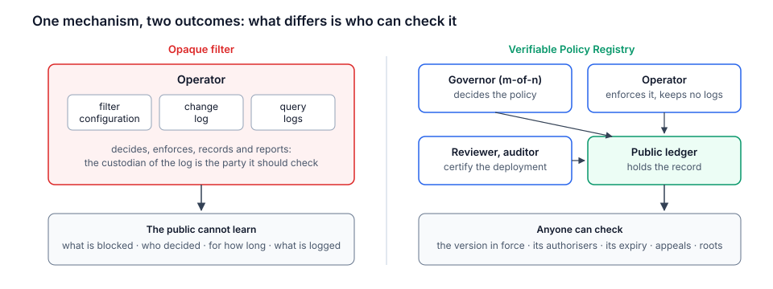

*Figure 1. The same filtering mechanism under two arrangements. On the left, one operator decides, enforces, records and reports, so its log cannot check it. On the right, decision, enforcement, certification and record are held by different parties, and the record is public.*

**Contributions.** This paper makes the following contributions.

1. A system model for accountable content filtering in bounded networks, with seven properties, each stated with the adversary it addresses, the assumptions it needs and the mechanism that enforces it (§3.3), and an account of who monitors the record (§3.4).
2. A minimal on-chain design consisting of a policy registry and a metrics anchor. Only commitments are stored on-chain, so the ledger never holds personal data or the contents of legally restricted lists (§4).
3. Three attestation schema definitions, a registry role mapping and an implemented EAS schema resolver that enforces issuer separation at issuance; registration of the schemas on a public network is planned (§4.4).
4. An implemented aggregation and commitment pipeline, plus a Designed resolver-export boundary for source minimisation. We analyse residual leakage and the conditions under which differential privacy would be preferable (§5).
5. A threat model with concrete adversaries and mitigations (§6), a mapping to relevant standards (§7), and a specification for a Planned zero-knowledge proof intended to close part of the enforcement–accountability gap, with trusted execution as further work (§11).

An open-source implementation of the contracts and the off-chain tooling accompanies this paper under the AGPL-3.0 licence [4].

---

## 2. Background and related work

**Protective DNS and Response Policy Zones.** Filtering at the recursive resolver is the dominant technique for network-wide protection because it requires no software on end-user devices. Response Policy Zones (RPZ) [5] express filtering rules as an ordinary DNS zone, and every major open-source resolver supports them. NIST SP 800-81 Revision 3 [6] is the current reference for secure and protective DNS deployments, including RPZ, DNSSEC validation and encrypted transport (DNS over TLS [7] and DNS over HTTPS [8]). RFC 8932 [9] defines the *Recursive operator Privacy Statement*, a public declaration of what a resolver logs, for how long and with whom it shares data. DNS filtering acts on domain names, not on URLs. Filtering at the level of individual pages, as required by some entries of the Internet Watch Foundation (IWF) list [10], needs a separate layer (§10).

**Transparency logs.** Certificate Transparency [3, 11] made certificate issuance publicly auditable with append-only Merkle logs, building on tamper-evident history trees [29]. Its security does not come from the log alone. *Monitors* download the log and look for misissuance, and clients must be protected against a log that shows different histories to different observers, the *split-view* attack. The defences are gossip between observers [30] and witness cosigning, in which a client accepts a log head only once a quorum of independent witnesses has checked its consistency and signed it [31]. The same design has been applied to key directories (CONIKS [12]), software signing (Sigstore and its Rekor log [13]) and module checksums (the Go checksum database [32]); Sigsum [33] builds witness cosigning into the log protocol itself. A blockchain replaces the witness quorum with consensus. Once a block is final, every verifier that checks it against consensus (with a light client, or against several independent RPC providers rather than one trusted endpoint) sees the same history. On an OP Stack rollup this holds for *finalized* blocks, which are derived from finalized L1 data. Blocks that the sequencer has produced but not yet posted to L1, the *unsafe* blocks, can still be replaced, so a verifier that reads them can be shown a history that later disappears (§3.2). The ledger does not remove the need for monitors: someone must still read the history and object to what it contains (§3.4).

**Why a public ledger rather than a witnessed log.** A transparency log with independent witnesses would give non-equivocation for policy versions with different trust: a log operator and a witness quorum instead of a sequencer, a bridge and upgrade keys. We use a ledger for three reasons, and they are the claim this design has to justify. First, the registry enforces rules, not only order. A version cannot outlive the scope's maximum validity, an appeal is accepted only by a version of its own scope that names it, and an attestation is accepted only from an address holding the schema's role at issuance (§4.3, §4.4). A log would record violations of these rules for monitors to find; the contracts refuse them, the last one for as long as the chain's EAS calls the schema resolver (§6.2, A11). Second, policy versions, role assignments, attestations and daily roots share one ordering and one clock, so a question such as "did this attester hold its role when it attested?" has a single answer. Third, the governor, the attestation service and the signing infrastructure (Safe, EAS) already exist on Ethereum and need no new witness network. The cost is the rollup's trust model (§3.2): its sequencer, its upgrade keys and its fees. A deployment that cannot accept that model should use a witnessed log instead; the off-chain formats of §4 and §5 do not depend on the choice.

**Censorship measurement.** Projects such as OONI [14] measure network interference from the outside, through vantage points that run tests and publish the results. Our independent test attestations (§4.4) follow the same principle. Measurement is done by a party distinct from the operator, from inside the network under test, and its results are published.

**Attestations and credentials.** The Ethereum Attestation Service (EAS) [15] provides a schema registry and a contract for on-chain and off-chain attestations, deployed on Ethereum and several layer-2 networks. W3C Verifiable Credentials 2.0 [16] defines a data model for credentials that can be verified independently of the issuing infrastructure. We use EAS for on-chain verifiability and keep the schemas compatible with representation as Verifiable Credentials.

**Privacy-preserving aggregation.** k-anonymity [17] and its refinements, such as ℓ-diversity [18], protect against re-identification in released tables, but their guarantees do not compose under repeated or overlapping releases. Differential privacy [19] provides composable guarantees at the cost of calibrated noise. Systems such as Prio [20] compute aggregate statistics over secret-shared inputs with robustness against malicious clients. Our setting is simpler than Prio's, because the aggregator already sees the events it counts. Our concern is what the *published* output reveals, and whether the output can be bound to its inputs (§5, §11).

**Multi-party governance on Ethereum.** Smart-contract multisignature wallets, of which Safe [21] is the most widely deployed, implement m-of-n authorisation over arbitrary contract calls. Institutional signers can use hardware security modules or passkey-based smart accounts, so signing does not require handling cryptocurrency directly.

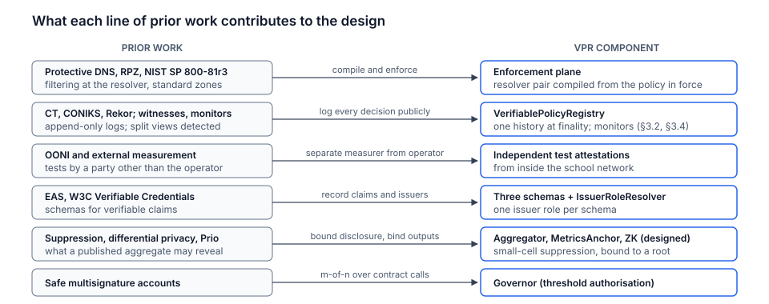

*Figure 2. What each line of prior work contributes. The design composes established mechanisms; its contribution is the combination and the explicit statement of what each part can and cannot guarantee.*

---

## 3. System model and goals

### 3.1 Actors

- **Governor.** A multisignature account bound to a *scope*. The proposed pilot model is a 2-of-3 Safe whose signers would be a Giga counterpart, the national Ministry of Education and an independent reviewer. No signer has been confirmed. The registry trusts the governor address and does not itself enforce threshold signing. A scope is created by its first governor with `createScope(name, Δ_max)`, and its identifier is derived on-chain as keccak-256 of the ABI encoding of that governor's address and the name. Another address therefore cannot occupy a canonical scope name first. Because the identifier binds the creating governor, verifiers pin the identifier itself and never recompute it from the current governor. The governor role is handed over in two steps (`proposeGovernor`, `acceptGovernor`).
- **Operator.** Would run the resolver, compile policies into zones, publish aggregate datasets and anchor their commitments. Xcapit is the proposed pilot operator; no operating agreement exists.
- **Independent reviewer.** An organisation with no operational role, for example a child-protection NGO or a university. In the proposed model it would be a governor signer, test deployments from inside school networks and review appeals. No reviewer has been engaged.
- **Auditor.** Assesses the resolver service against named frameworks and attests conformance.
- **Schools.** Change a single network setting and report wrongly blocked sites. School staff are never required to hold keys or tokens.
- **Public.** Donors, researchers, journalists, families and any other party who verifies.

### 3.2 Trust assumptions

We assume a standard computational model for keccak-256 (collision and second-preimage resistance) and the unforgeability of ECDSA over secp256k1 and, for passkey-based signers, over P-256, which OP Stack chains verify with the precompile of RIP-7212 [39].

*Ledger.* The contracts are proposed for an OP Stack rollup, whose L2 blocks pass through three states [37]: *unsafe* (produced by the sequencer but not derived from L1), *safe* (derivable entirely from L1 data) and *finalized* (derivable from finalized L1 blocks). By **ledger safety** we mean that the finalized L2 history is unique and is never reverted. For a verifier that runs a rollup node, it rests on Ethereum's finality and on the derivation rules, which that node applies itself; the fault-proof system matters to parties that act on output roots posted to L1, such as withdrawals, not to a verifier that derives L2 state. Safe blocks are derived from L1 data that is not yet final, so they can be reverted by an L1 reorganisation. By **ledger liveness** we mean that a transaction is eventually included: the sequencer can delay or censor it, but it can be forced through L1, and is included within the sequencing window, a deployment parameter that is typically 12 hours (§6.2, A9) [37]. Verifiers read state at a stated finality tag, recorded in the deployment manifest (INTERFACES I11; Figure 4). The properties of §3.3 are stated for `finalized`; at `safe` they hold unless L1 reorganises. Reading at `finalized` has a cost in latency: a new version, correction or attestation becomes visible only after its batch is posted to L1 and that L1 block is final, which takes at least the L1 finality delay of about two epochs (roughly 13 minutes). Renewals and corrections should be timed with that delay in mind. The VPR contracts are not upgradeable, but the rollup is. Its L1 system contracts and most of its L2 predeploys, including EAS and its schema registry, are proxies [40] that the chain's upgrade process can change. On a Stage 1 OP Stack chain, the role that upgrades the chain's L1 contracts requires the sign-off of its Security Council, which also holds the Guardian role; the Guardian can pause withdrawals and intervene in the dispute-game system [38]. We assume that these powers are not used against the system. This is an assumption about the chain's governance, not about the VPR contracts, and a verifier who rejects it should prefer a deployment on a chain whose model it accepts.

*Governor.* We assume that no coalition of fewer than *m* of the *n* signers can produce an authorised transaction. The registry does not check this; it trusts the governor address. The assumption therefore holds only while the governor is a Safe with threshold *m* and that configuration is unchanged. A change of owners or threshold, and a handover of the scope to another address (`proposeGovernor`, `acceptGovernor`), which could be a single key, is itself a governor transaction, visible on-chain (§6.2, A2).

We do **not** assume that the operator is honest. We **do** assume that the independent reviewer performs its tests honestly and that at least one of the governor's signers acts in the interest of the children and the public. Every property in §3.3 is stated relative to these assumptions.

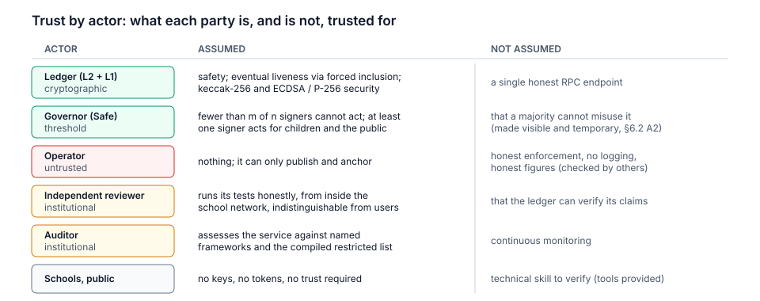

*Figure 3. Trust by actor. The ledger is trusted at its finality tag and under the chain's governance, and the governor threshold under standard assumptions; the operator is not trusted at all; the reviewer and the auditor are trusted institutionally for specific checks; schools and the public need no trust and hold no keys.*

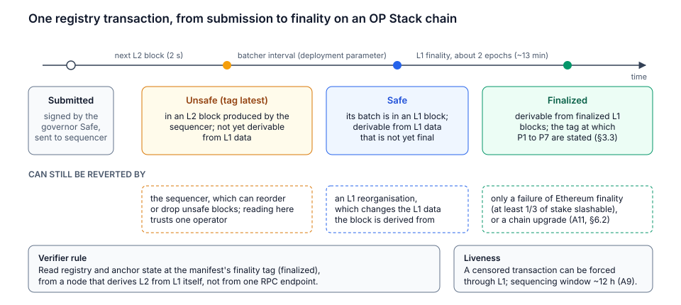

*Figure 4. What a verifier can rely on, by block state. An unsafe block can still be changed by the sequencer, a safe block by an L1 reorganisation, and a finalized block only by a failure of Ethereum finality or by a chain upgrade. The properties of §3.3 are stated at `finalized`, read from a node that derives L2 from L1 itself.*

### 3.3 Properties

Let a scope *s* have a sequence of policy versions ⟨*p*₁, …, *p*ₙ⟩. Each version *p*ᵢ = (*h*ᵢ, *ρ*ᵢ, *u*ᵢ, *c*ᵢ, *t*ᵢ, *e*ᵢ, *a*ᵢ) consists of a content hash *h*ᵢ, a restricted-list commitment *ρ*ᵢ, a document locator *u*ᵢ, a reason code *c*ᵢ, a publication time *t*ᵢ, an expiry *e*ᵢ and an optional resolved appeal *a*ᵢ. Observations are made at a finality tag *F* (§3.2): we write state_*F*(τ) for the registry state in the latest block of tag *F* whose timestamp is at most τ. A version is *in force* at time τ if it is the last version in state_*F*(τ) and τ < *e*ᵢ. Each property below names the adversary it is stated against, what it assumes, and what enforces it; the invariant names refer to the Foundry suites described in `docs/security/CONTRACT_ASSURANCE.md` [4]. They are tested properties, not proofs.

- **P1 · Transparency.** Any party can obtain from state_*F*(τ) the version in force at τ and its content hash *h*ᵢ, retrieve the document from *u*ᵢ or a mirror, and check that its canonical form hashes to *h*ᵢ.
  *Adversary:* the operator and any document host. *Assumes:* collision resistance; at least one available copy of the document (A10). *Enforced by:* the append-only version list and `currentPolicy`; `vpr policy-hash`.
- **P2 · Non-equivocation.** Of any two sequences of versions read at tag *F*, one is a prefix of the other, and a version once observed is never modified or removed.
  *Adversary:* the governor, the operator and any RPC provider. *Assumes:* ledger safety, and verifiers that check state against consensus rather than trusting one endpoint. It holds at `finalized`; at `safe` it holds unless L1 reorganises; at `latest`, which includes unsafe blocks, it does not hold. *Enforced by:* consensus, and a registry with no function that modifies or removes a version (`versionsImmutable`).
- **P3 · Threshold authorisation.** A version is appended only by a transaction from the governor address, which, for a Safe with threshold *m* of *n*, requires *m* valid signatures.
  *Adversary:* any coalition of fewer than *m* signers, and every other address. *Assumes:* unforgeability of the signers' schemes, key custody, and the Safe configuration in force, which the governor itself can change, as it can hand the scope to another address (A2, A5). *Enforced by:* `onlyGovernor` in the registry for every state change, checked call by call against the specification oracle (`oracleAgrees`); the threshold by the Safe, relative to its configuration.
- **P4 · Bounded duration.** For every *i*, 0 < *e*ᵢ − *t*ᵢ ≤ Δ_max(*s*) ≤ 365 days, and no version is in force at or after *e*ᵢ.
  *Adversary:* the governor. *Assumes:* no more than the contract's correctness; expiry is measured in block time, which follows wall-clock UTC to about ±30 minutes (A9). *Enforced by:* `createScope`, `publishPolicy` and `currentPolicy` (`boundedDuration`, `currentPolicyInForce`). The proposed pilot value of Δ_max is 90 days, subject to the Gate A charter.
- **P5 · Contestability.** Any party can file an appeal against a scope. Each appeal, identified by its document and filing round, ends in at most one outcome, recorded by the governor and final: acceptance by a version of the same scope that names it, or rejection with a non-zero reason hash, whose document the governor is expected to publish. A rejected document can be filed again as a new round.
  *Adversary:* the governor, which may ignore an appeal, and third parties, which may file or re-file documents (A8). *Assumes:* ledger liveness for the filing. The contract does not bound the time to respond; timeliness is a commitment of the scope charter. *Enforced by:* the appeal state machine (`appealResolution`).
- **P6 · Attested enforcement.** A school is reported as protected under *p*ᵢ only if an unrevoked, unexpired `VPR.IndependentTest.v1` attestation for *p*ᵢ exists whose attester held the Reviewer role in *s* when it attested.
  *Adversary:* the operator. *Assumes:* the honesty and diligence of the reviewer, and tests indistinguishable from ordinary traffic (A4). The ledger records the claim and its issuer; it cannot check the claim. *Enforced by:* `IssuerRoleResolver`, which checks only the attester's role at issuance, once the schemas are registered and while EAS calls it (A11). Expiry, revocation and the link to *p*ᵢ are checked off-chain by the reporting rule and the verifier.
- **P7 · Aggregate integrity with minimisation.** Once a day is anchored, every verifier rejects a release whose root differs from the anchored root, and the anchored root changes only through a governor correction that records a reason hash and increments a revision counter. Released rows are cells (*unit*, *day*, *category*, *count*) with *count* ≥ *k*.
  *Adversary:* the operator, as publisher. *Assumes:* collision resistance; ledger safety. *Enforced by:* `MetricsAnchor` for the anchored root and its corrections (`daysMatchModel`, `committedDaysWellFormed`); `vpr verify-root` for the root. The threshold is not enforced on-chain: a release with a count below *k* still has a valid root, and `vpr verify-root --k` detects it. P7 does **not** say that the release is the correct aggregation of what the resolver blocked. The step from event log to release is to be bound by the planned proof of §11 (milestone M4; designed, not implemented), and the step from resolver to log rests on the reviewer and the audit even then (§5.4).

The distinction between P1–P5, which a ledger can enforce (for P5, the record but not its timeliness), and P6–P7, which a ledger can only record, is central to this work. We return to it in §6.1 and summarise it in Figure 14.

### 3.4 Who monitors the record

A public record protects no one unless someone reads it and acts. In Certificate Transparency this is the work of monitors. Here it falls to four groups with different capabilities.

| Monitor | What it checks | Tooling today | Planned |
| --- | --- | --- | --- |
| Minority governor signer | Every proposed version before signing it; every change to the Safe's owners or threshold | Safe interface; `vpr policy-hash` | Signing rules in the scope charter |
| Independent reviewer | Enforcement in schools; appeals; that published roots match their releases | `vpr verify-root`, `vpr prove-row` and `vpr verify-row`; `contracts/scripts/check-eas.js` | Test suite and canary events (VPR-038) |
| Auditor | The compiled zone against the declared restricted list; the absence of query logs | Compile-time check of the restricted-list hash | Confidential verification procedure |
| Public (researchers, journalists, NGOs, donors) | Versions, reasons, expiry, appeals, corrections and missing days | The same tools, reading at the manifest's finality tag | Public dashboard with alerts (VPR-021) |

Two limits follow. Detection is not automatic: until the dashboard exists, a change is visible to anyone who looks, but nobody is notified. And the incentive to watch is institutional, not economic. The signers and the reviewer are bound by the scope charter; the public is not rewarded for watching, and a misbehaving governor loses no stake. The design adds no such incentive. It relies on the parties who already have a reason to care, and keeps their checks cheap: every check in the table is a read call or an offline recomputation over a daily release of at most a few thousand rows, with no key and no fee.

### 3.5 Non-goals

The system does not attempt to prove on-chain that a resolver behaves correctly at runtime. It does not target filtering at the scale of an internet service provider or a nation: the design assumes a bounded network with an accountable governor, and the project explicitly declines features for broader blocking (ADR-0006 [4]). It does not filter at URL level. It does not replace education, device management or supervision; it complements them.

### 3.6 Relevance to the Sustainable Development Goals

The system addresses SDG target 4.a, safe and effective learning environments, and target 16.2, ending abuse and exploitation of children. It is equally motivated by targets 16.6, accountable and transparent institutions, and 16.10, public access to information and protection of fundamental freedoms. Protection that cannot be audited is hard to distinguish from censorship. For that reason the design publishes each local blocking rule that can lawfully be published, commits to restricted-list contents by hash (§4.2), and makes every policy version expire.

---

## 4. Design

### 4.1 Overview

The target architecture has two planes. The **enforcement plane** would run in-country and consist of a pair of recursive resolvers with RPZ, DNSSEC validation and encrypted transport, a metrics exporter co-located with the resolvers, and a block page. None of those runtime components is implemented in this repository beyond tooling and a reference configuration fragment. The **accountability plane** has two implemented, unaudited contracts, `VerifiablePolicyRegistry` and `MetricsAnchor`, plus a third, `IssuerRoleResolver`, that enforces issuer roles for three Defined EAS schemas; the schemas are not yet registered. The dashboard and the public-network deployment are Planned. The design permits only attestations and aggregate commitments to reach the chain; this boundary has not been validated in a deployment.

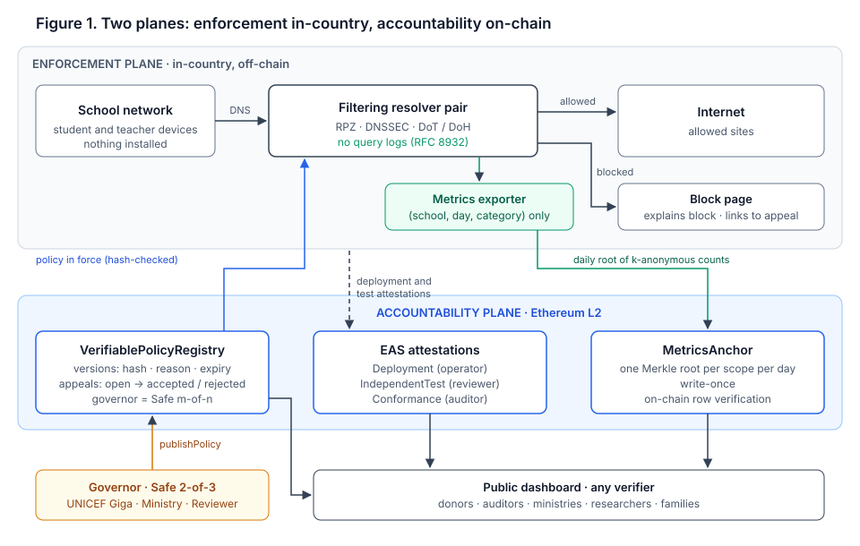

*Figure 5. The enforcement plane (top) filters traffic in-country with a conventional resolver. The accountability plane (bottom) holds only commitments: policy versions, attestations and daily roots. The governor is the only party that can change a policy.*

Table 1 summarises the function of each part and its intended effect for students, together with the condition under which that effect holds.

| Component | Function | Effect for students | Holds if |
| --- | --- | --- | --- |
| DNS filtering | Resolves each query against the zone compiled from the policy in force and blocks malware, phishing, adult content and CSAM at domain level | Protection from the first day of connectivity, including on shared devices without endpoint security | DNS from the school network is forced to the resolver (§4.5, A7) |
| Minimisation | Queries, client addresses and device identifiers are not retained; only (*school*, *day*, *category*) tuples leave the resolver process, and small cells are suppressed | Browsing is not recorded and cannot be linked to an individual from the published data | The operator honours its RFC 8932 statement (A3), checked by audit; group-level limits in §5.2 |
| Accountability plane | Implemented contracts record policy commitments, appeal hashes and daily roots; Planned EAS records would carry attestation summaries. No end-user fields are accepted by these interfaces | Policy changes become attributable and temporary, and a changed release no longer matches its anchored root | P1–P5 and P7 under §3.2; P6 once the schemas are registered with the role-enforcing resolver, and under reviewer honesty |

*Table 1. Components, their function and the conditions under which their effect for students holds.*

### 4.2 Policy documents and commitments

A policy is a structured document, published in full. It lists the content categories applied, the third-party threat feeds by provider and version, the local blocks and the exceptions. Every local block and every exception carries a reason, and the validator rejects entries without one. The document is validated, its domain names are normalised (lower case, no trailing dot), and it is serialised as JSON with keys sorted by code point, no insignificant whitespace and UTF-8 encoding. Its keccak-256 digest is the content hash *h*. For every document accepted by the reference validator, whose keys are ASCII and whose numbers are integers, this serialisation produces the same bytes as the JSON Canonicalization Scheme of RFC 8785 [36] provided every integer is smaller than 2⁵³ in magnitude. (JCS sorts keys by UTF-16 code unit and the reference by code point; the two orders agree on ASCII keys.) The normative definition is nevertheless the one in INTERFACES I1, not RFC 8785. Comments and key order do not affect *h*; values do. Because the canonicalisation is part of the public interface, any change to it is versioned (INTERFACES.md, I1 [4]).

Some lists cannot be published. The IWF list of URLs hosting CSAM is distributed only to members under strict terms, and publishing it would itself cause harm. Such lists are represented by a commitment *ρ* = keccak-256 of their sorted, newline-separated, normalised entries. The commitment appears in the document and on-chain. The operator merges the entries at compile time and never labels them in the compiled zone. As a result, the public can verify that a restricted list was declared and whether it changed between two versions, without the list being published. *ρ* is binding but not hiding. The list has low entropy, so anyone who holds a candidate list can test whether it is exactly the committed one, and the resolver's behaviour reveals whether a queried name is on it. *ρ* is also a flat hash, which supports no proof that a given entry is or is not in the list. The closest prior design is Apple's proposal to publish the root hash of its on-device database of CSAM hashes, so that researchers could check that every device held the same database [34]. It shares the purpose (one list for everyone, checkable without disclosure) and the limit (the commitment says nothing about how the list was compiled). That the declared list is the one actually compiled into the zone is checked by the auditor. For these entries, P1 is necessarily weaker: their contents are verified by the list provider and the auditor, not by the public.

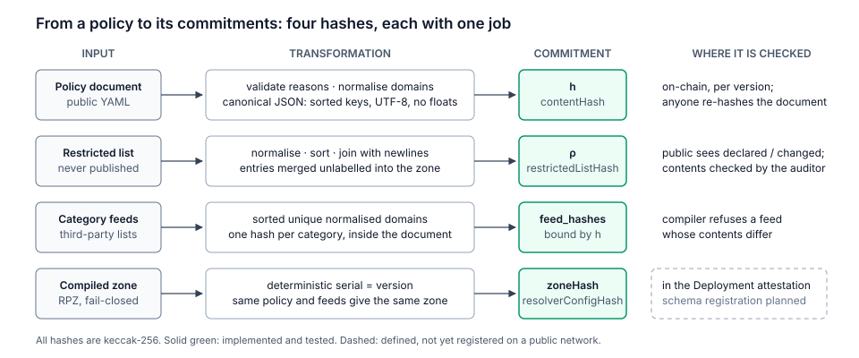

*Figure 6. Four keccak-256 commitments, each with one job. The content hash binds the public document, including the hashes of the category feeds; the restricted-list commitment proves declaration and change without disclosure; the zone hash links the compiled zone to a deployment attestation.*

### 4.3 Lifecycle and appeals

*Figure 7. Authorisation flow. Without a threshold of signatures the policy in force does not change. Each appended version is public, is designed to be loaded by the resolver only after its document is checked against the on-chain hash (sync daemon planned, VPR-015), and ends in an independent attestation per school.*

The governor appends a version by calling `publishPolicy(scopeId, h, ρ, u, c, validity, a)`. The contract rejects an empty hash, any validity outside (0, Δ_max], a locator longer than 256 bytes and a reason code outside the published list (1 to 6). Reason code 3, *appeal accepted*, is required exactly when *a* is set. If *a* is non-zero, the contract requires that *a* refers to an open appeal in the same scope and marks it accepted in the same transaction. In other words, accepting an appeal is not a separate administrative act: it consists of publishing the policy that resolves it.

Expiry is mandatory. When the latest version expires without renewal, `currentPolicy` reports it as not in force. What the resolver does in that state is a governance decision, recorded in the charter of the scope: either keep enforcing the last version, flagged as expired, or fall back to protective categories only (malware and phishing). We recommend the second option. It keeps the safety benefit of the filter without letting content restrictions persist past their authorisation.

*Figure 8. One scope over 180 days. Version 2 renews version 1 before it expires. Version 3 resolves an appeal and replaces version 2. When version 3 expires without renewal, no version is in force and the scope falls back to protective categories. Superseded versions remain public.*

An appeal is designed as a short document naming the domain, the requested change and its reason, together with a random nonce (format `vpr-appeal/3`), so that a document cannot be guessed and filed in advance by someone else. The implemented registry stores only its hash, `fileAppeal(scopeId, documentHash)`, so no caller can place free text on-chain through an appeal. The block-page relayer is Planned (VPR-017); it is intended to validate the document, reject personal data and file the hash so the appellant needs no wallet. Whether validated documents and reasoned decisions are public or access-controlled, and for how long, must be fixed in the Gate A DPIA. A rejection records a reason hash, and an acceptance records the content hash of the resolving policy version. A rejected document can be filed again in a new round, while a document with an open or accepted round cannot. The registry does not store who filed an appeal. That alone does not unlink appellants from appeals: a direct call to `fileAppeal` is a transaction whose sender is public. Unlinkability on-chain holds only for appeals filed through the planned relayer, which then knows the appellant and is bound by the DPIA's rules on what it keeps. The price of not storing the filer is that anyone can re-file a rejected document, whose hash is public, or file a document seen in transit first. In both cases the appeal exists and must be answered, so the harm is limited to added work for the governor.

### 4.4 Attestations and issuer separation

Three EAS schemas, published under CC0, record claims about deployments. Each has exactly one issuer role.

| Schema | Issuer | Claim |
| --- | --- | --- |
| `VPR.Deployment.v1` | Operator | School *x* resolves through a resolver configured with version *i*; commits to the hash of the published resolver configuration |
| `VPR.IndependentTest.v1` | Independent reviewer | From inside the school network: blocked categories are blocked, exceptions are reachable, DNSSEC validates, and known bypasses fail; valid until a stated time |
| `VPR.Conformance.v1` | Auditor | The resolver service conforms to a named framework and version, for example NIST SP 800-81r3 or an RFC 8932 privacy statement |

Under the proposed reporting rule, a school would count as protected only with a valid `VPR.IndependentTest.v1` for the version in force. The registry assigns each address at most one role per scope, and the governor never holds one: an address with a role cannot be proposed as governor, and the pending governor cannot be given a role. Each schema is registered with its own instance of `IssuerRoleResolver`, whose schema kind fixes both the required role and the layout of the encoded attestation. EAS calls the resolver at issuance, and the resolver accepts the attestation only if the attester holds that role in the registry for the scope named in the attestation. The resolver is implemented and tested; registration of the schemas on a public network is planned for M2 (VPR-012). The role is checked at issuance only. An attestation issued while its attester held the role remains valid after the role is withdrawn, so verifiers compare the attestation time with the public history of role assignments. Separation is enforced per address; one institution operating several addresses remains a governance matter. The Defined test schema contains a public summary of four booleans and a report hash. Report access, attestation validity and revocation procedures must be agreed at Gate A and implemented in M2.

*Figure 9. Each schema has exactly one issuer role. The operator can state that a school is deployed, but only the independent reviewer can state that it is protected.*

### 4.5 How a school joins

1. The ministry and Giga select the school from the Giga map.
2. The school's router or its connectivity provider points DNS to the resolver. Outbound DNS to other resolvers is blocked at the provider. Nothing is installed on devices.
3. The operator issues a deployment attestation for the school and the version in force.
4. The independent reviewer runs the test suite from the school network and issues a test attestation, identifying the school only by its public Giga identifier.
5. From then on, counts are aggregated daily. The test is repeated before the attestation expires, and the attestation is renewed or revoked depending on the result.

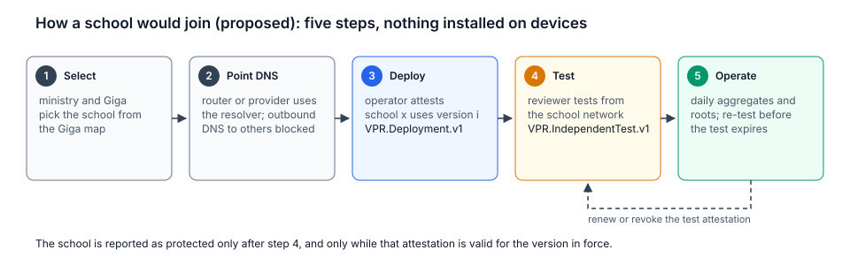

*Figure 10. Proposed onboarding of a school. Nothing is installed on devices. A school counts as protected only after the independent test, and only while that attestation is valid for the version in force.*

---

## 5. Privacy-preserving impact metrics

### 5.1 Minimisation at the source

*Figure 11. Identifying fields are discarded inside the resolver process. The exporter emits three fields per blocked query, the aggregator suppresses cells below k, and the release is committed to by a daily Merkle root that anyone can recompute.*

The design principle is that privacy should be enforced by what is collected, not by deletion after collection. The reference resolver configuration disables query logging. The Planned exporter would emit a single tuple (*school_id*, *day*, *category*) for each blocked query; client addresses, device identifiers, queried names and finer timestamps would not cross that boundary. This has not been validated against a running resolver or exporter. The implemented aggregator accepts exactly those three fields and rejects inputs with additional columns.

### 5.2 Release and suppression

The aggregator counts tuples per cell (*school*, *day*, *category*) and suppresses every cell whose count is below *k*. The example and proposed starting value use *k* = 10; the DPIA must set the deployment parameter. The released table is sorted and published as CSV or JSON. The number of suppressed cells is deliberately not published.

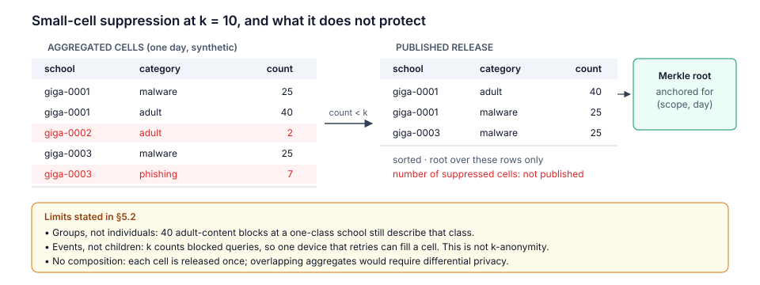

*Figure 12. Suppression at *k* = 10 on synthetic data. Cells below *k* are removed before the root is computed, and their number is not published. The box states what suppression does not protect.*

This mechanism defends against the most direct risk in a school setting. A count of 1 or 2 in a sensitive category at a small school could, combined with local knowledge, point to an individual child. Its guarantees are nonetheless limited, and we state the limits explicitly.

- *Group disclosure.* A released cell of 25 blocks in an adult-content category at a school with a single class says something about that class. k-suppression bounds disclosure about individuals, not about small groups. This is the reason the release is restricted to the category level and never includes domains.
- *Suppression is itself informative.* Publishing the number of suppressed cells reveals how many cells had between 1 and *k* − 1 events. The implementation therefore does not publish that number; a regression test checks that it does not appear in any output.
- *Events are not individuals.* The threshold applies to the number of blocked queries in a cell, not to the number of distinct children who produced them. A single device that retries, prefetches or repeatedly reloads a blocked page can fill a cell on its own. The mechanism therefore suppresses small counts; it does not give k-anonymity in the sense of [17], where each released record is indistinguishable from at least *k* − 1 others. A threshold on distinct contributors would require the resolver to count clients, for instance with per-day salted identifiers held only in memory and discarded before export. That is compatible with minimisation at the source but adds state to the enforcement plane, and we leave it as a design option to be evaluated in the impact assessment.
- *Composition.* Because each cell is released exactly once and cells do not overlap, differencing attacks across releases do not apply to the current design. They would apply as soon as overlapping aggregates were published, for example weekly totals alongside daily cells. Any such extension must be designed with a composable notion of privacy.

For deployments where overlapping or finer-grained releases are wanted, differential privacy is the appropriate tool. Adding integer noise, for example from the two-sided geometric (discrete Laplace) distribution, would give composable guarantees with a known privacy budget. It also creates a tension with verifiability: if the published figures are noisy, the commitment must bind the noise as well, which calls for publicly verifiable randomness or a proof that the noise was sampled correctly, as in verifiable differential privacy [35]. We consider this an open design question (§11).

### 5.3 Commitments

Each daily release is committed to by a Merkle root. A leaf is `keccak256(0x00 || day:uint32 || count:uint256 || len(unit):uint16 || unit || len(category):uint16 || category)`, with big-endian integers and UTF-8 strings. Internal nodes hash `0x01 || min(a,b) || max(a,b)`, so proofs need no position bits. An odd node is promoted unchanged. The operator anchors the root with `commitRoot(scopeId, day, root, datasetUri)` in the `MetricsAnchor` contract. The publisher can anchor each (scope, day) once, only after that UTC day has ended, and only within a back-fill window set by the governor (at least one day; it can be disabled explicitly for historical data). A day with nothing to publish is declared with `markEmpty`, so a missing root is never ambiguous. Only the governor can correct an anchored or empty day, with `correctRoot`. Each correction carries the hash of a published reason and the new dataset locator, increments a revision counter and keeps the previous root in the event log, so a correction is never silent. Anyone with the release can recompute the root or verify a single row. The Solidity tests and Python implementation share a test vector.

Leaves and internal nodes are domain-separated with the tags 0x00 and 0x01 of RFC 9162 [11], and promoting an odd node unchanged yields the same tree shape as RFC 9162's, whose left subtree always holds the largest power of two of leaves. The differences are the hash (keccak-256 instead of SHA-256) and the order of children. Children are ordered by value rather than by position, so an inclusion proof shows that a row is in the release but not where; there is no consistency proof between releases, which are independent and anchored once each; and no proof can show that a release is complete, which a verifier checks by downloading the release and recomputing the root. Rows are ordered by (*unit*, *day*, *category*, *count*), with strings compared by code point, which is the same as byte-wise comparison of their UTF-8 encodings; since cells are unique, the order is total. A leaf encodes the on-chain day number, the count and the length-prefixed unit identifier (the school, in this setting) and category, so the encoding is unambiguous and a row cannot be verified against another day's root. Prefixes alone would not suffice if the contract accepted arbitrary leaves, since an internal node would still verify with a shortened proof. The anchor therefore exposes `verifyRow`, which computes the leaf from the row itself. The publisher of each scope is appointed by the scope's governor in the registry, and there is no first-caller configuration. The leaf does not encode the scope. Roots are stored per scope, and a row is only ever verified against the root of the scope it is checked for, so binding the scope in the leaf would not change what a verifier learns. This is dataset format 2.

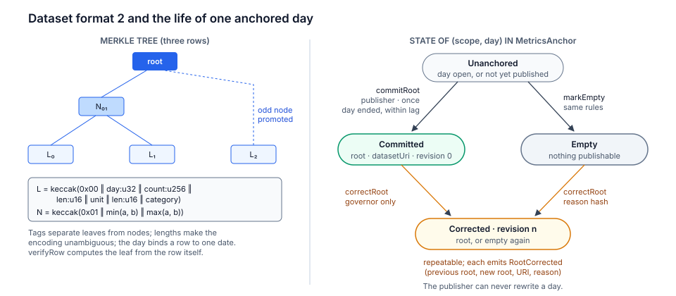

*Figure 13. Left: the format 2 encoding, with domain-separated leaves and nodes. Right: the states of one (scope, day). The publisher moves a day out of the unanchored state once; every later change is a governor correction that leaves a public trace.*

### 5.4 What the commitment does not prove

A Merkle root anchored on-chain proves that a release has not been altered since anchoring. It does not prove that the release reflects what the resolver actually blocked, nor that the resolver enforced the policy in force while producing those events. An operator that wished to inflate its impact, or to hide over-blocking, could fabricate tuples before aggregation. Without further mechanisms this is mitigated only by the reviewer's tests and by audit. §11 closes the step from log to release with a zero-knowledge proof and discusses the remaining step from resolver to log.

---

## 6. Threat model and security analysis

### 6.1 What the ledger proves, and what it does not

| Claim | Evidence | Assumption |
| --- | --- | --- |
| Version *i* is in force for scope *s* and was authorised by the governor | Registry state and events | Ledger safety; fewer than *m* signers compromised |
| The document for version *i* is the one the governor approved | keccak-256 of the canonical document equals *h*ᵢ | Collision resistance; document availability |
| School *x* applied version *i* at test time | Reviewer attestation, preceded by an operator attestation | Reviewer honesty; tests repeated before expiry |
| Impact figures for day *d* were not changed after publication, except by a public governor correction | Anchored root, revision count and correction events; public release | Collision resistance; ledger safety |
| Impact figures for day *d* are the correct aggregation of the committed event log, under the policy in force | Planned: zero-knowledge proof verified on-chain (§11; designed, not implemented) | Soundness of the proof system, once implemented; today, operator honesty and audit |
| The committed event log reflects actual blocks | Reviewer tests; audit | Reviewer and auditor honesty (§5.4) |
| The resolver keeps no query logs | RFC 8932 statement, published configuration, conformance attestation | Operator and auditor honesty |

*Figure 14. P1–P4 hold under standard cryptographic and ledger assumptions. P5 combines an on-chain record with an institutional commitment to respond. P6 rests on the independent reviewer, and P7 binds the published figures cryptographically but takes its inputs from the operator.*

### 6.2 Adversaries

We consider the following adversaries.

- **A1, a single governor signer acting alone,** for instance a ministry that wishes to block political content. Under the proposed multisignature deployment, P3 prevents one signer from publishing a version. The registry alone does not provide this property: it trusts the configured governor address.
- **A2, a colluding majority of signers.** Two of three signers could publish a version that blocks legitimate content. The design does not prevent this; it makes it *visible and temporary*. The version is public with its reason (P1), it expires (P4), the minority signer and the public can appeal (P5), and the record of the event is permanent (P2). We regard accountability without prevention as the correct guarantee here. Giving any single party a veto over a filtering policy would itself be a concentration of power. The same majority could also replace the third signer through the Safe's owner-management functions. That change is equally visible on-chain, and verifiers should treat any change to the signer set of a governor as an event that requires public justification.
- **A3, a dishonest operator.** It might enforce a policy other than the one in force, keep query logs, or fabricate metrics. Divergent enforcement is detected by the reviewer's tests (P6), and logging is constrained by the RFC 8932 statement and by audit. Today, altering figures before publication is not detected cryptographically. The planned proof of §11 would rule out alteration between a committed log and the publication. Fabricating the log itself would still not be detected cryptographically and is left to the reviewer and the audit (§5.4).
- **A4, a split-view resolver.** It behaves correctly for traffic it recognises as test traffic and differently for students. Tests are run from inside the school network, and the reviewer's test client must be indistinguishable from ordinary clients. Tests should be sampled at unannounced times and from ordinary devices. This is a known limitation of black-box measurement [14] and the main reason P6 rests on the reviewer rather than on cryptography.
- **A5, an external attacker targeting signer keys.** Mitigated by threshold signing, hardware-backed or passkey-based custody, signer rotation through Safe and a two-step governor handover (`proposeGovernor`, `acceptGovernor`), and by the fact that any malicious version is public and expiring.
- **A6, a re-identification attacker using released metrics.** Mitigated by minimisation at the source and by k-suppression, within the limits stated in §5.2.
- **A7, a user bypassing the filter** with external DoH, a VPN or an alternative resolver. Mitigated by blocking known public resolvers and DoH endpoints at the provider and by bypass testing in every review cycle. VPN and tunnelling bypasses cannot be fully prevented at the DNS layer; the attestation reports their status honestly rather than claiming otherwise.
- **A8, an appeal spammer.** Appeals submitted through the planned relayer would be rate-limited; appeals submitted directly to the contract cost the submitter gas. A document with an open or accepted appeal cannot be filed again. A rejected document can, in a new round, and since the filer is not recorded, a third party can do so as well. This is accepted so that appeals filed through the relayer are not linked to their appellants on-chain (§4.3); the response deadline is set by the scope charter, not by the contract.
- **A9, the ledger itself.** A layer-2 sequencer could delay or censor transactions. Filtering does not depend on the ledger's liveness: the resolver continues to enforce the last verified version until it expires, after which the charter's fallback applies (§4.3), and governance transactions can be forced through Ethereum L1 if the sequencer censors them. Time is only approximately under the protocol's control: on OP Stack, blocks that carry transactions are timestamped within 1800 s after their L1 origin, so L2 time can run up to about 30 minutes ahead of wall-clock time and can lag after an outage, and the sequencer can delay a transaction across a day boundary or past an expiry. Day numbers and expiry are therefore accurate to about ±30 minutes in normal operation; anchoring well inside its window and renewing days ahead absorb this (`docs/security/CONTRACT_ASSURANCE.md`, §9). The sequencer can also show a verifier unsafe blocks that it later replaces, which is why verifiers read at a finality tag (§3.2).
- **A10, a party withholding or substituting documents.** Substituting a policy document or a released dataset is detected, since its hash no longer matches the on-chain commitment. Withholding one defeats P1 for that version without being detectable from the chain alone; it is mitigated by mirroring documents and releases on independent hosts (§8).
- **A11, the rollup's governance.** The chain's upgrade process could change the attestation service or the bridge (§3.2). The VPR contracts would remain as deployed, but an upgraded EAS could, for example, stop calling the schema resolver, and so accept attestations that `IssuerRoleResolver` would refuse. `contracts/scripts/check-eas.js` reports the deployed EAS and schema-registry versions, so that an upgrade is visible to monitors; it cannot prevent one.

**Two limits of the governor design.** Separation of roles is enforced per address, and the contracts cannot see institutions. In the proposed pilot the same organisation, the independent reviewer, would be a governor signer, the issuer of test attestations and the reviewer of appeals (§3.1), so its capture would weaken P3, P5 and P6 together. The scope charter must either accept that concentration explicitly or assign the three functions to different organisations. Second, A2 is detected only after the fact: a version takes effect in the block that appends it. A notice period between publication and effect, through a timelock on the governor or a not-before time in the registry, would give the minority signer and the public time to object before a version applies. A proposed design, with a per-scope notice and an emergency path bounded in duration and frequency, is recorded in ADR-0011 for the M1 review; it is not part of the current contracts.

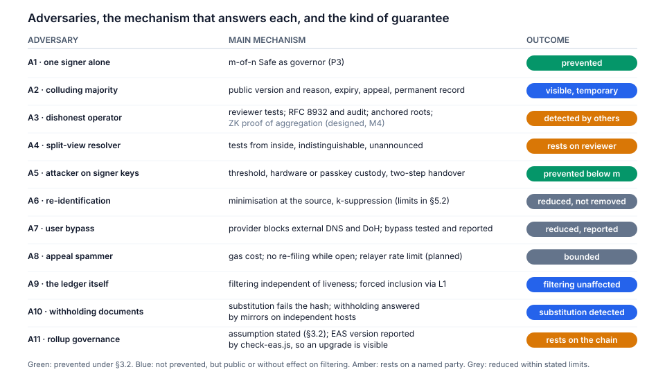

*Figure 15. Each adversary of §6.2 with its main mechanism and the kind of guarantee obtained. Only A1 and A5 are prevented outright; most threats are made visible, detected by another party or reduced within stated limits.*

### 6.3 Contract-level considerations

The contracts are deliberately small. `VerifiablePolicyRegistry` is append-only with respect to versions, enforces the validity bound, and implements the appeal state machine None → Open → {Accepted, Rejected}. In `MetricsAnchor`, the publisher writes each (scope, day) once, and only the governor can correct it, through a public, reason-bearing and revision-counted correction. `IssuerRoleResolver` accepts calls only from EAS and holds no state of its own. None of the three contracts holds funds, none is upgradeable, and all are compiled with a pinned compiler version. A defect is remedied by deploying new contracts, re-creating each scope there under the same governor Safe, and pointing the resolver's synchronisation process and the dashboard to the new addresses, while the old record remains readable. Because the scope identifier is derived from the governor and the name, the same Safe and the same name reproduce the same identifier on the new deployment. We prefer this to proxy patterns. An upgrade key on the registry would let its holder rewrite the history that P2 protects, and would add a trust assumption to those of the chain itself (§3.2), which this design cannot remove but need not extend. Static analysis (Slither, failing CI on any finding), invariant tests of the properties in §3.3 under fuzzing, checked call by call against an oracle written from the specification, bounded symbolic checks of the acceptance rules with Halmos, mutation testing over the whole test suite, and an integration test through the published EAS contracts run on every change; the evidence is collected in `docs/security/CONTRACT_ASSURANCE.md`. They do not replace the external audit planned before any production deployment.

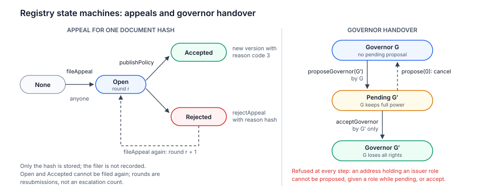

*Figure 16. The two registry state machines. Appeals are keyed by document hash and can be resubmitted only after a rejection. A governor handover takes effect only when the proposed address accepts, and no address with an issuer role can become governor.*

---

## 7. Standards and compliance

We include a framework only when it adds something that can be evidenced in the context of this project. Where the evidence can be recorded on-chain, it becomes a `VPR.Conformance.v1` attestation.

| Framework | Why it is included | Evidence |
| --- | --- | --- |
| Applicable law and institutional privacy requirements, to be identified at Gate A | No country or institutional arrangement is confirmed. The UNICEF Policy on Personal Data Protection [22] is relevant only if the confirmed arrangement makes it applicable | Jurisdiction-specific legal review and data protection impact assessment before any school pilot |
| NIST SP 800-81r3 [6] | Current reference for protective DNS, covering RPZ, encrypted DNS and DNSSEC; it references the relevant protocol specifications, which therefore need no separate entry | Resolver compliance matrix, reviewed in the external audit |
| RFC 8932 [9] | Turns what the resolver logs, for how long and with whom into a public, auditable statement | Published statement; each version's hash committed on-chain |
| UK Safer Internet Centre school-filtering criteria [23] with the IWF list [10] | The most developed public framework specific to school filtering that we are aware of | Published self-certification checklist |
| ITU Child Online Protection guidelines [2] | The framework already used by Giga's parent organisations | Content categories and age profiles |
| EAS [15] and W3C Verifiable Credentials 2.0 [16] | School certificates verifiable on and off Ethereum | Published schemas |
| ISO/IEC 27001 | Development and operation take place within Xcapit's certified information security management system; this is a property of the operator, not a new standard for the system | Current certificate |

We do not claim compliance with the UK Department for Education filtering standards, CISA Protective DNS, DNS4EU, ISO/IEC 27701 or ISO/IEC 29100. Applicability of GDPR, COPPA and national law cannot be decided from the proposed region alone; the Gate A jurisdiction-specific legal review must determine the applicable instruments and the evidence required for each.

---

## 8. Deployment considerations

The proposed network is OP Mainnet, where EAS is deployed and transaction costs are low; Base is an alternative with comparable properties. During the pilot, the accountability records start on OP Sepolia and move to mainnet once the external audit is closed. Filtering itself does not depend on the network, so schools are protected from the day they are onboarded. The expected load is small: one anchoring transaction per scope per day, one transaction per policy change, and one attestation per school per test cycle. Institutional signers use hardware wallets or passkey-based smart accounts through a web interface, so neither the ministry nor the schools handle cryptocurrency. Resolvers run as at least two instances on dedicated infrastructure in the region of the pilot, following NIST SP 800-81r3. Policy documents and released datasets are mirrored, for example on IPFS and in a public repository, so that P1 does not depend on a single host. School identifiers are those of Giga Maps, so that VPR's aggregates join directly with Giga's school and connectivity data. VPR complements Giga's connectivity measurement, which includes Giga Meter and a partnership with Cloudflare [28], and does not overlap with it. Placement for satellite links, the configuration expected from the connectivity provider, and behaviour when the resolver is unreachable are described in the architecture document [4]. Giga has previously worked with the Ethereum ecosystem on connectivity financing [24]; the present design concerns a different question, namely making the safety of that connectivity accountable.

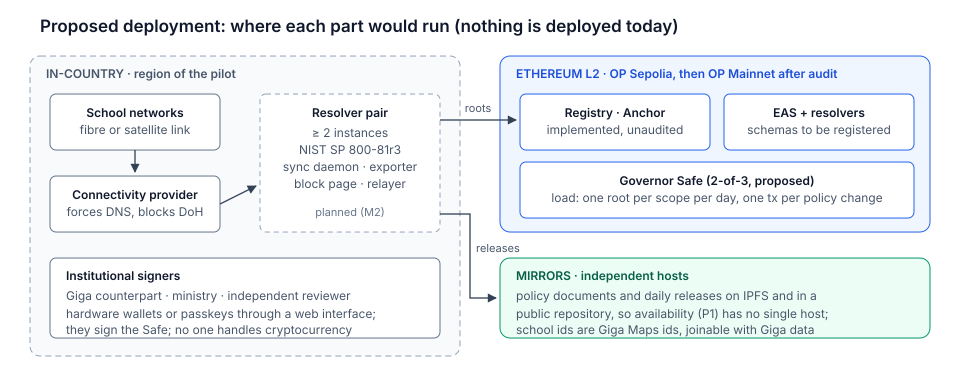

*Figure 17. Proposed placement of each part. Nothing is deployed today: the contracts are implemented but unaudited, the schemas are not registered, and the in-country runtime components are planned for M2. Dashed boxes are planned.*

---

## 9. Evaluation plan

The pilot has two phases (see the roadmap [4]). Phase 1 lasts four months: one month of design and sign-off, then three months to build a testnet reference implementation, run an alpha in two to five schools, audit and deploy the registry, and implement the zero-knowledge aggregation on testnet. Phase 2, which starts only if the phase 1 gates are met, scales to a cohort of 20 to 50 schools and takes the verifier to mainnet after its own audit. The indicators below, to be agreed with Giga, apply to each phase with the targets shown.

| Indicator | Target |
| --- | --- |
| Schools protected and holding a valid independent test attestation | Phase 1: at least 2 of 2–5 alpha schools; phase 2: 20–50 |
| Policy changes authorised by the multisignature and published with their reason | 100% |
| Personal data on-chain or in published datasets | None, confirmed by the external audit |
| Reports of wrongly blocked sites answered | Target set in the Gate A scope charter |
| Attested schools passing the periodic bypass test | All |
| Resolver availability | Target set at Gate A from selected hosting and school-link conditions |
| Published roots recomputed by a party outside the project | At least one |
| Digital Public Good registration | Application submitted with signed evidence for DPG Standard indicators 7–9 (phase 1); approval is an outcome, not a deliverable |

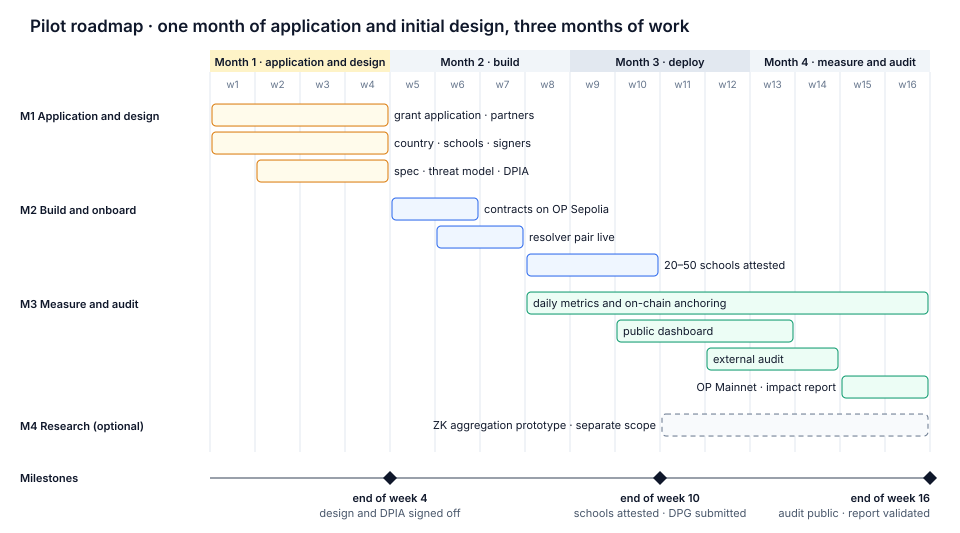

*Figure 18. Phase 1: one month of design and sign-off followed by three months of work, with gates A, B and C at weeks 4, 10 and 16. Phase 2 is gated and funded separately.*

---

## 10. Limitations

DNS filtering operates on domain names. IWF entries that are individual URLs on otherwise legitimate domains require an additional layer, such as a filtering proxy or a provider-side filter; we state this so as not to promise more than DNS can deliver. Devices that ignore network DNS settings, or that use a VPN, can bypass the filter, so the system complements education, device management and supervision rather than replacing them. Property P6 is only as strong as the independence and diligence of the reviewer, and the quality of governance depends on who the signers are. Mandatory expiry requires an operational process to renew policies on time; without one, the scope falls back to protective categories. Finally, the metrics pipeline protects individuals, not small groups (§5.2), and its integrity guarantee begins at aggregation, not at the resolver (§5.4).

---

## 11. Closing the enforcement–accountability gap

The weakest link in the design is the step between the resolver's behaviour and what is committed on-chain. Figure 19 decomposes it into three links. Without further mechanisms, only the last of them is cryptographic. Milestone M4 proposes to narrow the middle link with a zero-knowledge aggregation proof on testnet; the circuit audit and mainnet verifier are deferred to a separately agreed phase 2. No proof implementation exists in the proof of concept. Trusted execution and verifiable differential privacy remain further work.

*Figure 19. From resolver behaviour to on-chain root. The link from release to root is cryptographic. The link from log to release rests on the operator today and is to be closed by a zero-knowledge proof of aggregation, designed in §11.1 and planned for milestone M4. The link from behaviour to log rests on the reviewer and the auditor, and could be strengthened with remote attestation of a trusted execution environment (§11.3).*

### 11.1 Statement

The normative relation, with every encoding, is specified in `docs/security/ZK_AND_CRYPTOGRAPHIC_EVIDENCE.md` (§5–§6) and ADR-0010. In outline, for a scope *s* and a day *d*, the event log *L* = ⟨*e*₁, …, *e*ₘ⟩ is committed by *C*_L. The commitment is a salted hash of a Merkle root over salted, domain-separated event leaves, so it is binding and hiding. The number of events *m* stays private, because publishing it would reveal the total of the suppressed cells. Hiding is required: counts are small and the published cells are public, so an unsalted commitment would let anyone recover the suppressed cells by enumeration. The operator proves knowledge of the events and salts such that:

- (a) they open *C*_L;
- (b) every event belongs to scope *s*, day *d*, an admitted unit and a category of the policy version in force;
- (c) the published root equals the Merkle root of Agg_k(*L*).

The public inputs are a deployment domain (chain id, verifier and anchor addresses), *s*, *d*, the policy version and its content hash, the commitments `catRoot` and `unitRoot`, *k*, *C*_L, the root and the format version. The verifier contract reads `catRoot` and `unitRoot` from the registry; the prover never supplies them. That makes the category-to-policy binding part of the verified statement rather than an optional off-chain check. Tools and the dashboard confirm that `catRoot` matches the published document. The proof is zero-knowledge in *L*, so suppressed cells stay hidden.

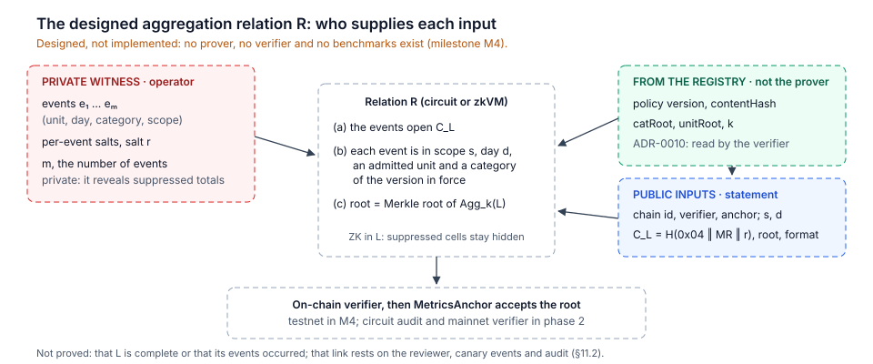

*Figure 20. The designed relation R. The operator supplies only the private witness; the policy-dependent inputs are read by the verifier from the registry. Nothing in this figure is implemented yet.*

### 11.2 What the proof guarantees, and implementation

Given a valid proof, the published figures are exactly the suppressed aggregation of a log the operator committed to, and no event in that log falls outside the policy in force. The operator can no longer adjust the figures after the fact, or report blocks in categories the governor never approved. The proof does not establish that *L* is complete or that its events occurred. That property belongs to the first link of Figure 19 and still rests on the reviewer's measurements and on audit. A partial tie is available at low cost: the independent reviewer issues test queries from known schools on undisclosed days, records them as canary events, and after each release asks the operator for a proof that every canary is included in *L*. If the operator cannot tell canaries from real traffic, omission is detected with a probability that grows with the number of canaries. That condition is not automatic: the operator sees source addresses and queried names, so canaries must come from ordinary devices in the school network, query ordinary names and follow ordinary timing (VPR-038).

Two implementation routes are to be evaluated in milestone M1: a general-purpose zero-knowledge virtual machine running a reference implementation of R, or a dedicated circuit for counting, threshold comparison and membership. zkVM proofs are usually wrapped into a succinct proof such as Groth16 [25] or PLONK [26] for verification on the EVM. A dedicated circuit is cheaper to prove but must implement keccak-256, which is expensive in arithmetic circuits. One option is to commit to *L* with a SNARK-friendly hash such as Poseidon [27] and keep keccak-256 only for the public Merkle root. In the planned design, the anchoring contract accepts a daily root only together with a proof that verifies on-chain; the circuit and the verifier are audited in phase 2, before any mainnet use. If proving a full day exceeds the daily budget on commodity hardware, the fallback is one proof per school, aggregated off-chain.

### 11.3 Further work

**Trusted execution.** If the resolver and exporter ran inside a trusted execution environment, such as Intel TDX, AMD SEV-SNP or AWS Nitro Enclaves, a remote attestation could bind *C*_L and the absence of logging to a measured, open-source binary loaded with the zone compiled from *h*ᵢ. This would strengthen the first link of Figure 19, moving part of P6 and P7 from institutional trust to hardware trust. Hardware trust has its own history of side-channel failures, and it concentrates trust in the hardware vendor.

**Verifiable differential privacy.** Where releases must overlap, the noise added for differential privacy should be verifiably sampled, as in VerDP [35], either from public randomness committed in advance or within the same proof as R. The goal is that neither the operator nor the analyst can bias the noise.

---

## 12. Conclusion

A filter that protects children and a filter that censors them can run the same software. What distinguishes them is accountability: who decided, for how long, on what grounds, under whose review, and at what cost to privacy. The Verifiable Policy Registry makes those questions answerable by anyone. It does so by placing minimal, carefully chosen commitments on a public ledger, by separating those who operate from those who certify, and by stating plainly which guarantees are cryptographic and which rest on institutions. It is released as open source with the intention of registration as a digital public good, and we invite review of both the design and its assumptions.

---

## Appendix A. Data inventory

Design rule: the ledger holds data about institutions (schools, agencies), never about people.

| Data | Location | Visibility | Purpose |
| --- | --- | --- | --- |
| Policy content hash, reason code, expiry; the authorising governor address (signatures stay in the governor contract, e.g. the Safe) | On-chain | Public | Audit what is blocked, by whom and why; detect over-blocking |
| Full policy document (categories, feeds, local blocks, exceptions with reasons) | Off-chain, mirrored | Public | Audit the content of each version |
| Restricted list (e.g. IWF) | Operator only | Commitment public; contents never published | Block CSAM without disclosing the list |
| Deployment, test and conformance attestations (Planned; schemas Defined) | Proposed on-chain EAS records | Public summary and report hash; report access set by the Gate A charter | Record deployment and review claims without implying that the ledger verifies them |
| Daily aggregate release (school, day, category, count ≥ *k*) | Off-chain, mirrored | Public | Measure impact |
| Daily Merkle root of the release | On-chain | Public | Prevent later alteration of impact figures |
| Appeals (domain, request, reason) | Public on-chain hash and status; off-chain document | Off-chain access and retention set by the Gate A DPIA | Contest blocks without placing free text on-chain |
| Individual queries and client IP addresses (Designed handling) | Transient resolver processing; retention prohibited except any buffer explicitly approved in the DPIA | Resolver operator during processing | Resolver operation only; no deployed evidence yet |

## Appendix B. Specification pointers

The formats exchanged between components (canonical policy encoding, ABIs, RPZ conventions, event and dataset formats, attestation schemas and the appeal document) are specified in `docs/INTERFACES.md`. Design decisions and their alternatives are recorded in `docs/adr/`. The DPG Standard mapping is in `docs/DPG.md`, and the harm analysis in `docs/DO_NO_HARM.md` [4].

---

## References

[1] UNICEF. Contribution to the WSIS+20 review (Giga figures). UNCTAD. https://unctad.org/system/files/non-official-document/wsis20_c25_unicef_en.pdf

[2] ITU. *Guidelines on Child Online Protection* and COP policy brief, 2020. https://www.itu.int/en/ITU-D/Cybersecurity/Documents/COP/20-00802_COP-Policy_Brief.pdf

[3] B. Laurie, A. Langley, E. Kasper. *Certificate Transparency*. RFC 6962, 2013.

[4] Verifiable Policy Registry source code and documentation. https://github.com/xcapit/verifiable-policy-registry

[5] P. Vixie, V. Schryver. *DNS Response Policy Zones (RPZ)*. Internet-Draft draft-vixie-dnsop-dns-rpz.

[6] NIST. *Secure Domain Name System (DNS) Deployment Guide*. SP 800-81 Rev. 3, 2026. https://csrc.nist.gov/pubs/sp/800/81/r3/final

[7] Z. Hu et al. *Specification for DNS over Transport Layer Security (TLS)*. RFC 7858, 2016.

[8] P. Hoffman, P. McManus. *DNS Queries over HTTPS (DoH)*. RFC 8484, 2018.

[9] S. Dickinson et al. *Recommendations for DNS Privacy Service Operators*. RFC 8932 (BCP 232), 2020.

[10] Internet Watch Foundation. *URL List*. https://www.iwf.org.uk/our-technology/our-services/url-list

[11] B. Laurie, E. Messeri, R. Stradling. *Certificate Transparency Version 2.0*. RFC 9162, 2021.

[12] M. S. Melara, A. Blankstein, J. Bonneau, E. W. Felten, M. J. Freedman. *CONIKS: Bringing Key Transparency to End Users*. USENIX Security, 2015.

[13] Z. Newman, J. S. Meyers, S. Torres-Arias. *Sigstore: Software Signing for Everybody*. ACM CCS, 2022.

[14] A. Filastò, J. Appelbaum. *OONI: Open Observatory of Network Interference*. USENIX FOCI, 2012.

[15] Ethereum Attestation Service. https://attest.org

[16] W3C. *Verifiable Credentials Data Model v2.0*. W3C Recommendation, 2025.

[17] L. Sweeney. *k-Anonymity: A Model for Protecting Privacy*. International Journal of Uncertainty, Fuzziness and Knowledge-Based Systems, 10(5), 2002.

[18] A. Machanavajjhala, D. Kifer, J. Gehrke, M. Venkitasubramaniam. *ℓ-Diversity: Privacy Beyond k-Anonymity*. ACM TKDD, 1(1), 2007.

[19] C. Dwork, F. McSherry, K. Nissim, A. Smith. *Calibrating Noise to Sensitivity in Private Data Analysis*. TCC, 2006.

[20] H. Corrigan-Gibbs, D. Boneh. *Prio: Private, Robust, and Scalable Computation of Aggregate Statistics*. USENIX NSDI, 2017.

[21] Safe smart account. https://github.com/safe-global/safe-smart-account

[22] UNICEF. *Policy on Personal Data Protection*, 2020. https://www.unicef.org/documents/policy-personal-data-protection

[23] UK Safer Internet Centre. *Appropriate filtering for education settings* and filtering accreditation scheme. https://saferinternet.org.uk/guide-and-resource/teachers-and-school-staff/appropriate-filtering-and-monitoring/appropriate-filtering/filtering-accreditation-scheme-for-uk-schools

[24] Giga and Government of Rwanda. *Proof of concept for Giga's crypto connectivity pilot*. https://giga.global/unicef-and-government-of-rwanda-collaborate-to-demonstrate-proof-of-concept-for-gigas-crypto-connectivity-pilot/

[25] J. Groth. *On the Size of Pairing-Based Non-interactive Arguments*. EUROCRYPT, 2016.

[26] A. Gabizon, Z. J. Williamson, O. Ciobotaru. *PLONK: Permutations over Lagrange-bases for Oecumenical Noninteractive arguments of Knowledge*. IACR ePrint 2019/953.

[27] L. Grassi, D. Khovratovich, C. Rechberger, A. Roy, M. Schofnegger. *Poseidon: A New Hash Function for Zero-Knowledge Proof Systems*. USENIX Security, 2021.

[28] Cloudflare. *Cloudflare Partners with Giga to Accelerate School Connectivity Worldwide*. Press release, September 2025. https://www.cloudflare.com/press/press-releases/2025/cloudflare-partners-with-giga-to-accelerate-school-connectivity-worldwide/

[29] S. A. Crosby, D. S. Wallach. *Efficient Data Structures for Tamper-Evident Logging*. USENIX Security, 2009.

[30] L. Chuat, P. Szalachowski, A. Perrig, B. Laurie, E. Messeri. *Efficient Gossip Protocols for Verifying the Consistency of Certificate Logs*. IEEE Conference on Communications and Network Security (CNS), 2015. doi:10.1109/CNS.2015.7346853; arXiv:1511.01514.

[31] E. Syta, I. Tamas, D. Visher, D. I. Wolinsky, P. Jovanovic, L. Gasser, N. Gailly, I. Khoffi, B. Ford. *Keeping Authorities "Honest or Bust" with Decentralized Witness Cosigning*. IEEE Symposium on Security and Privacy, 2016.

[32] R. Cox. *Transparent Logs for Skeptical Clients*. 2019. https://research.swtch.com/tlog

[33] Sigsum project. *Sigsum logging design*. https://git.glasklar.is/sigsum/project/documentation

[34] Apple. *Security Threat Model Review of Apple's Child Safety Features*. August 2021. https://www.apple.com/child-safety/pdf/Security_Threat_Model_Review_of_Apple_Child_Safety_Features.pdf

[35] A. Narayan, A. Feldman, A. Papadimitriou, A. Haeberlen. *Verifiable Differential Privacy*. EuroSys, 2015.

[36] A. Rundgren, B. Jordan, S. Erdtman. *JSON Canonicalization Scheme (JCS)*. RFC 8785, 2020.

[37] Optimism. *OP Stack specification: glossary* (unsafe, safe and finalized L2 blocks) and *L2 chain derivation* (sequencing window). https://specs.optimism.io/glossary.html, https://specs.optimism.io/protocol/derivation.html

[38] Optimism. *OP Stack specification: Stage 1 roles and requirements*. https://specs.optimism.io/protocol/stage-1.html

[39] *RIP-7212: Precompile for secp256r1 Curve Support*. Rollup Improvement Proposal, https://github.com/ethereum/RIPs/blob/master/RIPS/rip-7212.md; added to the OP Stack in the Fjord upgrade (OP Stack specification: precompiles, https://specs.optimism.io/protocol/precompiles.html). EIP-7951 later specifies the same precompile for Ethereum L1, with an additional input check.

[40] Optimism. *OP Stack specification: predeploys*. https://specs.optimism.io/protocol/predeploys.html
